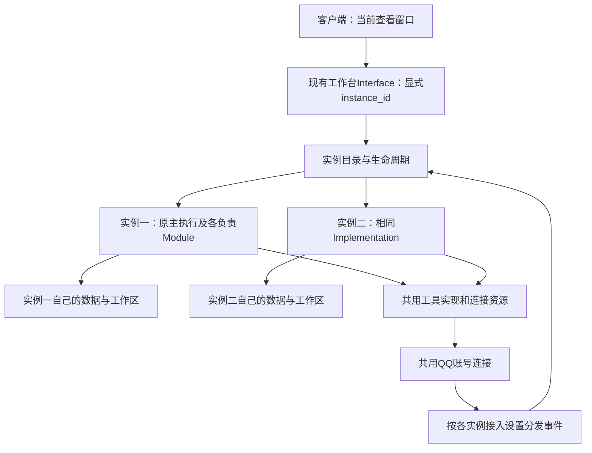

# Fish 实施对照表：代码位置、当前规则与退出清单

**当前结构设计：** [第13节](#instance-design-20261026)对应唯一规格第八节合并范围，已核对当前源码，供下一步to-tickets整合工单。第1—12节分别保留历史定位及原修复映射；当前设计不表示已经实施。程序、配置和生产数据未改变。

> 状态说明：第1—6节保留实施前定位快照，旧行号会随实施改变；当前工作树的新接口与退出状态见第7节。源码已改不代表已构建、载入或验收，运行结果以实施记录和最终07证据为准。

> 2026-10-24 本轮只读审查补充：第1—8节为各次定位快照，今日最新代码差异及未闭环问题见第9节。原30%预算、尚无目录/FTS等旧描述不再表示当前事实；需求仍仅由唯一规格负责。本轮只更新文档，未改运行代码。

日期：2026-10-24｜原 DeepSeek 合并任务表已按主人本轮裁决降级。

**本表仅记录代码事实与计划退出位置；需求和验收唯一依据为[实施规格](https://github.com/3259980040-droid/fish-agent/blob/codex/fish-tickets-20261025/project/spec.md)。** 行号是本次只读工作树的定位线索，实施时复核；“计划退出”不表示本轮已删除。正文不再另列目标、性能承诺或验收规则。

## 1. 实施前实际长度与节奏来源

| 当前来源 | 模块/存储与位置 | 当前值或实际含义 | 计划处理 |
|---|---|---|---|
| 表达规则 | `E:\Program Files\DSH\source\fish\harness\group_reply_style.py:3`、`:4`、`:7`、`:18` | MIN_CHARS=20、MAX_CHARS=500；通常范围是提示偏好，简单接梗可更短，讨论提示200—400，任务可超过；提示声明优先于人格一般长度偏好 | 只作为现状清点，不把数值写成新规格；保留唯一表达来源，变更时替代原值 |
| 普通主请求注入 | `E:\Program Files\DSH\source\fish\harness\fish_chat.py:337`、`:368` | 调用 expression_policy 并送入请求，证明上述模块参与当前请求组装 | 不再新增另一处长度提示覆盖 |
| 活动人格旧条目 | `E:\Program Files\DSH\source\fish\data\social\context.db`，default_personas(role=qq)及owner_routes.space→spaces.revision均指向同一personas；本轮revision为3dc6cef84d3946c79b030916faf77153 | 小鲸鱼·QQAgent卡仍有“群里闲聊默认1~10字”“默认1~10字”等偏好与一句一行等节奏条目；global_rules/workspace_rules无相应额外条目 | 在人格工单中列精确段落与版本差异，退出重复长度/失效工具指令；不直接删除人格特性 |
| 发送工具schema | `E:\Program Files\DSH\source\fish\harness\tool_host.py:230`、`:231` | fish_say每次1—3项文字，每项1—1000字符；是工具协议约束，不等于人格回复目标字数 | 如需调整在同一工具入口替代，不把它写成第二套表达规则 |
| 气泡与节奏 | `E:\Program Files\DSH\source\fish\harness\chat_output.py:12`、`:13`、`:16`、`:192` | 1—3文字气泡，最多1表情；后续气泡delay=min(4,1.2+0.035×上一气泡字符数)秒 | 保留其语义分段职责，不与表达重复定义总字数；本次不修改数值 |
| 通道分段 | `E:\Program Files\DSH\source\fish\harness\qq_agent_loop.py:1176` 一带 | 大于1800字符时按900—1800内的换行/句号或1800切段 | 仅为通道分段，不能误报成模型回答只能1800字 |
| 模型输出预算 | `E:\Program Files\DSH\source\fish\harness\model_gateway.py:16`、`:33` | max_tokens默认8192；本轮control无desktop_chat_max_tokens显式值，思考high。输出token非中文字数 | 参数归模型接入；本轮不改输出预算 |
| 旧代发工具单独限制 | `E:\Program Files\DSH\source\fish\harness\tool_host.py:306`、`:1312` | fish_group_send文本1—2000字符，仅是该旧工具检查 | 在工具/权限归并中判断替代；此次不得真实群发送 |

以上核实的是进入请求的来源和协议，并非本轮实测模型每次严格服从。运行代码和活动人格均未修改。

## 2. Agent、身份、上下文与前端位置

| 位置 | 当前职责 | 计划退出/合并 | 工单 |
|---|---|---|---|
| `E:\Program Files\DSH\source\fish\harness\fish_chat.py:176`、`:330` | 工具目录与主模型/工具循环 | 保留主入口，补能力；不建第二套执行器/登记 | 01、02 |
| `E:\Program Files\DSH\source\fish\harness\tool_host.py:375`、`:392`、`:446`、`:544` | 身份、space分支与执行 | 稳定主人/Agent/场所归属替代窗口凭据；保留统一执行 | 01、02 |
| `E:\Program Files\DSH\source\fish\harness\desktop_chat.py:55`、`:150`、`:168`、`:286` | 会话、人格和当前材料 | 退出会话决定授权/人格的旁路，入口适配接共同组装 | 01、03 |
| `E:\Program Files\DSH\source\fish\harness\desktop_context.py:27` | 局部历史、字符预算和压缩 | 统一到token预算与分层组装；不再各入口截条数 | 01 |
| `E:\Program Files\DSH\source\fish\harness\owner_private.py:45`、`:83` | 窗口有效性与私聊生成 | 退出窗口是否存在的授权前置，接共同经历 | 01 |
| `E:\Program Files\DSH\source\fish\harness\owner_private.py:131`、`:182`、`:203` | 回复、故障通知、处理 | 复用真实私聊发送/通知；提醒故障与自主不动分开 | 06、07 |
| `E:\Program Files\DSH\source\fish\harness\group_round.py:313`、`:659` | 群材料与回合 | 旧本群固定条数拼装退出，接统一材料；保留自主语义 | 01、06 |
| `E:\Program Files\DSH\source\fish\harness\workbench.py:745`—`:765`、`:811`—`:820` | 人格与任务管理 | 补活动配置/计划/状态的前后端同源；前端弃用动作逐项清理 | 03、06、07 |
| `E:\Program Files\DSH\source\dsh\packages\client\ui-fish\src\client\pages\FishTasksPage.tsx:266`、`:304` | 已有定时新建/删除 | 接聊天创建的同一任务；不再称全页只读 | 06 |
| `E:\Program Files\DSH\source\dsh\packages\client\ui-fish\src\client\pages\DelegationTasks.tsx:77`、`:86` | 委托取消/下载 | 使用真实任务与成果，不另造一份状态 | 02、07 |

## 3. 七类退出与保留职责清单

| 类别 | 源码定位 | 计划退出对象 | 保留/迁入职责 | 工单 |
|---|---|---|---|---|
| 主动重复 | `E:\Program Files\DSH\source\fish\harness\qq_agent_loop.py:352`、`:353`、`:369`；`E:\Program Files\DSH\source\fish\harness\group_proactive.py:117`、`:213`、`:277`、`:347` | 停用旧tick/独立生成发送与分散主动主线；不是整份文件先删 | 群回合仍用claim/evaluate/draft，先迁职责；提醒另行履约 | 06 |
| 冷却重复 | `E:\Program Files\DSH\source\fish\harness\group_policy.py:406`、`:440`；`E:\Program Files\DSH\source\fish\harness\group_decide.py:1384`、`:1417` | 重复否决及其叠加补丁 | 按最终职责只留一处决定；提醒不走自主冷却 | 06 |
| 资源关联重复 | `E:\Program Files\DSH\source\fish\harness\fish_library.py:36`、`:185`；`E:\Program Files\DSH\source\fish\harness\doc_store.py:203`、`:232`；`E:\Program Files\DSH\source\fish\harness\emoji_store.py:111` | 独立重复登记/索引与互不相认的存储入口 | 原件文件、文本块和图片资源有不同职责，迁到统一关联入口 | 04、05 |
| 视觉重复判断 | `E:\Program Files\DSH\source\fish\harness\multimodal.py:185`、`:201`、`:556`—`:557`；`E:\Program Files\DSH\source\fish\harness\vision_identification.py:61`、`:65` | 先核职责，再退出重复判断；当前已有直接调用证据 | 媒体准备/原图输入→VisionIdentification.resolve候选核对→结果回主模型；内部子模块可保留 | 05 |
| 三入口材料 | 上表owner_private、desktop_context/desktop_chat、group_round | 重复截取、拼接及入口性预算 | 来源适配、同一预算与共同经历 | 01 |
| 旧引擎/界面 | `E:\Program Files\DSH\source\fish\harness\qq_agent_loop.py:474`；`E:\Program Files\DSH\source\fish\harness\group_dialogue.py`；`E:\Program Files\DSH\source\fish\harness\app_v0.py` | 旧引擎分支、启动/发布引用，补齐替代后退出 | 仍使用能力先迁，不因文件名旧就提前删 | 02、07 |
| space授权 | 上表tool_host/desktop_chat；`E:\Program Files\DSH\source\fish\harness\memory_store.py:233`、`:266`、`:443` | space授权派生与运行时跨库归属查询 | 稳定主人/Agent/场所范围，历史引用仍可解析 | 01、04 |

## 4. 资料语义、调度与传输补建位置

| 位置 | 当前事实 | 计划删除/替代或补建 | 工单 |
|---|---|---|---|
| `E:\Program Files\DSH\source\fish\harness\doc_store.py:37`—`:39`、`:217`、`:239`—`:243` | 最新4000候选、前24词及前8粗筛，纯词法 | 删除时间先限候选及句末遗漏路径；补语义关联/明确降级 | 04 |
| `E:\Program Files\DSH\source\fish\harness\memory_engine.py:425`、`:524`、`:576` | 向量状态、查询与融合实现已在 | 补运行依赖/索引和UI真实状态；不可用明确词法，非空白 | 04 |
| `E:\Program Files\DSH\source\fish\harness\bot_control.py:205`、`:288`、`:355`、`:489` | 创建、更新、扫描和执行 | 提醒与自主意图区分，共用调度不共用“不动”裁决 | 06 |
| `E:\Program Files\DSH\source\fish\harness\memory_reminder.py:322`、`:414`；`E:\Program Files\DSH\source\fish\harness\private_proactive.py:206`、`:278` | 到期提醒与私聊主动各自入口 | 分别映射提醒履约/自主意图，退出重复入口，不把提醒吞进自主沉默 | 06 |
| `E:\Program Files\DSH\source\fish\harness\dsh_web.py:49`；`E:\Program Files\DSH\source\fish\harness\attachment_store.py:27`；`E:\Program Files\DSH\source\fish\harness\tool_host.py:1745` | 不同传输和附件大小来源 | 不用的订阅入口退出；原件按资源处理，不统一乱放大 | 08（依赖 02、04，交 07 集中验收） |

本表本轮只做只读定位与文档改写，尚无运行源码删除或迁移。

<a id="module-interface-map"></a>

## 5. 模块接口映射（codebase-design：真实接缝与迁入位置）

本节为本轮只读源码定位。固定引用为“模块接口映射”（锚点 module-interface-map），章节编号不作为工单定位依据。目标接口和依赖以权威规格 4.10 为准；下列“拟处理”没有在本轮实施，也不证明线上当前已走到相应分支。

| 源码事实与位置 | 说明 | 拟处理／工单 |
|---|---|---|
| `E:\Program Files\DSH\source\fish\harness\fish_chat.py:330`；`E:\Program Files\DSH\source\fish\harness\owner_private.py:83`；`E:\Program Files\DSH\source\fish\harness\desktop_chat.py:286` | 主循环已有；调用者仍分别准备 persona、history、memory、scope、references、current、工具面和输出形式等十余项材料 | 深化现有主循环与共同组装接口，入口只交唤醒引用／取消信号；不在外面再加一层照传旧参数的壳。01、02 |
| `E:\Program Files\DSH\source\fish\harness\fish_chat.py:18`、`:176`；`E:\Program Files\DSH\source\fish\harness\tool_host.py:208`、`:386`、`:544` | 主聊天 CATALOGUE 另列工具名，tool_definitions 从 builtins 建表后再按名单取；公布目录与执行器内部窗口／模式分支仍是两层知识 | 以统一登记生成可发现目录，退出手抄工具名称筛选及窗口凭据派生；保留真实来源、目标与结果，不新增权限门。01、02 |
| `E:\Program Files\DSH\source\fish\harness\desktop_context.py:27`；`E:\Program Files\DSH\source\fish\harness\group_round.py:313` | 前者自行字符计量、同步续聊摘要；后者自行按群字符预算倒序选消息 | 材料归同一预算和覆盖范围；保留各入口接收／媒体适配，退出各入口自定预算和截取。01 |
| `E:\Program Files\DSH\source\fish\harness\persona_library.py:175`；`E:\Program Files\DSH\source\fish\harness\workbench.py:745`、`:761` | 人格 apply 仍通过创建／切换 space，页面应用后又可 reload 当前桌面对话 | 保留预设库及既有页面动作名称可用部分，活动人格解析归运行设置；退出窗口决定活动配置和能力的旁路。03 |
| `E:\Program Files\DSH\source\fish\harness\bot_control.py:104`、`:115`、`:147`、`:205`、`:226`、`:270`、`:355`、`:477`、`:489`、`:531` | 已可注入 transport、on_fire、session_factory、run_turn；默认会创建 DSH 会话，计划 CRUD／扫描读取 DSH 原生计划，执行器也连接 DSH | 复用本地计划／实例和可用时间计算，将登记、到点和执行改接 Fish；退出 DSH 会话工厂与远端计时读写，不能仅换 run_turn。06 |
| `E:\Program Files\DSH\source\fish\harness\bot_control.py:541`、`:546` | _send_count 当前把 SUCCEEDED 与 EXECUTING 都计作发送数，_latest_receipt 只取 SUCCEEDED；两个口径不同 | 用真实投递结果完成任务，执行中不能升级为送达；复用既有状态含义，不建第二套枚举。06、07 |
| `E:\Program Files\DSH\source\fish\harness\private_proactive.py:139`、`:153`；`E:\Program Files\DSH\source\fish\harness\memory_reminder.py:172`、`:204` | 提醒与主动 compose 都用空历史、空记忆及无工具形式调用主函数；异常会退模板 | 接带意图的同一唤醒、共同材料和工具；退出空经历旁路与掩盖模型失败的自主话术模板；提醒按规格单独履约、故障单报。06 |
| `E:\Program Files\DSH\source\fish\harness\group_round.py:469`、`:489` | 生成后仍调用 worth_speaking，再作发送判断；冷场还用 proactive.draft | 随主线归并迁移仍使用职责，退出旧决定链；维度引导的组织比较留在后续 G7，不在这里新增独立判断器。06 |
| `E:\Program Files\DSH\source\fish\harness\model_gateway.py:184`、`:215`—`:217`、`:235`—`:247`；`E:\Program Files\DSH\source\fish\harness\workbench.py:431`—`:510` | 流已读 reasoning_content，仅 tools 存在时收集；工具调用结果会返回该字段，普通 stop 结果只返回正文。工作台现有痕迹还从请求／工具记录按时间归集 | 在模型接入处保留并传出真实可用字段，以同回合关联显示；退出根据零散时间推定的假对应及额外解释生成，不要求再调用模型写理由。07 |
| `E:\Program Files\DSH\source\fish\harness\qq_agent_loop.py:1152`；`E:\Program Files\DSH\source\fish\harness\owner_private.py:131`；`E:\Program Files\DSH\source\fish\harness\chat_output.py:29`、`:66` | 已有实际投递、语义气泡和正常不发送语义；客户端目前 _chat_turn 默认纯文本呈现，QQ 依发送工具队列 | 在现有投递与本地呈现处接同一行动／结果接口，继续区分待发与确认；不另建发送队列或让入口再次判断她该不该说。02、07 |

可沿用的外部接缝证据：`tools/test_owner_private.py` 已替换 ModelGateway 与出站 action；`tools/test_turn_sending.py` 已有 FakeChannel；BotControl 的注入参数可用于临时根出站。这里只读这些入口，没有运行测试或增加测试文件。它们服务于规格的集中整体观察，不成为逐票实发／付费测验要求。

传输与大附件归 08：调用资源登记／原件接口，具体当前值与旧路径见下节；07 等 08 完成后集中验收。

资源位置继续沿用第 3—4 节：原件／资料块／图片是资源模块内部不同实现，媒体准备仍实际调用专业视觉核对；按职责合并引用，不能整个文件先删。


## 6. 传输层与大附件：当前事实和工单归属

本节为本轮源码只读结果。下列均为当前代码值，不是新的产品上限；实际更改后在本表原位填写新值和作用域。目标与验收只由权威规格 4.8、5.2 决定，交付归 08，M01 不负责这一能力。

| 层／位置 | 当前事实 | 迁移／替换对象 |
|---|---|---|
| `E:\Program Files\DSH\source\dsh\packages\client\ui-fish\src\client\pages\FishChatPage.tsx:480`、`:487`；同目录上层 `locales.ts:169`、`:583` | 选择文件检查 20 MiB，整份编码后调用 attachments.import；中英文文案也写 20 MiB | 前端接分块／流式导入及真实配置，退出重复硬编码与整份大 base64 请求 |
| `E:\Program Files\DSH\source\fish\harness\workbench.py:835`—`:845` | attachments.import 检查 base64 字符串长度 28×1024×1024，再整体解码送 import_bytes | 附件内容不再借普通动作 JSON 整份内联；保留同一原件／资源关联，不能只放大字符串检查 |
| `E:\Program Files\DSH\source\fish\harness\tool_host.py:1745` 一带 | Content-Length：/workbench 32 MiB，其他路由 2 MiB；先整份读取 JSON | 控制消息大小与原件传输分层，附件路径适配流式／分块；普通控制路由不统一升到 1 GiB |
| `E:\Program Files\DSH\source\fish\harness\desktop_chat.py:221` | 本地文件另检查 20 MiB，再走 AttachmentStore.import_path | 退出与新导入规则不一致的重复大小判断 |
| `E:\Program Files\DSH\source\fish\harness\attachment_store.py:27`、`:28`、`:221`、`:258`、`:298` | MAX_BYTES=20 MiB；EXCERPT_BYTES=256 KiB；文本仅解析开头；本地路径 read_bytes 后整体导入 | 原件分块落盘、统一登记／资源引用，按需读后续片段；明确解析范围，不因只索引开头就宣称读完 |
| `E:\Program Files\DSH\source\fish\harness\dsh_web.py:49` | FISH_DSH_FOLLOW_MAX_MIB 默认 1024，即该旧订阅连接 1 GiB；它不控制附件导入或模型窗口 | 仍被调用时注明本层作用；旧 DSH 订阅退出时一同退役其无效配置，不移植成全局附件上限 |

08 实施后记录“旧值／新值／作用层／读取配置处／前端显示来源／实际覆盖范围”。超过旧 20 MiB 原件的导入取用在最终同一次体验中观察；本轮没有执行文件上传、生成大测试文件或做传输压力实验。


## 7. 本轮新源码落点（尚未载入运行）

| 职责 | 当前工作树接口 | 已退出的重复路径 | 仍待交付证据 |
|---|---|---|---|
| 共同经历 | harness/experience.py:ExperienceTurn；desktop_context.py:history；context_compaction.py:tick | 回复前安静窗口、群_focus独立拼历史、旧字符预算 | 共同视图与自主回合归并、整体运行 |
| 真实预算 | harness/context_budget.py:ContextBudget.fit/snapshot；fish_chat.py:respond | 各入口另算字符/条数作为总预算 | 实际请求/usage/五时间点对应 |
| 人格 | harness/social_context.py:active_persona/apply_active_persona；ui-fish FishPersonasPage | 主人下一轮依赖历史窗口绑定、预设仅保存不可选 | 生产选择迁入与保存/应用实际往返 |
| 工具 | harness/tool_host.py:builtins/execute；agent_tools.py；fish_chat.tool_definitions读取/catalog | 主聊天CATALOGUE手抄白名单、插件按send/post名称默认拒绝 | 能力完整对照、子任务成果、实际工具回执 |
| 资料 | harness/doc_store.py:ingest/search/doc_detail/maintain；fish_library仅适配归档入口 | 新网页JSON旁注第二索引、前8/24词与最新4000候选过滤 | 旧资料迁入、向量实用、原件/检索UI往返 |
| 记忆 | harness/memory_store.py:get/history/recall；memory_engine.py；memory_embeddings_worker.py | 主人记忆读取依赖spaces来源、语义仅看首1000/4000字符、旧跨角色FAISS快捷路径 | tools/migrate_agent_environment.py实际备份/迁移，纠正后召回 |
| 视觉 | harness/image_views.py:register/view/preview；multimodal.py:_image_uri；tool_host.image_look | 一律1440缩图作为模型输入、自动二次角色核对、缓存描述冒充新图 | 原图/局部实际进模型、界面构建、GIF原件私聊 |

专业候选核对仍在vision_identification.py:inspect/analyze，只经fish_image_verify明确调用，返回辅助候选数据；不是每张图自动跑的最终判断。显示预览缩图与模型视图是两个不同用途。

传输层当前20MiB等实际限制仍由08继续替换，不因资源索引能记录原件就宣称大附件已通。06的旧定时/主动路径、07状态与最终私聊过程仍未实施完成；M01仍延期。工具来源关系见实际根docs/agents/tools.md，未声称已迁齐DSH全量能力。


### 2026-10-24：06源码接线补充（未激活/未验收）

- 唯一计划与到期执行：`harness/fish_schedules.py`；唯一扫描/唤醒队列：`harness/agent_scheduler.py`。管理入口`BotControl`转发到它们，不创建DSH计划/会话。
- 模型和工具：仍为`fish_chat.respond`；到期委托`delivery_required`复用现有输出契约，不叠加第二套长度规则。
- 发送分段唯一函数：`chat_output.transport_parts`；实际通道仍是原fish-qq，必须实际消息编号才标送达。
- QQ输入：`QQAgentLoop._on_group/_fish_start`先存原消息再由群队列积累，已考虑范围来自`experience.py`，没有安静等待窗口与外层25秒付费线程弃等。
- 删除/退役：GroupDialogue/Shadow实际入口、付费预筛/二次否决、旧主动三个入口与旧跟进等待器退出；旧模块已移项目需要清理目录，原历史库保留。旧群参数界面清理仍待07。
- 激活前：执行`tools/migrate_fish_schedules.py`确认旧调度器归属已退出；随后统一构建/重载/单次私聊与客户端验收。源码接线不算真实生效。


### 2026-10-24：08源码接线补充（未激活/未验收）

- 原件/分块/绑定/读取范围：`AttachmentStore`；统一资源/切片/检索：`doc_store`。旧附件FTS保留历史表，退出新写入和查询。
- 前端聊天、资料库唯一分块函数：`ui-fish/src/client/attachments.ts`。后端`attachments.config/begin/chunk/finish/detail/open`同一入口。
- 旧20MiB与28MiB检查退役；HTTP控制限制由`tool_host.control_ceiling`负责；图像协议由`ImageViews.NATIVE_IMAGE_BYTES`负责；原件不整份成为模型输入。
- 新增`fish_attachment_read/search`按实际范围读取/搜索原件，实际取用写附件读取记录。
- 成果归档/下载/QQ投递取现有原件，不整份base64复制。旧DSH订阅1GiB仍由未收口的TaskDelegation使用，不混作文件/模型承诺。
- 实际旧QQ附件5份原件均在；迁移脚本默认只读、应用前备份两库，尚未应用。验收统一在07。

<a id="workbench-operation-map"></a>

## 8. 原生操作工作台：接口与退出对象映射（09，只读定位）

日期：2026-10-24。本节只给已读代码、缺口与拟退出对象；需求和验收仍由权威规格 4.7、5.6 决定。本轮未实现 09、未调用生产模型或管理接口，以下“待补接”不等于线上已有。

| 职责/真实位置 | 本轮核对事实 | 09 接法与退出对象 |
|---|---|---|
| `E:/Program Files/DSH/source/fish/harness/workbench.py:642` | delegations.list/submit/get/cancel/open/download 已有 | 执行任务详情接真实结果与成果；退出页面独立推断的成功状态 |
| `E:/Program Files/DSH/source/fish/harness/workbench.py:673`、`:721`、`:764` | settings.get/save、channels.status/update 已有；现有设置保存只覆盖其明确字段 | 读取真实配置并按项保存；模型服务管理先找正式配置入口，不往 settings.save 塞一份无运行读取的页面配置 |
| `E:/Program Files/DSH/source/fish/harness/workbench.py:783`、`:797`、`:804`；`E:/Program Files/DSH/source/dsh/packages/client/ui-fish/src/client/pages/FishPersonasPage.tsx:132` | 人格列举、保存、应用入口已有；saveDraft 后 load 会从活动人格重装编辑内容 | 区分保存后的选中预设与当前活动版本；退出保存后被旧正文覆盖的交互，不另造人格存储 |
| `E:/Program Files/DSH/source/fish/harness/workbench.py:806`—`:848` | memory 的 overview/curate/digest/history/search/save 已有；digest.revise 为模型按意见修订；工作台当前分支未暴露删除/合并动作，删除实现已在 MemoryStore.delete | 现有动作与删除方法直接接管理流程；合并需补到资源与记忆，保留来源关联；退出仅时间线、假列表删除和将模型改写当直接保存 |
| `E:/Program Files/DSH/source/fish/harness/workbench.py:850`—`:859` | schedules.list/create/update/delete 已有；当前已读分支未见 schedules.run，但 BotControl.run_now 和 FishSchedules.run_now 均已存在 | 工作台补最小桥接到既有 run_now；核对暂停计划人工实例的领取语义；退出只读任务页，不造第二调度器 |
| `E:/Program Files/DSH/source/fish/harness/workbench.py:975`—`:1003` | library.status/open/organize/upload/list/detail/delete/search 已有；upload 直接为文本 ingest | 接资料对象管理、真实试查与导入进度；文件沿现有 attachments 分块原件通路，不把文本表单等同全格式解析 |
| `E:/Program Files/DSH/source/fish/harness/plugin_registry.py:77`、`:89`、`:93`、`:163`、`:182`、`:348`、`:382` | 已有 PluginRegistry 的 entries/save/toggle/remove/discover/catalog；该事实不证明工作台已有完整管理桥接 | 核其他正式入口后复用这一注册表接插件/API/MCP；不在前端另存第二份工具清单；当前无通用热更新实现证据时不宣称所有插件支持 |
| `E:/Program Files/DSH/source/dsh/packages/client/ui-plugin-manager`、`ui-plugin-market`、`ui-skill` | 组件包存在；当前未证明可直接管理 Fish 模型/插件/Skills 来源 | 复用合适表单和编辑器，数据绑定 Fish；模型用途/Skills 管理先核正式配置和加载路径，确缺才补对应桥接 |
| `E:/Program Files/DSH/source/dsh/packages/client/ui-sidebar-files`、`ui-sidebar-terminal` | 已有文件与终端界面包 | 接 Fish 实际工作区/交办工程与任务，不沿用 DSH 当前项目默认值，不另建客户端或搬工作根 |
| `E:/Program Files/DSH/source/dsh/packages/client/ui-fish/src/client/pages`、`pages.module.css`、`FishPanel` 与 `locales` | 现有 Fish 页面和原生宿主集成位置 | 在此演进导航、对象列表/详情、操作及反馈；迁移完成后退出对应旧路由、重复控件和无用文案；具体删除记录实施后补齐 |

拟退役的设计规则：固定六页、每页仅一个操作、灰字只能空/错、错误只能到设置看、为“只改前端”而保留空按钮。当前没有删除任何生产源码；本节列的是 09 实施对象，不以文档改写充当源码清理完成。

本次源码事实只限已读入口；没有定位到工作台动作不等于整个项目不存在该能力。开始实施前扫描最新工作树，优先重用；实现与验证结果在 09 的实施记录补记。

### 8.1 codebase-design：实际深化位置与 Interface 核对

下列为同日追加只读定位；目标仅由权威规格 4.10.5 定义，未修改这些实现。

| 源码证据 | 当前事实 / 深化位置 | 09 要退出的散落知识 |
|---|---|---|
| `E:/Program Files/DSH/source/dsh/packages/client/ui-fish/src/client/workbench-client.ts:createWorkbench`；`src/index.ts:apply/forward`；`E:/Program Files/DSH/source/fish/harness/tool_host.py:1533`；`harness/workbench.py:dispatch` | 浏览器 → 宿主同源转发 → Fish工作台分派的真实 Seam 已有；宿主包含启动/维护转发，不能将它另作 Agent 核心 | 不再造第二条直连通路或万能 WorkbenchCore；不在宿主重算人格、计划、记忆或工具决定 |
| `E:/Program Files/DSH/source/dsh/packages/client/ui-fish/src/client/FishPanel.tsx:requestRefresh`、`pageProps`；`page-props.ts:FishPageProps` | 各页接 raw call/reportRefresh；外框每切页读全局 status，各页操作又分别读/解析/刷新；这不是全部后端状态都由外框维护的证据 | 对象 Module 集中操作顺序与结果；外框只留全局摘要；对象读写定向刷新，不另建一个全局包揽业务的状态仓库 |
| `E:/Program Files/DSH/source/dsh/packages/client/ui-fish/src/client/pages/FishPersonasPage.tsx:load/saveDraft/applyDraft/applyRevision` | load 同时 setCurrent 与 setBody；saveDraft 保存后调用 load，草稿被活动人格覆写；保存并应用的两个阶段由页面直接编排 | 草稿/已保存/活动分别关联；保存应用和部分成功集中在人格编辑 Module；退出页面各自重写的保存刷新顺序 |
| `E:/Program Files/DSH/source/fish/harness/bot_control.py:130`、`:198`；`harness/fish_schedules.py:222`、`:231`、`:235` | 已有 run_now 创建 due 实例；pending/claim 排除 paused，单纯桥接按钮不保证暂停计划能手动运行 | 复用实例和调度；人工立即运行与暂停状态的接续在计划 Module 内实现，不临时恢复再暂停，不另开执行线程/计时器 |
| `E:/Program Files/DSH/source/dsh/packages/client/ui-fish/src/client/pages/FishTasksPage.tsx:dueText/firstField/statusDot` | 页面猜多个时间字段、状态映射；有效表单转换也在页内 | 在计划操作 Module 的 Interface 适配一次；不把业务原始记录复制成第二库，不强制所有格式化函数独立成文件 |
| `E:/Program Files/DSH/source/fish/harness/memory_store.py:385`；`harness/bot_control.py:204`—`:220` | MemoryStore.delete 已删除活动条目/向量并按既有参数登记防重学；工具管理已有调用；不证明工作台删除/合并已接通 | 工作台走原存储方法；合并保留来源与修订关系由原 Module 内补，不在页面或工作台再写一遍 DELETE |
| `E:/Program Files/DSH/source/fish/harness/core.py:978`；`harness/app.py:410`、`:426`；`harness/setup_config.py:save_setup`；`harness/model_gateway.py:ModelGateway.__init__` | 现有角色配置保存、保护凭据和主模型读取已有；setup保存同时涉及DSH CLI/QQ/人格等，不能直接当作仅改模型连接的 Interface | 在运行设置内保留同一有效模型/密钥来源，按用途补接；新连接表单不调用整套初始化向导，不顺带改人格/DSH配置，不建一份没人读取的 model-providers 页面 JSON |
| `E:/Program Files/DSH/source/fish/harness/plugin_registry.py:PluginRegistry`；`E:/Program Files/DSH/source/dsh/packages/client/ui-skill/src/index.ts` | Fish 已有插件登记/发现/执行；ui-skill 节点侧是纯UI入口的空apply，该事实不能证明其已管理Fish技能加载 | 扩展页复用Fish注册；Skills接实际Fish加载 Interface，缺口如实补；不把DSH界面包存在当作后端接通或借用DSH人格加载 |
| `E:/Program Files/DSH/source/fish/harness/agent_tools.py:AgentTools.workspace/execute` | 文件读写、目录、workspace、shell/process已有，工作目录按真实任务归属；前端工作区尚待接通 | 文件和进程来自既有 Module；不复制一套网页文件服务器，不把DSH当前项目当作Fish默认根 |
| `E:/Program Files/DSH/source/dsh/packages/client/ui-fish/src/client/parsers.ts`、`contract/workbench.ts`、`contract/slots.ts` | 已有传输结果与对象解析；旧mode/work语义仍能在类型中看到，这只是现状而非本轮允许重新引入工作模式 | 新页面只依赖真实需要的对象 Interface；迁移完成时清理失效解析/文案及仅锁死旧布局的断言，不从旧类型自动生成新产品开关 |

删除判断：传输 Adapter 只搬运数据，保持小且清楚；人格编辑/计划管理 Module 则应消化保存应用顺序、草稿关联、时间选择与执行实例拼接。若只加一层原样转发，不能认作完成深化。未被证明失效的独立行为检查和历史数据继续保留。

本轮没有跑付费模型、注入生产故障或做新测试矩阵；依赖与整体观察按权威规格 4.10.5、5.6。只完成代码阅读与文档设计，09状态不变。

### 8.2 to-tickets：09子票的落点分工（未实施）

本节只维护“由哪张票修改哪类现有职责”，不新增权威需求。09父规格保留原文；真实领取、依赖和状态以本地工单索引为准。源码证据继续用8.1，领取时核当前工作树，不以旧行号作为另造实现的理由。

| 子票 | 主要落点/负责Module | 用户故事编号 |
|---|---|---|
| 09-01 | 现有FishPanel导航/主题、人格页面与运行设置；首个完整过程内整理编辑接续 | 58、59、60、61、62、63、64、65、66、67、101 |
| 09-02 | 现有任务页面、工作台schedules桥接、BotControl/FishSchedules和实例详情 | 61、62、63、68、69、70、71、72、73、101 |
| 09-03 | 现有有效配置/凭据保存、模型读取和用途绑定；模型服务视图 | 62、63、78、79、80、81、100、101 |
| 09-04 | 现有PluginRegistry、工具目录和执行；扩展/API/MCP管理视图 | 61、62、63、82、83、85、101 |
| 09-05 | 核现有Skills加载及宿主编辑视图；Fish实际装载/管理的最小交接 | 61、62、63、84、85、101 |
| 09-06 | MemoryStore与既有小结/社交语料管理，工作台对应动作及记忆视图 | 61、62、63、86、87、88、89、94、101 |
| 09-07 | doc_store、现有原件/附件/网页导入及检索，资料管理视图 | 61、62、63、90、91、92、93、94、101 |
| 09-08 | AgentTools的文件/workspace/process及宿主文件终端视图 | 61、62、63、74、75、76、77、101 |
| 09-09 | 既有settings/channels/故障记录与宿主维护动作，连接系统视图 | 62、63、95、96、97、101 |
| 09-10 | 既有聊天/附件/trace/任务成果交接与投递展示，整体连续体验和旧入口汇总 | 58、60、62、73、75、97、98、99、100、101、102 |

同一负责Module可能被多票使用；修改内部Interface含义时同步真实调用者，不在每票追加一个同名Facade。原01—08不重做，本轮没有修改运行代码、调用模型或执行验收。

## 9. 2026-10-24 今日改动与09的只读复核

完整证据：Codex只读审查报告（本地资料，未公开）。本节只记录当前事实、负责位置和计划退出对象，以下未修复。

| 当前源码/对象 | 已核实事实 | 负责票与替换去向 |
|---|---|---|
| harness/desktop_context.py:19,214；context_budget.py:53 | 已删除旧字符常量，按token选最近材料；两处配置来源/窗口解析不一致 | 01：同一有效配置/当前模型解析，替换缓存最大容量与固定猜值 |
| harness/experience.py:43 | 多来源older剥掉来源取最大数字，再向当前来源/会话排队 | 01：按真实来源和范围，不保留裸编号决定 |
| harness/context_compaction.py:76,85,103,147,180,214,220 | 已加checkpoint/catalog，但自动开关非全入口、失败可重复pending、超大条假进度、旧摘要截尾和多次提交仍在 | 01：迁用DSH选择/合并/提交逻辑，原辅助执行槽保留；退出被替代分支 |
| harness/history_index.py:35,58 | 两来源已建FTS；只追加MAX(rowid)之后，search尚无真实调用者 | 04：接实际检索与更新/删除随动，不再造另一FTS实现 |
| harness/history_catalog.py:18,43 | 目录查询有实现但不返回source；原文SQL假定QQ字段，桌面库缺这些列 | 04：统一来源适配与引用/分页，目录→原文闭环 |
| harness/tool_host.py:325,738,750,962 | 新历史工具有schema但外层名字集合不包含它们，现分支不可达 | 02接同一分发，04保留读实现；不复制执行器 |
| harness/tool_host.py:213,1658；fish_chat.py:29 | 默认22工具和MCP隐藏；主请求只读tools且没有补齐隐藏工具的发现入口 | 02补完整动态发现；09-04只管理同一注册，不存第二白名单 |
| FishTasksPage.tsx:285,371；workbench.py:850；fish_schedules.py:222,231 | 当前页面已有新建/编辑/暂停恢复/删除；run_now基础存在，暂停实例被pending/claim排除 | 09-02：桥接立即运行、手动实例与真实结果，退出重复字段猜测 |
| core.py:978；ModelGateway.__init__；SecretStore | 模型配置读写和凭据基础已存在；缺完整连接/用途管理界面 | 09-03：单一有效来源，必要连接对象迁移消费者，不直接新建无人读取models.json |
| plugin_registry.py:PluginRegistry.save/discover | 插件登记/发现已存在，不只是catalog；工作台管理仍缺 | 09-04：复用原注册与生命周期；技能真实加载独立由09-05核对 |
| memory_store.py:385；FishMemoryPage.tsx:365 | 长期记忆delete已有；页面停用调用language.manage，针对语料 | 04/09-06：接原删除与新增停用/合并；不混淆两个对象 |
| workbench.py:916,934；FishChatPage.tsx:155；turn_trace.py | 已读真实思考；列表只挂载加载，错误清空；正文截20000字；trace本身保存更多可用内容 | 09-10：唯一trace引用、刷新、完整读取/分页与中文错误，不生成解释 |
| governance.py:220,299 | config读取并归一，save才写文件；非治理键可能在save时丢弃 | 原负责配置模块+09-09：独立职责、单一来源，纠正“读取会重写”说法 |

库结构只读核对确认：桌面messages使用created_at，无QQ的ts/chat_id/sender_id。旧聊天已清空后有新消息自然进入，旧trace仍保留；不恢复旧数据、不用清空前统计冒充本轮验收。

任务入口仍为原工单及索引的[本轮分工](https://github.com/3259980040-droid/fish-agent/blob/codex/fish-tickets-20261025/project/ticket-index.md#review-20261024)。前端与后端分开，历史票状态不自动消除新开放问题。

<a id="codebase-design-20261025"></a>

## 10. 2026-10-25 codebase-design：当前事实与目标源码映射

唯一行为与Interface设计见[权威规格4.10.6](https://github.com/3259980040-droid/fish-agent/blob/codex/fish-tickets-20261025/project/spec.md#agent-structure-20261025)，目标来源见同规格7.6；责任见[工单索引](https://github.com/3259980040-droid/fish-agent/blob/codex/fish-tickets-20261025/project/ticket-index.md#confirmed-20261025)。本节只维护源码事实、建议位置和迁接/退役，不另立产品规则。

本轮直接读取Fish工作树HEAD `5abfe0d`，读取时后端及DSH的ui-fish子树未显示未提交改动；这是读取时的源码状态，不是生产进程版本证明。前文第9节为2026-10-24旧事实，已有修复以本节核对为准。未导入生产写库类、调用模型、测试QQ、修改代码或重启。

### 10.1 已有能力及真实旧调用者

后端源码根：`E:/Program Files/DSH/source/fish`；前端根：`E:/Program Files/DSH/source/dsh/packages/client/ui-fish`。下列行号定位本次工作树，实施时按方法名复核。

| 已核实源码/入口 | 当前事实 | 目标迁接与退役归属 |
|---|---|---|
| `harness/unified_service.py:main`；`fish_desktop/services.py:573 start_fish`；`harness/tool_host.py:1782 serve` | Fish后台宿主创建ToolHost，再由services启动fish-qq和qq-agent-loop子进程；桌面执行和QQ执行不在同一Python进程，进程内单例无法自然统一它们 | 装配处创建唯一主执行并注入ToolHost/Workbench/计划；QQ进程保留收发Adapter，提交到同一宿主；启动/关闭关系一起迁，不在QQ进程再建runtime |
| `harness/qq_agent_loop.py:on_event`、`:418 _on_group`、`:431 _fish_start`、`:556 _fish_reply`、`:755 _worker` | 私聊按item进入queue/_worker；群观察后每次调用_fish_start，已有按群合并的inbox/pump，并非每条群消息各建一个付费回合；群/私聊仍分别准备与执行 | 01/06：保留接收/QQ来源记录及必要通道操作，移走私聊worker和每群pump的模型执行职责，统一submit；新增@/8条/45分钟目标判定在主执行，不能从当前行为反推目标 |
| `harness/owner_private.py:72 generate`、`:115 reply`、`:193 process` | 私聊自行读取资料/人格、构造回合并调用respond；系统故障通知复用reply | 01/06：generate/process的主执行和组装迁入；reply中的真实通道投递迁投递Module。故障通知仍明确为系统通知，保留其必要真实出站，不让整个文件因移走聊天逻辑而误删 |
| `harness/workbench.py:209 _executor`、`:1178 chat.send`、`:_send`；`harness/desktop_chat.py:197 receive`、`:230 send`、`:328 _chat_turn` | 客户端已有request_id去重、先receive再独立线程队列send；桌面内部另外准备媒体/记忆并调用聊天或work旧路径 | 01/09-10：保留真实接收与请求引用，工作台chat.send改submit同一主执行，chat.job由原引用读结果；退出桌面独立生成队列、入口自拼材料及目标已停用的工作模式路径。既有历史浏览/保存不丢 |
| `harness/group_proactive.py:50 request_self_wake`、`:88 _take_self_wake`、`:212 claim`、`:262 mark_sent`、`:468 tick` | 自唤醒chain跟随待执行行，take时删行；claim仍按last_attempt/随机间隔/退避，最后还经过evaluate；并非目标的全局开始清计数、完成重计时 | 06：将有用工具参数接主执行request_followup；持续次数和截止归主执行状态。旧随机节拍、fresh资格、重复evaluate/tick退出目标触发主线；不得把当前延迟3—600秒当目标参数 |
| `harness/tool_host.py:641 fish_think_again`、`:929 fish_memory_search`—`:981 social` | 自唤醒当前只接群scope；群memory_search仍固定本群，complete/delete仍拒群；只修改save不足以统一 | 02/04/06：工具登记与执行仍同源，调用对应公共Interface；统一记忆/续醒不再被这些入口分支改义。身份来源保留，不新建一套“开放版”工具表 |
| `harness/agent_scheduler.py:AgentScheduler.loop/_run`；`harness/fish_schedules.py:235 claim`、`:255 run`、`:306 _thought` | 独立线程池直接plans.run/_thought后调用respond；保存了明确计划/实例及旧两小时/07点/22点初始化计划 | 06：计划保留save/detect/occurrence，due改提交主执行，不自行生成；旧两小时初始化默认巡查由新45分钟默认触发替代，保留明确用户计划及既有早晚问候实例语义，避免两套常驻巡查 |
| `harness/storage.py:180 thinking_slot`；`harness/fish_chat.py:168 respond`、`:211 _respond`、`:270 experience.updates` | FIFO/文件锁是当前多入口串行化；工具接续前会加入新消息 | 01/06：单消费主执行拥有回合；有用模型/工具协议循环迁入execution内部，新消息按已定回合快照进入后续统一回合。退出把多个入口都挂到同一锁上的主调度做法；压缩辅助槽不回收为主聊天锁 |
| `harness/experience.py:ExperienceTurn`、`harness/desktop_context.py:DesktopContext.history` | 已有共同取材、原始来源/位置、已考虑记录、五时间点基础；已考虑消费仍带旧session入口语义 | 01：迁入experience，保留原始引用及计量；加入主输入/背景区分、统一接收顺序及快照，退出以旧场所session作为不同执行者的消费方式 |
| `harness/context_compaction.py:49 _record_checkpoint`、`:159 tick`、`:190—241` | 已用experience.db保存checkpoint/catalog/compactions；仍先写原库chat_summaries，再写检查点，再提交processed；旧摘要截尾及输入8000补丁仍在 | 01：迁用DSH选段/合并/提交，检查点/目录/进度同库同提交；旧chat_summaries停止成为活动写源。保留原始内容和历史可定位，不新建平行摘要器 |
| `harness/history_index.py:35 ensure`、`:62 search`；`harness/tool_host.py:780/810`；`harness/history_catalog.py:read_range` | FTS5已存在，工具实际调用search，search已有桌面字段适配；ensure已删除源不存在索引，但仍按MAX(rowid)追加，旧行文字更正不会更新；不能继续说“search无调用者/桌面必报缺列” | 04：保留实际查询，迁为来源写入/修订驱动的索引随动，目录→概述→原文继续收拢；不重写已经修复的适配，不再造第二张同义历史索引 |
| `harness/memory_store.py:233 _visible_scopes`、`:276 save`、`:385 delete`、`:811 enqueue`、`:923 learn_one`；`harness/memory_engine.py:560 recall` | owner读owner/public，群读本群/public，向量召回也依赖该范围；正文、修订、防重学和学习队列已有 | 04：统一生产Agent读视图及相关get/save/修订/语义/小结调用；旧scope转来源用途，生产记录ID保留。现有学习和来源证据迁入共用整理程序，不只改工具一处search |
| `harness/tool_host.py:1758 worker`、`:1831—1837`；`harness/qq_agent_loop.py:331 _maintenance`；`harness/memory_maintenance.py:528/731/1055`；`harness/daily_curate.py:276/306` | host worker每2秒learn_one/压缩/索引；另有MemoryMaintenance后台每日/周学习；QQ维护另调daily_curate清理/小结/表情；页面又可直接run，实际有多种启动和消费 | 04/06：一个organize任务入口与单一整理程序；既有取材、学习、修订、摘要、表情子步骤迁入，移走重复定时检查/消费者；压缩归experience，不继续寄宿learning worker |
| `harness/attachment_store.py:103/166/173/247/260/280`；`harness/multimodal.py:125/405/454` | 已有原件登记、分块上传、解析/片段读取与MediaService；没有此次目标的连续3秒批次Implementation | 08：复用原件与媒体，实现experience内部batch关联/封口/交接；下载/解析在knowledge内部，不能另造附件库或让每个入口分别计三秒 |
| `harness/bot_control.py:292 deliver_bubbles`、`:306 _deliver`、`:357 _channel_transport`；`harness/qq_agent_loop.py:_deliver_reply`；`owner_private.reply` | 计划/主动/私聊存在不同投递编排，底层均有真实通道回执和现有气泡/段落处理 | 02/06：把共用气泡、目标、原件及回执编排迁投递Module，保留实际QQ传输Adapter；旧调用者仅交发送意图，不各自再次发送或重复判成功 |
| `harness/workbench.py:878 memory.curate.run`、`:904—955`；前端`src/client/pages/FishMemoryPage.tsx:154/239/250/278/309`、`FishTasksPage.tsx:365` | 工作台已有记忆停用/合并/保存和schedules.run→run_now；页面已有相应调用。不能按旧审查把这些全部当作缺失；但它们仍读owner范围，curate当前同步run | 09-06/09-02：消费统一知识/整理进度和计划实例Interface，复用有效操作；页面不从翻译后的状态文案反向决定业务状态，不复制索引/计时；run_now的暂停实例语义仍需依其执行路径解决 |
| 前端`src/index.ts:145/183`、`src/client/workbench-client.ts:45`、`FishChatPage.tsx:161/482`；后端`turn_trace.py` | 已有宿主同源转发、工具宿主工作台、真实trace和读错提示；新执行仍应沿这条传输，不是新建浏览器直连 | 09：传输继续只做Adapter，chat.send/job/trace关联新引用；对象结果定向刷新。已有真实reasoning继续读取，慢/断连不制造模型解释或另一套页面业务状态 |

### 10.2 目标目录：迁入同一业务包，旧根不另长一套

以下为**建议目标位置，尚未创建这些文件**。只列有明确职责的文件；先按完整用户切片迁实际Implementation，不先机械搬全仓。包入口只导出公共Interface，内部代码承接真实复杂性，不能全部原样转调旧模块。

```text
E:/Program Files/DSH/source/fish/
  harness/
    unified_service.py               # 保留受支持启动入口，调用装配
    fish_agent/
      bootstrap.py                   # 唯一装配及生命周期
      execution/                     # 主执行Module，一个公共Interface
        __init__.py
        runner.py                    # respond/_respond中的模型与工具循环
        wakes.py                     # 接收合并、45分钟/8条/3秒、认领与结束
        state.py                     # 同一Agent状态及已有运行记录适配
      experience/                    # 共同经历与上下文Module
        __init__.py
        events.py                    # 统一顺序、来源引用、覆盖与读取
        batches.py                   # 连续3秒文件批次
        context.py                   # 共同取材、预算和请求材料
        compaction.py                # DSH算法适配、检查点/目录/进度
      settings/                      # 运行设置Module
        __init__.py
        personas.py                  # 草稿/保存/活动版本
        models.py                    # Fish模型/凭据引用/用途
        expression.py                # 唯一长度/气泡/节奏来源
      tools/                         # 工具执行Module
        __init__.py
        registry.py                  # 现有工具登记/发现/执行
        effects.py                   # 发送、整理、续醒等真实效果交接
      knowledge/                     # 资源与记忆Module
        __init__.py
        memory.py                    # 统一读取、修订、来源、现有向量召回
        curation.py                  # 唯一完整整理程序/运行结果
        indexes.py                   # FTS5/目录及现有向量更新
        documents.py                 # 原件/资料块/分类（现有实现迁入）
        vision.py                    # 现有原图/局部/媒体能力
      plans/                         # 计划与履约Module
        __init__.py
        schedules.py                 # 计划/到期实例/履约，提交同一主执行
      delivery/                      # 投递Module
        __init__.py
        receipts.py                  # 气泡/原件/实际结果，调用通道Adapter
      adapters/
        qq.py                        # QQ接收/发送的真实传输
        desktop.py                   # 客户端输入/呈现的差异
        model.py                     # 复用ModelGateway的真实传输
        workbench.py                 # 现有动作到公共Interface
```

七个Module是公共业务职责，内部文件不是新的独立插件/进程。`fish_agent`只是现有Fish源码内的包，不是另一个Agent、运行根或数据库；M01仍延期。非本轮涉及的工具Implementation先在其归属明确后迁入，不为目录整齐搬动用户工程或下载资产。前端仍在既有ui-fish包；对象操作Interface置于原客户端对象职责附近，沿原workbench-client调用，不建新的全局状态大仓。

### 10.3 现有存储与最小扩展落点

| 位置 | 保留 | 拟扩展/替换 | 唯一写入者 |
|---|---|---|---|
| `data/qq/qq.db`、`data/qq/desktop-chat.db` | 原始消息/会话和用户已删除事实 | 原来源Adapter使用共同记录操作；原文更正/删除同步FTS；必要的来源代次/修订用于引用，不能从裸ID大小判跨库先后 | 输入/记录Adapter，业务不跨模块直接SQL |
| `data/social/experience.db` | experience_turns/considered、compactions、context_checkpoints、chat_catalog | 统一输入引用/接收序号、Agent运行状态及合并唤醒、文件批次及条目；experience_turns关联输入快照/结束事实。主执行状态和开始认领/清计数在同一短提交；压缩检查点/目录/进度在同一成功提交，停止另写原库活动chat_summaries | execution写运行/唤醒；experience写事件/批次/覆盖/压缩，各有私有写函数，不互相改字段 |
| `data/qq/memory.db` | memories/memory_history/exclusions/learning_jobs/memory_embeddings及既有小结 | 统一Agent读取与来源映射；适用的memories FTS5；一份整理运行记录关联范围/修订/步骤和结果。正文/修订/索引失效一起提交；向量仍沿既有工作执行，不复制正文库 | knowledge |
| `data/social/owner-control.db` | scheduled/occurrences及既有计划引用 | due只提交主执行并保留实例关联，结果由同一履约方法登记；手动运行和暂停状态由原计划职责处理 | plans |
| 原附件/资料登记及文件目录 | AttachmentStore、doc_store、表情原件与资源引用 | 由batch关联原资源；整理及索引沿原来源更新，不复制一份到新“批次附件库” | knowledge；experience仅存引用/批次 |
| `data/social/workbench.db`及现有trace存储 | 客户端request_id/job引用、真实模型字段与工具记录 | job映射统一提交/回合引用，退出它自己的模型执行队列；状态读主执行/整理/投递真实结果，不独立更新一份推测进度 | 工作台适配只维护请求映射；业务状态由相应Module |

这些是设计扩展，不是本轮执行的DDL；实施时在相关负责Module的既有迁移入口一次完成，不手工在生产库拼表。统一输入条目只保存原记录引用和必要排序/关联，不再复制整份历史。必须新增的状态分别解释用途：输入序号用于跨来源排序；合并唤醒用于一个消费过程；Agent状态用于计数/定时/连续次数；文件批次用于3秒归批；整理运行记录用于三个入口共用进度。既有表能表达的字段直接扩展，不为每个步骤造新表/数据库。

### 10.4 按调用者迁接与退役交接

1. **01/06首个完整过程：** 装配唯一主执行→QQ/客户端submit→统一接收/触发→原模型/工具循环迁入→实际投递结果回读。迁同一个调用者时退出其旧执行职责；不能让旧group pump、私聊worker、桌面executor与新runtime都处理该输入。提醒实例仍保留不同履约义务。
2. **08文件过程：** 原附件登记→连续3秒批次→同一主执行材料→原资源读取。退出各入口自建接收缓冲/单独准备同一附件的决定，保留下载/解析及真实外部格式限制。
3. **04记忆过程：** 先切统一知识Interface的真实调用者，包括ToolHost、主上下文、社交/资料工具、MemoryEngine、MemoryDigest、MemoryMaintenance和Workbench；再迁入共用整理程序。迁完相同职责即退出旧host.worker/QQ daily tick/独立maintenance的重复付费消费，不用新organize再包住三条旧循环。当前ToolHost未发现现成完整整理工具，拟在同一登记内补`fish_memory_curate`：start接受可选资料引用/时间范围，省略则增量；status接受operation_id读同一进度/结果。既有`memory.curate.run`改交同一organize并返回operation_id，新增对应`memory.curate.status`读进度；工具说明只写用途/参数/调用和结果，不附整理义务。它们是拟新增/迁接动作，不是已经上线的名称。
4. **01压缩过程：** 用DSH config/region/summarizer/检查点对应算法替换已有compaction内部Implementation；同一来源范围和版本发布后，停止原库chat_summaries活动读写。保留历史原件、辅助归纳能力及关闭设置，不保留两套自动触发。
5. **09前端过程：** 原chat.send/job、memory.curate.run、memory.search/save/merge等动作映射同一Interface，新的operation进度沿现有工作台查询；Tasks和ThoughtRail用真实引用定向刷新。普通保存不加模型调用；有用的现有按钮/后端方法继续用，不按旧“未实施”标签整页重写。
6. **退出与发布：** 更新启动入口、所有真实导入/调用者和实际发布清单；`tools/package_release.py`按source_files及归档清单校验，目录迁移不能继续把旧文件/旧入口留在发布包生效。必要临时迁移接法在原票列明退出条件，相关调用者迁完即退役；停用实体按既有需要清理方式处理，原始数据与无关工具不删除。本轮不执行打包/部署。

当前入口协议在相关完整切片接通时同时迁消费者，不长期新增同义版本路由。需要跨QQ进程提交时，在现有ToolHost本机传输增加主执行动作，复用认证/配置来源；它是submit的Adapter，不拥有另一套队列。主模型执行不得仍藏在旧适配器的回调中。

### 10.5 修改集中位置、依赖与必要核对

| 后续要改什么 | 主要修改位置 | 无需跟着修改的部分 |
|---|---|---|
| @/8条/45分钟、3秒续醒和计数时点 | execution/wakes和其状态操作；工具仅提交参数 | 群/私聊/桌面不再各改触发条件，记忆不负责调度 |
| 文件批次时长/交接 | experience/batches，必要对应输入/资源字段 | 不改自唤醒工具的3秒，不另改人格/模型参数 |
| 上下文预算/DSH压缩内部算法 | experience/context/compaction | 通道不重新拼历史，前端不算token或截断来源 |
| 记忆检索/整理程序 | knowledge/memory/curation/indexes | 每日、工具和按钮同用入口，不三处改逻辑 |
| 回复长度/动作/气泡节奏 | settings/expression和delivery各自职责 | 不改上下文预算，不给群/私聊新增两套长度规则 |
| 操作界面布局/对象编辑 | 原ui-fish对象操作及页面 | 主执行不依赖React，DSH宿主不接管业务规则 |

依赖分类继续沿权威规格4.10.5：本地SQLite/文件用实际临时根，QQ/模型用既有实际Adapter和必要替代返回；不为本表新建每表仓库层或测试插槽。必要核对跨公共Interface看接收顺序、计数时点、真实结果和保存后读取；旧测试若仅断言旧scope隔离、旧工作模式或私有调用顺序，随其Implementation退出，独立有效行为保留。

本轮只做源码阅读和设计，无模型/API请求、QQ实发、生产写库、代码变更或服务重载。to-tickets接本节和权威4.10.6分解原票，不再重复做一遍全仓审计；真正开始改代码前复核相关方法是否被并行工作更新即可。

<a id="ticket-code-map-20261025"></a>

## 11. 2026-10-25 to-tickets：按具体子票领取的源码与退出位置

本表是第10节设计的实施落点，不另立需求；准确行为与Interface仍见权威规格4.10.6。下列拟目标包均在现有Fish源码根内，未实际创建。领取时只复核该行真实方法的新改动，不重复审计全仓。

| 子票 | 当前应读/改的位置（相对Fish源码根，前端另注明） | 迁入的Implementation/调用者 | 退出与交接 |
|---|---|---|---|
| 01-01 | harness/unified_service.py:main；tool_host.py:serve/dispatch；workbench.py:chat.send/_send；desktop_chat.py:receive/send/_chat_turn；fish_chat.py:respond/_respond；chat_request.py；storage.py:thinking_slot | fish_agent/bootstrap、execution/runner/state及experience/context的首个完整过程；ToolHost与Workbench注入同一个runtime；原有效ModelGateway/工具循环/配置快照迁入 | 先接客户端submit/status及真实结果，退出桌面独立生成executor和入口自拼材料；启动/关闭与launch_fish.py/Fish.spec/实际发布导入同步，QQ暂未迁入的代码不得在生产与新runtime双跑 |
| 01-02 | qq_agent_loop.py:on_event/_worker/_process；owner_private.py:generate/process/reply/fault_notice；qq_store.py:record_message；tool_host.py的本机传输；bot_control.py:_deliver/deliver_bubbles | QQ输入Adapter→同一runtime.submit；experience/events统一来源/顺序；delivery及QQ发送Adapter迁有效私聊投递 | 退出私聊worker/generate主思考，保留真实来源和系统故障通知；原QQ/客户端请求映射同一执行引用，不另存推测成功 |
| 01-03 | qq_agent_loop.py:_on_group/_fish_start/_fish_reply；group_policy.py:observe及实际来源判断；experience.py；desktop_context.py | execution/wakes的@/8条判断、统一短交接/认领及计数；experience/events批次快照和人物/引用适配 | 退出每群pump的生成职责及按旧session分割消费；group_policy保留有效观察/既有通道设置，旧决定不再二次否决已定触发 |
| 06-01 | group_proactive.py:request_self_wake/_take_self_wake/claim/mark_sent/tick/evaluate；tool_host.py:fish_think_again；agent_scheduler.py旧自主默认初始化 | execution/wakes/state拥有45分钟截止、自唤醒请求/次数；工具执行effects提交狭义followup请求 | 退出随机/退避/fresh与删除任务即丢次数；不混入experience/batches的文件3秒；旧两小时默认初始化不得与新默认触发并行 |
| 06-02 | agent_scheduler.py:loop/_run；fish_schedules.py:detect/claim/run/_thought/run_now/pending/finish；bot_control.py:plans/execute；workbench.py:schedules.* | plans/schedules保留计划/实例及到期交接；主执行按实例处理，delivery回履约；现有任务页读同一实例 | 退出计划线程自行respond和分散发送；修暂停计划手动实例的pending/claim路径，不用临时恢复/暂停；后续09-02只做完整管理与结果呈现 |
| 08-01 | attachment_store.py:begin/append/finish/import_path/_register/read_range；multimodal.py:attachment_path/document_message/prepare_content；两个输入Adapter | experience/batches连续3秒窗口和引用；knowledge/documents/vision复用下载、原件、解析和读取；runtime.prepare按批接续 | 退出入口各自计批/重复准备和重复大小决定；原件不复制到新批次库，慢下载不延长归批；继承原08大附件能力范围 |
| 01-04 | context_budget.py；context_compaction.py:_trigger_tokens/auto_enqueue/tick/_record_checkpoint；desktop_context.py:retain_tokens/history；experience.py:requested；workbench.py上下文动作 | experience/context/compaction：当前模型/统一预算、DSH算法迁写、同一提交发布检查点/目录/进度 | 停止原库chat_summaries活动读写及8000/800/2000补丁；保留原文与辅助执行。DSH参考source/dsh/packages/compaction/compaction-basic/src/config.ts、region.ts、summarizer.ts及compaction/src/checkpoint.ts，遵MIT许可 |
| 04-01 | memory_store.py:_visible_scopes/get/save/delete/remember_social；memory_engine.py:recall；memory_evidence.py:save_from_tool；tool_host.py记忆/社交分支；memory_digest.py；desktop_context.py；workbench.py:memory.* | knowledge/memory统一Agent生产读视图、来源/修订/证据及实际向量调用；所有上述消费者切同一Interface | 退出按群/私聊硬隔离和对应工具文案；不把全部scope直接改成owner而丢来源，不恢复删除记录；现有工作台合并/停用/保存复用 |
| 04-02 | history_index.py:ensure/search；history_catalog.py:search_catalog/read_range；doc_store.py及MemoryStore/原记录负责写方法；tool_host.py历史/资料工具 | knowledge/indexes与experience/history读取：官方FTS5、同源增删改、目录/概述/原文和资源关联 | 保留已接通FTS工具与桌面字段适配；替换MAX追加不更正、错误来源与截断候选，不复制另一套历史/记忆正文 |
| 04-03 | memory_maintenance.py:HistoryCursor/MemoryMaintenance.run/_daily/_weekly/start_background；daily_curate.py:run/tick/_cleanup/_emoji；memory_store.py:enqueue/learn_one；tool_host.py:worker/工具登记；qq_agent_loop.py:_maintenance；workbench.py:memory.curate.run | knowledge/curation的唯一organize/operation；同一学习/来源/小结/表情步骤；拟fish_memory_curate start/status、memory.curate.run/status；plans提供每日启动 | 同范围/修订共用执行引用；迁完对应职责后退出host.worker/QQ daily tick/独立maintenance的重复学习和定时，不用一层organize包三条旧循环；前端09-06消费此结果 |
| 07-01 | turn_trace.py；experience.py的时间/结果；governance.py既有故障语义；workbench.py:chat.thoughts/chat.reasoning/chat.job/对象详情；前端FishChatPage.tsx:ThoughtRail及现有刷新 | 统一提交/回合/任务/资源/整理/投递关联；主执行status和原trace呈现，不引入第二份页面状态 | 退出裸消息号误绑定和推测成功/沉默；原模型字段、五时间点和真实中文错误保留，给09-10一次总体验入口 |

### 11.1 既有09子票本轮新增的真实前置

| 09子票 | 本轮新增前置 | 原因/实现交接 |
|---|---|---|
| 09-02 | 06-02 | 暂停计划立即运行及到期实例必须经同一主执行履约；前端已有按钮和run_now不能当作该执行含义已完成 |
| 09-06 | 04-03、01-04 | 整理工具/按钮/每日共用进度，统一检索/修订和压缩管理都要有真实后端Interface |
| 09-07 | 04-02 | 完整试查/概述/原件沿统一索引与来源读取，不在页面重建查询 |
| 09-08 | 01-01 | 工作区交文件办事及取消/成果接新主执行引用；保留已有AgentTools，退出旧工作模式隐式依赖 |
| 09-10 | 07-01（另有原09-02—09-09） | 新后端所有运行事实接通后，与新工作台在同一次私聊/客户端过程集中验收 |

09-01/03/04/05/09没有增加无关后端前置；原09-01的工作台入口依赖继续保留。完整原09职责和具体页面源码仍按第8/10节，不复制成第二组前端票。原父项和历史状态保持，本轮真正领取新子票。


<a id="repair-code-map-20261026"></a>

## 12．2026-10-26 验收修复源码映射

此节只负责代码落点与退出对象，行为以唯一规格§8为准。当前运行版本后端008731f、前端d93de44f52；规格/工单发布不代表已修代码。当前Fish基础设施保持整体，不以未来插件方向拆分现有结构；这些修复可按必要的完整调用路径改动。

| 修复票 | 需核查和修改的现有Implementation | 退出对象与交付边界 |
|---|---|---|
| R01（A1/C1） | 后端根内harness/fish_agent/execution/state.py:AgentState.claim_next、execution/__init__.py:submit/_execute；experience.py:ExperienceTurn.prepare/requested/received/finish、was_considered；desktop_context.py:DesktopContext.history；fish_agent/experience/context.py各材料入口；fish_agent/plans:dispatch/_payload/record_result | 退出跨场所越序合并、独立plan被最后一个payload替代、背景covered越过认领范围。复用agent_inputs/agent_runs和既有经历，不重建消息队列 |
| R02（A4/A5） | harness/fish_agent/execution/__init__.py:_finish_clock/_stored_place/_due_wake；fish_agent/experience/context.py:self_wake_materials；qq_agent_loop.py:_submit_group/watch_turn/_watch_turn、_fault/_recovered/_fault_notice与_maintenance；governance.py现有fault/audit记录；owner_private.py:故障通知调用者；ui-fish既有回合/维护显示 | 共同结束计时已有，不再加计划timer；修plan触发和场所交接；退出未await/未创建任务的监听调用。技术诊断归管理员日志，普通聊天不自动推故障通知，需同时核既有周期故障通知入口，不能只改一个回合场景 |
| R03（B1/B2） | harness/fish_agent/execution/runner.py:run_model_loop工具列表和offered检查；fish_agent/tools工具目录/执行；tool_host.py:fish_tool_list、/catalog；plugin_registry.py:save/discover/set_enabled/catalog/execute；ui-fish/src/client/pages/FishExtensionsPage.tsx与相应contract/parsers | 退出本轮初始清单阻断已发现工具；按需目录覆盖实际启用内置/扩展能力，初始公布裁剪不变成调用缺失。补CLI/HTTP工具schema交接，不另建代理；现有连接不擅自删除 |
| R04（C2/C3） | harness/memory_curation.py:submit/_collect/_groups/_learn/execute/tick/_last_end/_finish；memory_maintenance.py读取原库及既有游标；memory_store.py:learning_jobs/enqueue/extract/apply_extraction；memory_digest.py:build；daily_curate.py适配入口；tool_host.py:fish_memory_curate、workbench.py:memory.curate.run/status；现有整理进度页面 | 沿memory_curate_runs与learning_jobs，选择程序自动续批这一方案：固定范围/截止，按材料大小分批调用现有qq内容提炼，程序自动继续直至完成，最后生成/更新小结；FTS5不替代模型内容提炼。退出rows[:400]后整体推进、deferred仍done、每日只取新04:00短范围；原文保留，不建立另一套整理队列 |
| R05（C4） | harness/knowledge.py:_document_hits和open相关分发；tool_host.py:library/fish_doc_search/fish_doc_read；doc_store.py:search/doc_detail的真实过滤；workbench.py统一检索及ui-fish的KnowledgeSearch/FishLibraryPage | 退出阻断已确定统一读取的owner+本群默认硬过滤；保留显式资料来源、原件/分块/修订关联和实际检索模式，不复制资料库 |

### 12.1 研究用途的现状与暂存

research_autonomy.py:_discover用research-discovery判断B站元数据方向；ResearchReviewer.review用research-chunk分段归纳、research-review生成报告；ResearchReviewer.save负责程序性报告/资料登记及研究记忆保存。research_pipeline.py:LocalVideoAnalyzer经MediaService(root,'research')处理无字幕研究的媒体材料。它不是QQ日常聊天或默认qq记忆整理的模型用途。

tool_host.py:ToolHost.__init__直接导入并创建ResearchWorker、serve组装其线程，未来插件化要先迁接加载/生命周期而不是直接删文件。B3当前仅保留调查，不改凭据、现有研究代码、B站配置或调研开关。真实开关/任务/用量快照仅在本地审计保存，不公开上传生产数据。

### 12.2 发布与复核

本轮实际源码位置只在本节维护，子票不复制行号。各票可以复用现有最高层入口独立复核；共享文件的改动统一整合。五票完成后接续原09-10的一次客户端＋主人私聊使用，不另设第二张验收票。原21票记录和原父Issue正文/状态保留。


### 12.3 不调用聊天API时的现有程序边界（只读核实）

- memory_curation.py:submit的steps支持选择既有步骤，默认包含range/learn/tidy/digest/emoji/index；这不是已接通的“纯程序完成所有记忆理解”。
- memory_curation.py:_learn→memory_store.py:extract调用gateway.json，默认role为qq；memory_digest.py:build有材料时调用ModelGateway(root,'qq').json。它们与B3的research用途不同。
- memory_curation.py:_groups/tidy_memories负责明确去重与已有记忆状态维护，不调用聊天模型；fts5_index.py、history_index.py、memory_store.py:sync_index、doc_store.py:sync_index、memory_digest.py:sync_index负责词法索引与原文/结果回查，不进行语义归纳。
- 当前_index还并列调用MemoryEngine.backfill/doc_store.maintain的向量路径，是否使用本地或远端嵌入配置需另按实际连接核实，不能把“不调用聊天API”泛称“所有阶段零模型/零网络”。
- 技术依据：SQLite官方FTS5文档明确其为全文检索虚拟表模块，提供分词索引、查询、排序及片段；snippet是命中摘录，不是语义摘要：https://www.sqlite.org/fts5.html 。

<a id="instance-design-20261026"></a>

## 13．2026-10-26 codebase-design：合并规格的结构与实际改造位置

本节是唯一规格§8.9的源码对照与Implementation设计，不另列产品规则。当前后端HEAD为008731f5885ad3816daac3602a86c8141ee96370，DSH前端HEAD为d93de44f525a538d0368bc655d0030eee5da7e3f；本次读取时两个工作区干净。只读源码、设计及文档同步，不执行生产查询、模型调用、程序测试或部署。

### 13.1 当前真实关系与目标差异

| 已核实Implementation | 实际含义 | 本轮设计处理 |
|---|---|---|
| harness/fish_agent/bootstrap.py:get_runtime按resolved root缓存；FishRuntime持有一个execution/state/settings等集合 | 运行实例不是前端聊天标题，现有单根只装配一份可变状态 | 同一宿主管理多份有稳定instance_id的Runtime；共用实现，每份持有自己的状态和资料位置。 |
| harness/core.py:HarnessConfig把配置、工作区路径解析都放在root；storage.py:role_dir、fish_agent/schema.py:path与多个Store也据root定位库 | 当前root同时承担程序、宿主资源和实例数据的定位 | 显式区分宿主位置与实例位置；不将另一个数据文件夹假扮源码根，不靠切换环境变量或进程全局root。 |
| harness/tool_host.py:serve只启动self.runtime；/submit、/turn/status、/turn/cancel和fish_think_again均取它 | 即使前端有多个聊天，控制端仍指向一份运行对象 | 宿主按instance_id解析目标Runtime；续醒、状态、取消和异步结果都保留原实例。 |
| harness/qq_agent_loop.py:_on_group须listen且reply且engine=fish才提交 | 关闭发送也停止群输入交给主思考 | 接收参与决定分发；发送开关仅控制相应工具/投递。QQ进程处理账号连接，实例自己持有参与与能力设置。 |
| QQStore已有db_path参数；QQAdapter同时持有记录与账号控制请求 | 原文/处理状态与公共连接混在一个root中 | 账号连接共用；每个接入实例用自己的原记录及处理库。解析事件一次，再按实际订阅逐实例入库和提交。 |
| ToolHost.identities主键(role,session)，chat_says等主要按session；PluginRegistry.execute用共享entry.enabled及role | 没有表达不同窗口的独立调用归属与能力开关 | 工具调用绑定实例，身份/待发气泡/预览及取消状态随实例定位；共用注册和连接，实例启停由本实例Settings解析。 |
| AgentState.claim_next认领最早run后合并所有同source/conversation后继；ExperienceTurn可扩展covered | 对应R01原越序合并与背景提前结清风险 | 认领连续有序范围，计划不被普通消息覆盖；背景查阅与实际认领分开，沿原队列修复。 |
| ExecutionModule._finish_clock已有共同结束路径；_watch_turn被直接调用而未调度，已有watch_turn负责create_task | 无需再做第二个计时器；监听调用本身需要修通 | 沿每实例相同结束钩子计时，修plan来源与场所；使用已有异步监听入口，日志区分真实结果。 |
| runner.run_model_loop在gateway.chat前调用RequestInspector.capture；capture在清理前检查240000 UTF-8字节 | 额外调试副本能阻断模型请求与工具结果接续 | 正常循环退出强制capture；保留已有原记录/trace/usage，管理诊断按需取。 |
| ExecutionModule.turn_view已关联输入、trace、文件批次及投递时间；workbench另有按会话拼的chat.snapshot和全局latest | 有可复用真实回合入口，当前界面仍被会话/最新一条拆开 | 扩充turn_view及列表查询组成当前实例的工作台投影，不从调试快照重建历史。 |
| ThoughtRail读取call返回的外层字段；真实FishResult值在value；chat.reasoning又截20000字符 | 空白/截短不代表模型没有产生思考 | 前端用同一解包和解析约定，完整历史按实例及回合读取；修读链，不重跑模型。 |
| DSH StatsPills有轮/步、usage与缓存计算；Fish ModelGateway/ContextBudget已有usage和时间 | 风格和部分统计可复用，不能直接拿DSH工作会话数据 | 在Fish回合投影聚合本实例数据，复用显示与计算；没有足够原始计时的数据据实为空。 |

以上来自实际方法读取；没有读取截图当轮完整请求，不据此认定240000字节具体被哪个字段撑满。实际源码路径均以Fish源码根为基准；前端位于同宿主dsh/packages/client下。

### 13.2 唯一推荐结构：单宿主、按实例持有状态、共用实现与连接

保留现有统一后台与QQ账号进程。后台增加实例目录和生命周期装配，每份启用实例复用现有ExecutionModule的消费者线程，各实例独立推进；不启动多套完整程序、不为每窗口开一套端口。实例内部仍一轮主思考与工具接续，不把消息数量变成生成线程数。



这不是新增一套Agent核心。实例装配负责名称、资料归属与生命周期；是否唤醒、如何合并、如何调用模型和工具仍由现有主执行负责。共用账号的实际发送可沿原传输顺序串行，这不再占用全系统的同一思考锁；不承诺多个实例共享服务额度时仍具有固定响应秒数。

#### 宿主位置与实例位置

- 新增显式InstanceContext值对象：稳定instance_id、实例数据位置、默认工作区及宿主资源引用。它不是一个执行器或通用仓库层。上下文经构造/调用显式传递，不用当前前端窗口或线程全局变量推断。
- 程序根、监听端口、账号凭据、工具安装和可复用模型连接仍由宿主持有。复用model_connections/HarnessConfig/SecretStore，不恢复已退出的models.json，也不为每窗口拷贝密钥。
- 每实例选择和有效运行设置在实例侧保存；引用同一实际连接是明确共享资源，不等于共享人格、思考进度或工具启用状态。现有research用途和凭据处理继续暂存，不因本设计重新初始化N份ResearchWorker。
- 存储访问统一从实例位置取得原有数据库/文件位置。当前Store、role_dir、schema.path、归档和模型材料调用者一起迁接；原有表结构和算法尽量保留。不在每张表都加一份容易漏写的instance_id过滤，再继续让所有实例混写同一个库。

建议资料布局在当前程序根的现有data目录下细分；这是必要的实例内归类，不是M01跨盘迁程序根：

```text
data/
├─ host/
│  └─ instances.json       # 目录：实例ID和名称等定位信息，不复制业务状态
└─ instances/
   ├─ <实例ID一>/
   │  ├─ config/           # 本实例参与项、工具启停、运行设置
   │  ├─ social/           # 原context/experience等对应数据库
   │  ├─ qq/               # 本实例原消息、桌面对话、记忆等现有库
   │  ├─ resources/        # 资料、语料、图片/表情及附件，继续细分
   │  └─ workspace/        # 默认任务工作区和成果
   └─ <实例ID二>/          # 同级、同类归属
```

文件夹以稳定ID定位，显示名称可改；不能因改名改变调用归属。工作区是默认保存位置，不从本设计额外产生一套主人文件工具访问限制。具体旧文件分项对应由同一位置解析持有，不把每个目录都再包装为公共Module。

### 13.3 公共Interface与规则所有者

以下是在原七个Module上深化，并加必要的实例装配；名称是设计约定，尚未创建代码。

| Module | 小Interface及其含义 | 内部负责与不外泄的复杂性 |
|---|---|---|
| 实例装配（新增） | list/create/set_running/runtime：列现有实例、建独立档案、明确启停、取得指定实例运行面 | 初始资料承接、实例目录、启动/停止和缓存；不持有全局活动人格、不决定发言。 |
| 运行设置（原） | snapshot/save/apply及同一effective_capability查询 | 人格活动版本、接入/发送/工具有效值及保存结果；目录公布、真实工具执行和投递都消费这一来源，不各写规则。 |
| 主执行（原） | submit/request_followup/status/cancel/turn_view，补已有回合的列表读取 | 每实例FIFO认领、固定本轮输入引用、计划、8条计数、45分钟/3秒、串行模型接续和真实完成记录。 |
| 共同经历与上下文（原） | record/prepare/record_result/read | 逐实例原始材料、统一时间排序、引用、实际纳入范围、预算与DSH压缩；不把背景阅读当认领完成。 |
| 工具执行（原） | catalog/execute，返回同调用的真实结果 | 注入实例设置与共用注册/连接，按需发现接执行，参数/错误转换与异步关联。 |
| 记忆资料（原） | 原有search/open及curation submit/status | 实例内跨场所FTS5/原文、固定范围自动续批、内容提炼与保存进度；不另造记忆库或调度Agent。 |
| 计划（原） | 原有计划管理、dispatch/record_result | 每实例计划与到期实例，明确提醒履约；调主执行而非自己生成。 |
| 投递（原） | 原有submit_*及receipt，对实例上下文和真实目标执行 | 每实例待发内容到共用账号传输，最后可控交付点消费同一能力判定，记实际回执和未确认。 |

原QQ、本地工作台和模型都是现有Adapter接法，不因增加实例再加N套抽象代理。删除实例装配会让定位/生命周期散落每个入口，删除设置Module会让目录/工具/投递分别重写启停规则，这两处有实际Depth；仅传参数的HTTP壳保持简单。

### 13.4 接入、工具与结果的一条完整路径

**接收：** QQ账号进程解析原始事件→宿主按连接ID和场所查本次参与实例→各实例沿QQStore/Experience登记自己的原文和输入→主执行按本实例触发规则处理。解析/连接资源共用，独立实例保存自己的已接收记录是资料归属，不是复制整理算法。原消息状态/runtime_turn_id不能由多个实例覆写同一全局行。

连接端如需要接收对象集合，应由使用此账号的各实例参与设置汇总；不能先拿旧单实例allowlist/reply或当前前台窗口过滤掉另一实例已接入的群。账号实际可达范围和主人身份仍按真实连接核验，实例接入不自动执行入群。

同一外部事件保留连接、平台消息和场所来源，各实例内部引用各自原记录；实例外的控制请求以(instance_id,execution_id)定位。重投同一事件在本实例去重，另一实例仍可合法接收。

**开关：** 工作台对instance_id保存本实例设置→返回保存值→Settings读取同值→目录与执行使用同一个effective_capability结果。发送工具判断目标私聊/群一/群二后，实际交付沿相同解析函数核对；不是复制两份if逻辑。关闭发送不控制接收提交。关闭窗口一不修改共用PluginRegistry的全局启用或账号连接状态。

目录在后续模型请求/按需发现时读取实例当前有效值；重新开启后不继续用初始关闭清单锁死。当前调用已经产生副作用的事实按真实记录保留，开关不倒写历史。

**发送时点：** 目录是当前可用能力展示，执行仍依据调用所属实例的当前值；内容还在本地队列时，最终出站沿既有validate入口读取同一设置。已经送到外部服务的请求不能靠之后切开关撤回；已送达保留送达事实，未确认仍是未确认，不补发。这里是能力生效时点说明，不新增冷却/额度/审批。

**工具返回：** 参数错误、被关工具、当前工具执行失败由原runner捕获并加入同tool_call_id的结果；已发现工具通过更新本轮可调用定义来源进入原执行器，不用初始offered清单二次误拒。发送内容排队只返回受理状态，不冒充投递完成。

最终异步结果或生成结束后的发送失败由原任务/投递记录交回发起实例经历和可续接材料。当前模型循环还在时可随工具接续读取；该轮已结束则下次读取真实结果，不为了补一份状态强行再调用一次模型或要求她补说一句。完整模型连接已断时记录失败，不声称模型当时已经知道。

#### 主执行与整理的内部交接

- 修R01时按待处理顺序认领连续的普通输入范围；同轮可按既定合并语义保留多个场所材料的完整顺序，不能抽走后方同群输入却越过中间来信。明确计划实例保持独立任务，不能以最后一个payload代表全部。实际处理材料由Experience.prepare取认领引用；已完成历史可作背景，晚到尚未认领输入不被提前结清。
- “本轮输入认领边界”继续保留，它与额外请求调试副本完全不同。退出RequestInspector强制capture不删除输入范围、原文、压缩检查点或trace。
- 计划结束和普通结束沿同一_finish_clock重置本实例45分钟；每实例消费者持有各自活动运行。thinking_slot及压缩锁按实例定位，不用共享role=qq把不同窗口主思考排成一个全局队列。
- R04继续在同一memory_curate_runs/learning_jobs中保存范围、实际批次位置与小结结果，日常/工具/页面调同一执行程序。按当前实例读取原件与索引；程序自动续批，不让模型决定下一批或完成游标。

### 13.5 工作台Interface与前端实现

沿现有POST /fish/workbench → ToolHost /workbench保留通道。作用于窗口的动作在现有params携带instance_id；本地客户端绑定调用函数时固定该ID，后台开始执行前解析为InstanceContext。全局实例列表/创建及明确的连接维护动作才走宿主范围。Frontend不传任意根路径，不在服务端维护“最后选中的全局窗口”。

| 既有/拟补动作 | 实际返回 | 前端如何消费 |
|---|---|---|
| instances.list/create/set_running（补） | 实例身份、名称、真实运行与人格配置情况 | 顶部窗口列表/新增/明确启停；切换本身只换查看对象。 |
| 现有personas/settings、groups/plugins等动作（迁接） | 所属实例保存对象、活动/有效值、必要原因 | 同窗口各管理页消费同一值；工具安装/连接资源编辑与本窗口启停含义分清。 |
| turns.list（补到原主执行读面） | 全部实际回合的稳定分页、触发、时间、状态及摘要引用 | 主记录与快速定位；不只列非空reasoning，不把已发送气泡当全部回合。 |
| turn.view（沿原入口补） | 实际输入引用及来源/时间/对象、工具、任务/投递、已有reasoning、时间与usage关联 | 左侧完整材料与结果、右侧选中回合、底部本实例统计；细节取同一执行引用。 |
| 现有原文与reasoning读取（修） | 完整已保存内容，长材料按原读取能力连续取回 | 无固定20000字符静默截断；无reasoning和读失败分别显示，不调用模型补写。 |

前端保留FishResult的ok/value或failure约定，统一解析一次；修ThoughtRail目前把reply.value当外层的读法。页面以实例+回合为数据键，异步返回绑定发起ID；切窗后旧返回不能覆盖新窗口画面。显示所选历史回合与是否跟随最新分开，后台更新不抢占历史阅读。

布局沿FishChatPage及CSS Modules，保留宿主主题；主区撤下原灰色技术details堆叠，替换为实际回合内容。两侧独立滚动、全文复制与定位，输入及底部栏保持可用。窗口/接入/工具管理与该页面使用同一绑定调用面，不积压成纯前端壳。

StatsPills的展示和纯计算复用，Fish的数据投影由本实例turn/trace/context usage提供；默认展示本实例累计轮/步及token/缓存，当前/选中回合提供其独立详情。输出速度仅在有真实输出阶段时长时计算，不能把“reasoning或工具首事件”到结束的总时长冒充纯输出速度；旧记录缺数据据实显示。这个默认范围是本轮技术设计选择，可在现有显示设置内调整，不新增模型统计程序。

### 13.6 源码落点与退出清单

| 改造点 | 当前实际文件/方法及建议落点 | 保留与替换 |
|---|---|---|
| 实例目录与装配 | fish_agent/bootstrap.py:get_runtime/FishRuntime；拟fish_agent/instances.py放目录与上下文值；unified_service.py、tool_host.py:serve | 保留现有后台启动、同一主执行实现。替换按源码root唯一runtime及shutdown只停一个的假设，启动/停止遍历真实实例；不按实例创建ToolHost服务器/ResearchWorker。 |
| 程序/资源/数据位置 | core.py:HarnessConfig/resolve；storage.py:role_dir/settings_lock/thinking_slot；fish_agent/schema.py:path；各Store构造；model_gateway.py、model_connections.py、secrets_store.py | 共享连接和凭据来源保留，数据位置按InstanceContext。退出裸root既读源码又读实例资料、按全局qq角色思考锁；不新增模型注册表或复制源码。 |
| 工作台归属 | workbench.py:__init__/runtime/chat/dispatch/_chat_view；tool_host.py:/workbench、/submit、/turn/* | 宿主动作和实例动作分清，实例Workbench缓存与jobs各归属；退出全局_selected_conversation/active人格作为所有入口目标。原窗口聊天记录变为实例内历史，不与实例身份混用。 |
| 人格与权限 | social_context.py:active_persona/apply_active_persona/create_space/owner_space/deployment；owner_mode.py；tool_host.py:bind/identity/work_context | 保留预设保存与应用；活动人格在实例数据内。已有稳定主人校验保留，旧space作为授权根/全局活动路由退出。旧测试空间资料按原事实承接，不删除、恢复或将它们全当新运行实例。 |
| QQ事件分发和记录 | qq_agent_loop.py:on_event/_on_group/_submit_group/watch_turn/_watch_turn；QQStore(record_message/update_message,db_path)；fish_agent/adapters/qq.py；host /submit | 账号解析/网络共用；参与实例分别入库/提交/监听。退出reply开关阻止思考提交、共享一行runtime_turn_id和直接调用未调度的_watch_turn。 |
| 回合队列、材料、计时 | execution/state.py:claim_next；execution/__init__.py:submit/_consume/_execute/_finish_clock；experience.py；fish_agent/experience/context.py；plans/__init__.py | R01/R02按原修复来源实施；固定认领、实例内顺序和计划保留，实例时钟/锁独立；退出背景covered结清未认领材料。 |
| 设置和工具真正生效 | fish_agent/settings、fish_agent/tools；tool_host.py:identity/execute/fish_tool_list/dispatch；plugin_registry.py:catalog/execute；agent_tools.py | 共用注册/CLI/HTTP/MCP执行实现，实例能力来源统一。替换全局enabled当窗口开关、offered固定拒绝、带旧root读全局暂停的旁路；文件/进程输出默认本实例workspace，跨进程结果保持实例归属。 |
| 实际出站与回执 | fish_agent/delivery；QQAdapter.deliver；qq_agent_loop.py:group_deliver/_group_blocked及现有validate；bot_control.py；tool_host.py:say/group_send | 保留现有气泡、账号发送队列、回执与未确认；出站消费同一实例设置，退出第二套独立群reply决策；不改为自动重发或必发。所有发送工具及直发/计划/MCP接法都要带原实例归属，不只修fish_say一个名称。 |
| 请求调试副本及工具返回 | execution/runner.py:run_model_loop/execute；request_inspector.py:capture；tool_host.py:/requests/capture；turn_trace.py | 正常执行退出前置capture调用，原trace/usage/请求继续。既有按需诊断入口可保留；工具结果沿同call_id记录，当前上限等中断按真实状态结束，不新加重试。 |
| 记忆/资料与整理 | memory_curation.py:submit/_collect/_learn/execute/tick/_finish；memory_store.py；memory_digest.py；knowledge.py:_document_hits/search/open；doc_store.py；各FTS入口 | 复用原整理和索引算法，实例物理库与归档位置独立；R04自动续批，R05实例内跨场所查原文。退出旧owner+当前群硬过滤，不变成跨实例查询，research保留。 |
| 回合投影与完整历史 | ExecutionModule.turn_view/_turn_trace；turn_trace.py；workbench.py:chat.thoughts/chat.reasoning/turn.view；context_budget.py:snapshot、ModelGatewayusage | 扩展同一主执行读面及分页列表，保留真实reasoning；退出主区全局latest和按单会话分割的替代记录，解除外层解包及20000截断。无需另建展示事件数据库。 |
| 前端与宿主桥接 | dsh/packages/client/ui-fish/src/index.ts；client/workbench-client.ts、contract/slots.ts、contract/workbench.ts、parsers.ts、client/index.ts；pages/FishChatPage.tsx/.module.css、FishExtensionsPage及实际接入设置页 | 保留action/params传输与原主题。绑定instance_id、保存值回读、实例切换隔离、回合选择/双滚动；移除灰色诊断主视图和无数据思考栏，所有相关页迁同一调用面。 |
| 底栏复用 | dsh/packages/client/ui-chat/src/client/chat/StatsPills.tsx；ui-chat/src/client/apply.ts；Fish context_budget/ModelGateway/turn trace | 复用控件或抽出其纯展示/计算以两处真实调用，不能注入DSH会话store；同窗口累计与单轮详情分开，缺失输出计时不编速度。 |

临时新文件名仅为Implementation建议，实际实施可依当前目录收敛；Interface及职责不随意分散。行号不复制进下一步子票，领取时按方法核对最新改动即可。

### 13.7 承接顺序、迁接与验证的实际范围

1. **先落实实例上下文这一条可用路径。** 原有Fish登记为初始实例，客户端原过程经明确归属照常运行；接通实例资料位置与工作台入口。接着新增第二窗口，沿同一程序创建自己的档案和设置。不是先造一套只列列表的空壳。
2. **原资料迁接单独明示。** 保持程序根与宿主连接位置；实例侧原库、文件和绝对引用在同一维护过程迁接到同级实例目录。识别所有者后退出旧活动写路径，不把同一份数据两边长期双写。保留原ID、原文、原授权关系和真实删除状态，不恢复主人删掉的历史。具体迁接清单随位置解析在实施时生成，不在本轮搬文件。
3. **接QQ分发与实际能力控制。** 有稳定实例后让接收、工具执行和投递都带该实例；同一组改动内迁完目录和真实出站调用者，再启用多窗口参与。共用账号凭据不复制，旧按群控制中的窗口能力职责退出。
4. **各修复沿原负责位置完成。** R01/R02依赖实例内执行含义稳定，R03依赖有效设置与共用注册来源明确；R04/R05依赖资料位置和原文引用已稳定。具体票可在Interface稳定后推进，不要求所有模块全部结束才开始另一个，也不从五张旧票的无阻塞直接推导新依赖。
5. **工作台消费同一真实记录。** 回合列表/详情、历史思考、底栏与设置操作随相应完整路径接通，保留原21张已实现能力；原09-10承担整组最后一次客户端＋主人私聊体验，群只读或临时根。这里不是新增票号或已批准依赖图。

采用同一整合分支推进；尚未迁接的入口保持旧实现可用，迁接后对应调用者退出，启用目标结构时只有一套活动主执行路径。必要过渡不得变成永久兼容层。实施期同步源码GLOSSARY/ADR的实例含义；本轮只在规格和此表记录，不改当前运行包里的ADR或源码。

验证直接跨已有工作台/主执行/工具/整理Interface看保存、生效和真实结果；SQLite及文件可用临时实例根，QQ/模型沿现有替代返回，不新建每张表的Repository或额外实验框架。原测试若仅锁定被替换的全局root、全局活动人格和旧页面字段布局，随该Implementation替换；独立有效行为继续保留。整体完成后集中验收，必要局部核对不是每票一轮付费实发。

### 13.8 本轮完成与下一步

本次已给出实例装配、数据归属、工具实际能力、QQ分发、回合读取与前端消费的Interface、实际调用者及退出对象。没有新增运行Module、创建实例文件夹、迁移生产库、改代码、调用模型、重载或发送消息。下一步to-tickets依据本节合并/修订原R01—R05与新增目标，列真正前置和完整用户过程；当前不擅自改Issue图。
