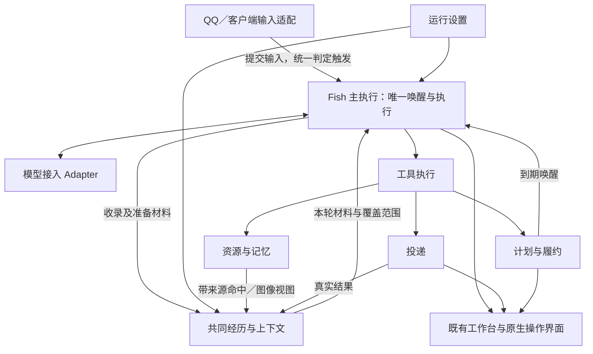
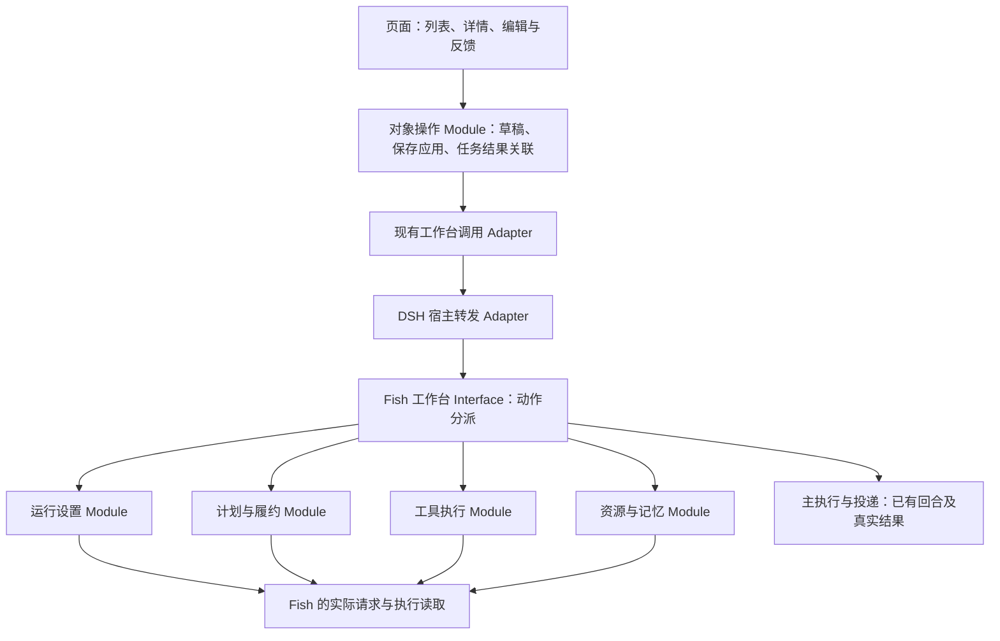

# Fish 统一 Agent 系统更新：实施规格（唯一权威）

<!-- confirmed-spec-stage-one:20261026 -->
**2026-10-26 当前阶段：to-spec第一阶段已确认。** 主人已通过现有9项修复目标、记忆整理的程序/API分工、C3程序自动续批主方案，以及“现有Fish保持整体、未来新增能力按插件接入”的方向。主连接对外统一称“Fish API”，不限定QQ用途。本轮仅确认并发布这些规格；新提出的群唤醒、界面/思考查看、统一时间线和新建入口问题另存待讨论，不在本轮细化、设计接口、设验收或新增可执行工单。此前工单保留，未据本次确认开始代码实施。

**2026-10-26 当前执行入口：** [第八节验收修复规格](#audit-repair-spec-20261026)为本轮最新裁决，9项已确认问题拆成5张修复子票，状态ready-for-agent、尚未实施。C3技术推荐为固定范围的程序自动续批；现有Fish保持整体，未来新增能力按插件接入，不将当前基础结构插件化。A2/A3保留现有行为，B3配置处理暂存。此前阶段的状态说明与验收记录保留为历史，不覆盖本条。

日期：2026-10-24｜整理：Codex｜按主人本轮转述的 DeepSeek 审核与主人裁决修订。

**2026-10-25 最新目标确认：** 本轮先写入主人已通过的结构、触发、消息合并、统一记忆与整理程序要求，尚未实施这些新要求。定时触发经主人再次确认是 **45分钟**。后续依次通过 to-spec → codebase-design → to-tickets 完成规格、目标结构及源码映射、可执行工单；本次目标记录不代表三个步骤已经完成。此前交付、构建和验收状态仅对应各自历史范围。

**Status: implementing。主人已批准按工单实施、上传 GitHub、使用 API 并自行完成必要重载；主人只参与最终验收。** 本地工作流现进入实施阶段，GitHub 创建／上传尚待访问条件就绪，不因远端未就绪暂停本地实施。

**需求、行为和验收以本规格为唯一权威。** [实施对照表](https://github.com/3259980040-droid/fish-agent/blob/codex/fish-tickets-20261025/project/implementation-map.md)只维护代码位置、当前规则事实和删除/迁移清单；[本地工单索引](https://github.com/3259980040-droid/fish-agent/blob/codex/fish-tickets-20261025/project/ticket-index.md)只维护工单入口与依赖。旧边界与旧任务讨论已经降级为历史，不作为当前要求来源。

本规格只列模块职责、行为和接口约定，具体代码位置放在实施对照表。后续改变需求或验收时先改本规格，再同步相应工单，不在多个文档另立规则。

**最新修订范围：** 本轮操作工作台规格和工单 09 为 ready-for-agent，尚未开始该票实现；此前 01—08 的交付状态独立保留。见 4.7、5.6、7.4。

## 一、问题陈述（Problem Statement）

主人希望 Fish 是一个能够聊天、感知、使用工具、处理事务并延续记忆的独立 Agent。现有实现已具备模型与工具循环、QQ 通道、人格、部分记忆/资料、任务和管理界面；问题在于这些能力尚未形成连贯的实际使用过程。

主要表现：

- 客户端、私聊、群聊的身份与经历接续不完整，引用和人物容易混淆，忙群会放大等待与重复处理。
- 工具注册已有主入口，但能力尚不完整，入口或窗口绑定仍影响主人实际能让她做什么。
- 人格、表达、策略与通道重复决定相同规则，旧字数和行为限制可能覆盖新设置。
- 页面显示、后端保存和运行生效没有逐项闭环；有实现不等于用户能通过当前界面使用。
- 记忆、网页、资料与图片有多种存储和检索路径，原始材料与整理结果缺统一关联，资料语义通路尚待新增接通。
- 部分图片在模型看到前已被缩小，缺原图和局部继续查看能力。
- 定时、群主动、私聊主动和到期提醒仍有不同入口与进度，未完全回到同一个 Fish。
- 思考展示、真实故障与送达结果缺统一呈现，容易把程序等待、失败或未确认混成沉默。

目标是补齐现有 Agent 的能力并收敛上述路径。使用效果必须落实到真实对话、工具结果与客户端，不以配置条目、代码存在或构建成功单独判完成。

## 二、解决方案（Solution）

### 2.1 用户将获得什么

Fish 保持自己的模型接入、人格、共同经历与执行循环，使用配备给她的 Agent 工具完成文件、终端、MCP、QQ、联网、视觉、资料整理和计划任务。适合的工具组件复用，缺少的实现可从 DSH 迁入并适配；是否委托其他 Agent 是一种可选工具使用方式。

主人在客户端、QQ 私聊、群内发言均以同一“主人”身份进入共同经历。Fish 获得足够的相关材料后，自主选择行动或不行动。已接受的明确委托按任务跟进；执行问题和结果如实呈现。

原生操作工作台对应真实后端状态：在 DSH 客户端内完成对话、任务自动化、文件办事、模型与工具配置、记忆资料管理和连接维护。人格与设置可保存、应用并正确进入下一请求；任务、资料与扩展可在各自页面操作并回读结果。六页不再是固定数量，简洁不等于只读。

### 2.2 11 项范围对应

| 原任务项 | 本规格负责的结果 |
|---|---|
| 1 | 独立 Fish Agent、完整工具、QQ MCP 与工作区归属 |
| 2 | 原生操作工作台：各区完整操作、前后端保存/执行与结果闭环，见 4.7 |
| 3 | QQAgent 风格、主人高信任与持续临时上下文 |
| 4 | 原件、经历、记忆、语料、小结与外部资料的关联检索 |
| 5 | 原图、局部细看、长图/文字辅助与动图原件 |
| 6 | 官方联网、资源归档、稳定索引与后续复用 |
| 7 | 系统计划、自建计划和自主唤醒进入同一 Agent |
| 8 | 共同信息流、引用、持续接收、统一预算与实际延迟 |
| 9 | 原始接口思考、工具过程、故障与投递状态 |
| 10 | 分层传输参数、大文件落盘与按需处理 |
| 11 | 唯一规则归属、旧路径退出与集中整体校验 |

### 2.3 完成的含义

已审定范围内的功能形成端到端闭环；替代的旧决定、旧读写和旧调度退出执行路径；页面、存储和运行使用同一结果。仍未完成、真实失败或存在差距的内容明确列出。自主选择不说是有效结果，未执行或未送达不能报告成已完成。

## 三、用户故事（User Stories）

### 独立 Agent 与工具（原第 1 项）

1. 作为主人，我希望直接在 Fish 对话里交办事务，以便她用自己的执行循环完成工作。
2. 作为主人，我希望 Fish 使用独立的模型配置、人格和经历，以便接入工具时仍保持同一个 Fish。
3. 作为 Fish，我希望能够发现并使用配备环境中的完整工具，以便按需要读写文件、运行命令及调用 MCP。
4. 作为维护者，我希望可以复用或迁入 DSH 已有工具实现，以便补缺能力并保留清楚的来源和依赖归属。
5. 作为 Fish，我希望能按需要调用子任务或子代理，以便取得成果后回到自己的主线继续处理。
6. 作为主人，我希望 Fish 具备当前 QQ 接口实际支持的操作，以便消息、图片、文件及其他账号操作真实可执行。
7. 作为主人，我希望自主文件按所属任务和资源分类保存，以便项目之间保持清楚归属。
8. 作为主人，我希望交办已有工程时 Fish 能处理指定位置，以便不用为了工具权限重复复制工程。

### 前后端闭环（原第 2 项）

9. 作为主人，我希望编辑人格后能够保存为预设，以便之后再次选择。
10. 作为主人，我希望区分保存与应用，并看到当前活动版本，以便明确下一轮使用哪份人格。
11. 作为主人，我希望记忆、资料、任务和设置页面的操作改变真实运行状态，以便管理界面可以实际使用。
12. 作为主人，我希望重新打开页面仍能读回已保存内容，以便不依赖当前页面的临时变量。

### 人格与主人关系（原第 3 项）

13. 作为主人，我希望保留已认可的 QQAgent 风格，以便 Fish 有持续、自然的说话习惯。
14. 作为主人，我希望客户端、私聊和群内都被认作同一主人，以便信任与已给出的能力保持一致。
15. 作为主人，我希望明确委托有实际执行、跟进与真实结果，以便高信任关系落实到办事。
16. 作为主人，我希望临时扮演、调侃和当前话题在后续交流中保持，以便连续聊天不会两句就回到旧模板。
17. 作为主人，我希望回复长度和动作描写由表达设置与内容需要决定，以便旧角色卡规则不再覆盖新设置。

### 记忆、语料与资料（原第 4 项）

18. 作为主人，我希望能够找回原消息、原文件和原图，以便核对记忆从哪里来。
19. 作为 Fish，我希望召回重要偏好、经历和未完成事项，以便持续理解主人和此前承诺。
20. 作为 Fish，我希望按人物身份、别名及引用对象理解社交记录，以便分清谁在对谁讲话。
21. 作为 Fish，我希望语料保留使用语境，以便自然接话而非机械复读某个词。
22. 作为 Fish，我希望使用续聊摘要和阶段小结接续旧经历，以便在有限上下文内保持连贯。
23. 作为主人，我希望更正关联原记录并影响后续召回，以便旧推测不会继续冒充确认事实。
24. 作为主人，我希望较长资料按章节、段落和表格解析，以便后半段与表格说明也能被查询。
25. 作为主人，我希望长问句的句末关键词和换一种说法的查询仍可命中资料，以便不需要迁就固定关键词。
26. 作为主人，我希望命中资料能展开相关上文并定位原件，以便理解结论成立的条件和出处。
27. 作为维护者，我希望不同类型资料关联同一资源体系，以便原件、记忆与索引各有职责且能互相定位。

### 图像与视觉（原第 5 项）

28. 作为 Fish，我希望能够取得原图并按需要继续查看局部，以便识别缩略图中看不清的细节。
29. 作为主人，我希望长截图、小字与多张图的顺序和问题关联得到保留，以便回答不串图。
30. 作为主人，我希望角色识别结合实际特征、主题候选和需要的资料，以便群主题不会替代图片事实。
31. 作为主人，我希望原动图保存与发送保持动画，以便分析视图不覆盖发送原件。
32. 作为维护者，我希望语音视频保留后续接入位置，以便本轮集中补视觉时不扩成完整音视频项目。

### 联网与资源整理（原第 6 项）

33. 作为 Fish，我希望使用 DeepSeek 官方联网查资料并按需取正文，以便获得有来源的新信息。
34. 作为 Fish，我希望自己选择值得保存的文本和图片并分类归档，以便资料长期可复用。
35. 作为主人，我希望同一资源的再次保存能正确关联来源与版本，以便不形成互相找不到的重复索引。
36. 作为主人，我希望了解资料的取得时间与缓存情况，以便旧资料不会被描述成刚查询的新结果。

### 定时与自主行动（原第 7 项）

37. 作为主人，我希望说“半小时后叫我”就能建立真实计划，以便提醒不只存在于一句聊天记录。
38. 作为 Fish，我希望可以创建、查询、修改和取消自己的计划，以便安排后续行动。
39. 作为主人，我希望聊天创建的计划与任务页是同一份记录，以便统一管理。
40. 作为 Fish，我希望到点收到原任务意图及当前相关经历，以便用自己的工具和表达完成行动。
41. 作为主人，我希望默认自主思考按45分钟或累计8条群消息触发，既有明确计划与此区分，以便旧巡群入口不会叠加成另一套主思考路径。
42. 作为主人，我希望定时和消息共用处理进度，以便同一句不会变成两份重复委托。

### 统一信息流（原第 8 项）

43. 作为主人，我希望在群里说过的话转到私聊或客户端仍能接上，以便三个入口保持连续经历。
44. 作为 Fish，我希望引用、人物、附件和自己的已发送/失败/未确认结果在经历中清楚可辨，以便不混淆说话归属。
45. 作为主人，我希望群持续聊天和工具执行时仍能接收新内容，以便不用等群清净才开始处理。
46. 作为主人，我希望只有明确说停才取消当前动作，以便普通新消息不会不断打断进行中的工作。
47. 作为 Fish，我希望原文、摘要、记忆、资料和工具结果使用统一 token 预算，以便有限窗口内保住相关话题。
48. 作为主人，我希望看到真实排队、处理和投递耗时，以便能够分辨程序等待和她自己的选择。

### 思考与实际状态（原第 9 项）

49. 作为主人，我希望看到接口返回的原始思考和真实工具过程，以便理解她这一轮正在做什么。
50. 作为管理员，我希望在统一运行日志中按回合区分未开始、思考完成、工具结果和发送未确认；普通聊天未发消息不据此判错，技术诊断不推给聊天用户。
51. 作为主人，我希望必要时有中文显示辅助，以便阅读思考，同时不增加默认的每轮说明或翻译调用。

### 传输、整理与交付（原第 10—11 项）

52. 作为主人，我希望按审定规格导入、保存和使用较大资料，以便文件体积不会被误当成模型窗口。
53. 作为主人，我希望各层大小配置含义和实际值清楚，以便知道是哪一段传输或导入出了问题。
54. 作为维护者，我希望每种规则有唯一最终归属，以便改一次就能让相关入口一致生效。
55. 作为主人，我希望每批明确交代旧实现退役结果，以便更新不是继续向旧逻辑叠加覆盖。
56. 作为主人，我希望改根与数据搬迁单独安排，以便功能改造和运维迁移可以分别理解与处理。
57. 作为主人，我希望整套完成后只做一个连续私聊测验，以便实际体验后再调，不扩成多组对照或群实发。

### 操作工作台（本轮前端修订）

58. 作为主人，我希望在 DSH 现有客户端切入 Fish 工作台，以便聊天、管理和本机办事在同一应用完成。
59. 作为主人，我希望按日常使用、能力配置、数据管理和连接维护找到入口，以便不用猜哪个设置页藏着功能。
60. 作为主人，我希望常用正文、字段、按钮和状态能清楚阅读，以便界面不再由大量小文字组成。
61. 作为主人，我希望选中对象附近就能编辑、启停和打开结果，以便列表不仅能看还能用。
62. 作为主人，我希望每个操作说明正在处理、完成或具体失败，以便不把点击过当成成功。
63. 作为主人，我希望刷新或重新打开仍读回已保存状态，以便页面临时变化不会冒充后端保存。
64. 作为主人，我希望人格默认易于阅读、需要时再编辑，以便既能看清她的性格又能修改。
65. 作为主人，我希望“仅保存”后仍能看见刚保存的预设正文，以便不会被当前活动人格覆盖。
66. 作为主人，我希望“保存并应用”或选用预设后看到当前生效人格，以便下次聊天使用我选择的内容。
67. 作为主人，我希望换人格后仍保留既有经历和主人关系，以便换表达不等于换成另一个她。
68. 作为主人，我希望在任务页新建一次或重复计划，以便不必每次通过聊天创建。
69. 作为主人，我希望在任务详情修改内容、时间、时区、目标和重复方式，以便计划可以实际维护。
70. 作为主人，我希望暂停、恢复或取消计划并看到真实状态，以便暂时不用与永久取消有区别。
71. 作为主人，我希望可以立即运行一项适用计划，以便使用同一任务执行能力而非另建一条任务。
72. 作为主人，我希望计划、执行记录和发送回执各自清楚，以便知道是还没到点、正在做还是结果未送达。
73. 作为主人，我希望在同一任务详情打开或取得成果，以便完成后不用去日志里找文件。
74. 作为主人，我希望在工作区浏览、预览和编辑 Fish 的实际文件，以便这里能辅助处理本机事务。
75. 作为主人，我希望将选中文件交给 Fish 并关联当前任务，以便文件树与对话能够配合使用。
76. 作为主人，我希望看到本机执行任务、终端输出和已有取消入口，以便知道电脑上的工作进度。
77. 作为主人，我希望工作区明确属于 Fish，并能打开我交办的其他工程，以便不会误操作 DSH 当前项目或失去已给出的能力。
78. 作为主人，我希望新增、修改和删除 Fish 模型服务连接，以便自己管理 API 地址、凭据与模型。
79. 作为主人，我希望能获取服务提供的模型列表，或在其不支持时填写模型标识，以便不同提供商仍可配置。
80. 作为主人，我希望区分保存连接、测试连接和实际使用中的服务，以便地址填完不会被显示为已经可用。
81. 作为主人，我希望为聊天、识图及已有检索服务选择真实可用的模型，以便界面选择与运行请求一致。
82. 作为主人，我希望在扩展页新增、修改和启停 Fish 已支持的外部 API、CLI 或插件，以便能力配置不依赖手改文件。
83. 作为主人，我希望在 MCP 项中编辑连接、发现工具、重连并查看错误，以便接入 QQ 等工具后能知道实际可用能力。
84. 作为主人，我希望 Skills 可以导入、查看、编辑、启停或移除，以便说明内容实际进入 Fish 使用流程。
85. 作为主人，我希望扩展页显示真实支持的安装、更新和重载操作，以便不会出现点了也不能执行的按钮。
86. 作为主人，我希望搜索、新建、修改和停用记忆，以便错误内容能够退出后续召回。
87. 作为主人，我希望合并重复记忆时保留来源与修订关系，以便整理之后仍能解释从哪里得到结论。
88. 作为主人，我希望分别查看长期记忆、社交信息、语料和小结，以便按实际对象整理，而不只有日期时间线。
89. 作为主人，我希望按范围整理或修订小结并看到处理结果，以便不会把模型改写冒充立即保存。
90. 作为主人，我希望在资料库导入文本、已有支持的文件和网页资料，以便资料入口覆盖 Fish 已具备的资源能力。
91. 作为主人，我希望给资料分类、改名、移动、打开或移除，以便资源不会再次堆在一个列表或目录。
92. 作为主人，我希望导入时看见原件保存、解析和索引的真实进度，以便知道哪些部分已可查。
93. 作为主人，我希望输入问题试查资料并打开命中来源，以便直接知道资料是否能被 Fish 找到。
94. 作为主人，我希望词法降级或解析失败在相应资料操作处可见，以便不用靠猜或翻所有日志。
95. 作为主人，我希望在 QQ 连接页配置连接并读取真实状态，以便这里能管理已有通道。
96. 作为主人，我希望日常设置与故障维护分开，以便常用操作简单、需要排查时又能找到完整信息。
97. 作为管理员，我希望从已有日志/维护入口定位运行错误与对应工具；普通界面保留操作必需结果，聊天用户不被技术故障消息打扰。
98. 作为主人，我希望继续查看本轮原始思考、真实工具过程和成果，以便不用让模型另外写一份解释。
99. 作为主人，我希望原型演示、已保存配置和已验证功能分别标明，以便截图不会冒充已经上线。
100. 作为主人，我希望语音和情感扩展沿清楚的服务接口后续接入，以便不会因为本轮画出入口就被宣称实现。
101. 作为主人，我希望新管理入口替换对应旧入口与页面临时存储，以便以后改一个设置不再出现两套值。
102. 作为主人，我希望完成后沿客户端和 QQ 私聊连续使用一次，以便按实际效果验收而非反复跑实验。

### 2026-10-25 已确认的结构与触发补充

103. 作为主人，我希望先按最终目标设计整洁结构，再安排旧源码迁移，以便旧实现不反过来限定功能目标。
104. 作为主人，我希望被@、QQ私聊消息和客户端消息第一时间进入处理，以便这些明确交流不必等待群消息计数或定时。
105. 作为主人，我希望普通群消息先持续接收，在累计8条或45分钟到期时触发思考，以便普通群消息不会条条单独开启回合。
106. 作为主人，我希望思考期间的新消息统一合并，按到达顺序接续，以便主人消息也不会插队造成对象和目标混乱。
107. 作为主人，我希望思考开始清零群消息计数、思考完成重启45分钟计时，以便两个动作不再混成一个重置点。
108. 作为Fish，我希望通过内置3秒自唤醒工具提交兴趣值，数值达到0.7即可满足启动条件，以便程序按确定参数执行我的调用。
109. 作为主人，我希望文件按连续3秒一批统一接收处理，以便批次不是一次收集窗口，也不会变成多个并发主思考。
110. 作为Fish，我希望不同场所都能使用同一份记忆，并能沿人物、场所、时间和原件找到来源，以便记忆连贯且不混淆归属。
111. 作为Fish，我希望调用工具就能启动完整的记忆整理程序，以便无需自己逐项操作数据库和索引。
112. 作为主人，我希望每日整理与Fish主动整理共用一套程序，以便更正、概述和索引不会形成两套结果。
113. 作为主人，我希望检索、概述、细化是同一资料的不同读取层次，以便不用维护三份互相失配的物理副本。
114. 作为主人，我希望所有用户可见时间默认北京时间，以便不必选择时区或自行换算。

## 四、实施决定（Implementation Decisions）

下列为规格层的职责与交互，不指定具体源码文件或代码片段。最终代码落点以审定后的实际工作树扫描为准。

### 4.1 Agent 与工具归属

- 以独立Fish Agent的最终目标设计主执行和工具职责，再据实际源码决定复用、改造与退役；保留可用能力不等于冻结现有文件布局或调用结构。主执行不以另一个DSH Agent会话为前提，不建立与目标主线并存的第二套执行核心或工具登记。
- API 配置、系统输入、人格、经历和工具执行接续归 Fish。工具协议和必要参数说明随工具提供，DSH 默认编程人格与旧工作历史不自动进入主聊天。
- 工具可模块复用或源码迁入，保留来源和必要许可信息，配置与运行由 Fish 管理。动态发现或参数按需加载管理请求体积，完整能力仍可发现和调用。
- 子任务/子代理与外部委托作为 Fish 可选工具；结果、成果文件和未完成事项回到同一主线。工具可有独立执行上下文，主 Fish 的身份与经历保持连续。
- 对应能力具有真实工具注册、参数说明、执行实现和结果回传，原任务能经 Fish 自身工具入口闭环后，退出该能力的旧受限入口或转交路径；不以“完整环境”这一未定义条件推迟退出。
- 完整工具的可验收定义：形成当前 DSH 工具及实际 QQ 接口到 Fish 的能力对照；每项明确注册名、实现及可用状态；模型可发现完整目录；读写文件、终端、MCP 与任务等已有能力确有执行实现；外部账号/接口未提供的具体说明。此次私聊验收只实测允许的私聊动作，未实测的群写操作不得标成已实测。

### 4.2 身份、人格与配置

- 主人使用稳定身份；客户端、QQ 私聊和群中主人账号在展示及模型材料里统一为“主人”，内部保留路由所需的来源字段。
- 群友、Fish 自己、引用人和被引用对象分别标识。授权归主人/Agent/场所关系，删除历史记录不撤销既有授权。
- 预设版本与活动版本区分：保存预设不自动切换；应用或保存并应用在下一次模型请求生效，普通编辑不取消当前回合。
- 人格管性情与关系，表达管长度节奏，工具注册管能力说明，任务管计划。临时设定随上下文和未完成意图维持，不机械永久改卡。
- **长度与节奏以现行实现为准。** 实施前先在实施对照表贴出当前实际进入请求的长度规则：负责模块、当前值、调用入口、活动人格中的冲突条目，以及工具/通道/模型各自约束。本规格不另立字数范围。
- 后续清理重复来源时保留唯一长度所有者，任何调整先明确替代哪个旧值；群/私聊不自动获得不同长度铁律。

### 4.3 共同经历与请求材料：最小可行 token 预算

- 共同记录包含消息号、时间、人物、场所、引用、附件关联和 Fish 行动结果；引用是独立字段。
- 接收与生成分离。立即触发仅指被@、QQ私聊消息和客户端消息；普通群消息持续接收，默认由45分钟或累计8条群消息触发，内置3秒工具提供特殊自唤醒，详见4.6。不能再写成“任何来源第一条消息都立即启动思考”。
- 主思考空闲时，符合立即触发条件的第一条消息第一时间进入处理；忙碌时继续接收，后续消息统一合并并按到达顺序接续。主人身份不改变处理或回复顺序，不因主人消息插队而混淆发送对象、引用和投递目标。
- 本批采用回合开始快照：新消息统一合并留下一回合，已有工具接续补本轮工具结果，不抢先消耗后续输入；持续聊天不要求等清净，不追加每次发送前“追最新”的模型调用。保持一个主思考，不为每条消息预建一个独立等待生成回合；普通新消息不取消正在进行的思考，只有主人明确说停才取消。
- 文件接收按连续3秒一批归并，普通文字不因此每句延迟3秒；批次与主思考接续的交接见4.8。消息计数和45分钟计时按4.6分别在思考开始、完成时重置。
- 已考虑进度与是否行动、投递结果分开。消息和自主触发共用输入进度；提醒仍有独立任务履约记录，见 4.6。

**预算按本轮裁决落定，不再待审：**

1. W 为当前实际模型的总上下文窗口，来源为该提供商模型元数据；模型切换后重新解析，不能从旧字符上限或模型别名猜容量。
2. 沿用今日工作树的 **8%** 作为工作预算初值，替代旧 30% 初值和仅限 25%—35% 的旧要求；配置校验根据当前模型窗口、输出预留及有效参数进行，不另建入口特有比例。输入预算 B 为“向下取整的当前比例×W”与“W 减当前输出预留”中的较小值。它是可用上限，不要求每轮填满。**预算上限不是使用目标：按本轮问题、现场和未完成事项取用实际需要的材料，不为接近上限补入无关历史、资料或小结。** 不另加固定条数或另一套私聊 token 硬上限。
3. 当实际模型元数据 W 为 **1,048,576 tokens** 时，8% 对应 **83,886 tokens**。这是核对示例；实现读取当前提供商与模型的真实值，不取其他模型缓存的最大值、不硬编码示例容量。[官方模型元数据](https://api-docs.deepseek.com/api/list-models/)
4. 人格/系统输入、当前请求、必要工具定义与未闭合工具协议先计入 B；输出预算单独预留。其余可选上下文共用剩余预算，避免只算历史却声称算了整个请求。
5. 使用与实际模型匹配的本地 token 计量，图像和工具包装按对应协议计入，记录计量来源与估算性质，并用服务商回执 usage 对照。不能把字符数或消息条数改名为 token。

**可选材料从高到低的保留顺序：**

| 层 | 材料 | 超预算处理 |
|---|---|---|
| L1 | 当前会话原文 | 最后处理较旧完整轮次，当前请求保留；需要时对旧段增量整理 |
| L2 | 跨场所相关原文 | L3—L5 不足以释放预算后，再缩减低相关/较旧完整消息 |
| L3 | 日小结 | 在 L4/L5 之后缩减，保留原件与覆盖范围 |
| L4 | 记忆/资料命中 | 在 L5 之后缩减较低相关结果，原库记录不变 |
| L5 | 周/月小结 | 最先缩减 |

“当前会话”指本轮所处理的场所，不恒等私聊。这里是请求材料的整理次序，不是私聊必须先回的行为规则。

- 超预算在**组装阶段**从 L5 向 L1 裁，按完整片段/消息处理，保留引用和来源索引；原始记录不删除，未覆盖输入不标已考虑。
- 若高层自身很长，增量摘要其较旧范围；长附件按资源引用与相关片段取用，不把整份原件直接挤进当前输入。真正超出模型容量应给可定位原因，不回到固定条数上限。
- 每轮记录 W、比例、B、计量来源、固定开销、各层组装前/后用量、裁剪层和原文范围、实际请求总量，以及后续回执 usage；客户端可查“用了多少、裁了哪层”。
- **私聊每轮实际用量与预算上限分开报告。** 每次模型请求分别记录实际／估算输入 token、输出预留和回执中的实际输入／输出 usage，并标明估算来源；工具接续包含多次请求时，保留逐请求数据和本轮累计用量。界面区分“上限 B”和“本次实际用量”，不把尚未使用的额度当成消费，也不以填满预算判断完成。不追加模型调用来解释用量。
- 摘要后台按固定原文范围产生，不等待群安静；日小结与续聊摘要各自保留用途，不把周/月小结冒充全部历史。

**2026-10-24 本轮明确要求：上下文与记忆后端单独维护，前端由 09 消费其接口。** 自动压缩以本地 DSH 当前的 token 压力计算、最近完整内容保留、旧摘要合并和成功提交后替换为源码依据，迁入 Fish 自身执行/模型通路，不带入 DSH 编程人格或默认 API 配置。80% 触发与 16% 最近保留沿用为当前初值，均由同一配置解析；摘要的输入/输出预算由对应用途负责，当前 8,000 token / 800 字 / 旧摘要尾部 2,000 字只记为补丁现状，不提升为最终限制。未压缩成功的范围不标已整理，关闭自动压缩须对全部自动入口生效。原文、检查点、主题目录与长期记忆各有职责，具体程序与数据库落点在原 01/04 中落实，不在前端重新实现。

### 4.4 记忆与资源

- 记忆属于同一个Fish：客户端、QQ私聊、群聊使用统一的记忆读写、检索、修订与整理能力，群内同样能够读取。人物、场所、时间、原话、原消息及原文件位置保留为来源；不再把场所当成几个互相隔离的记忆身份。退出原按群/私聊硬隔离的记忆查询和相关工具说明，不能只撤保存拒绝而保留旧读取隔离。
- 原件、经历、派生记忆、阶段小结、资料块和图片视图分别保存，使用稳定资源关联与来源关系串联。数据库保存结构与索引，大原件以文件保存。
- 检索、概述、细化是同一记录体系的三个读取层次：先查索引定位，再读概述，需要时展开具体事件、原话与附件；概述和索引关联同一来源及修订，不另造三套互相复制的记忆库。
- 采用SQLite官方FTS5作为全文词法检索基础并接入真实调用；FTS5负责索引与查询，不负责判断内容重要性或生成概述。语义能力按本节既定就绪与降级要求接续，不用FTS5冒充语义检索。
- 主人/群友原话、图片观察、网络资料、模型推测、后续确认与更正可区分。更正影响当前召回，旧来源可追溯，主人主动删除的历史不擅自恢复。
- 外部资料采用结构解析、父子分块、混合检索和必要上文展开。长问句首尾信息都可参与，不让最新候选上限永久排除相关老资料。
- 外部资料补缺失的向量通路；长期记忆复用既有向量实现并补齐运行依赖/有效索引。就绪判据为：模型可用、索引与模型匹配且内容有效、查询实际经过语义通路；只有真正用过语义的请求才显示混合检索。
- 语义不可用时，**明确降级为词法检索**并继续提供可用结果；界面显示“仅词法：语义未就绪”及实际原因和待补建状态。索引缺失、加载失败或查询失败均不能留空白、伪称混合或把词法分数当语义分数。
- 交付报告区分语义已接通与仍处词法降级的范围，未完成的语义能力单列，不用界面文案掩盖未完成。
- 按容量增量整理续聊；每日记忆整理沿既有定时安排接入，不另立第二个整理周期。每日自动启动与Fish主动调用整理工具共用同一套可重复执行程序：读取新增或指定范围→基础格式/明确重复项/来源整理→通过Fish配置的模型提炼事实、事件与概述→保存记忆及修订→更新FTS5和适用的现有向量索引→返回范围、保存结果与失败内容。未变化材料略过，未完成承诺按真实任务状态维护。
- Fish获得启动整理的能力，不被要求每轮主动整理，不为此修改人格。工具说明只写用途、参数、调用方式和真实结果含义；工具启动完整程序，Fish无需逐项操作表、索引或处理进度。
- 内容归纳与原始文件删除/归档分开；附件保留期限和物理处置仍按后续确定的策略，不从90天/1年/30天旧建议自动生成删除行为，也不擅自恢复主人已删除记录。
- 网页、文档、附件和表情统一资源登记与检索关联；原件存储、资料块和图片衍生视图可以各有内部实现，不抹去其职责、来源和人物归属，也不继续用旧场所范围阻断本节已确定的统一记忆读取。

### 4.5 视觉与联网

- Fish 可取原图、整体/局部视图、长图分段及必要 OCR 辅助；多图保持顺序与问题关联。原动图与分析视图分开。
- 图像输入遵守实际服务协议，不以固定缩略图替代所有问题需要的原图；高细节也不承诺模型内部无缩放或角色识别永不出错。
- 主题用于辅助候选，结论以实际图片和需要的来源为据。媒体准备与专业候选核对可以是同一视觉入口内的子模块，重复最终判断和无效调用退出。
- 使用 DeepSeek 官方 Search/Fetch；联网时机与是否保存由 Fish 按任务和现场决定。保存内容附来源、时间与版本，进入自身分类资源库。
- 同一 URL/资源可关联再次访问，内容更新保留版本含义，不机械制造孤立副本，也不把相同 URL 的所有版本强行抹成一个。

### 4.6 可靠提醒、自主主动与投递：共用基础，分开行为

计划、页面和定时基础可复用，**到期提醒与自主主动不是同一种执行选择**。

**A. 主人明确委托的到期提醒**

- Fish 接受提醒并建立任务后，到期应执行该委托。提醒有独立的履约记录，不进入自主回合的“不动/说不说”选择，不被自主冷却或主动评分挡掉。
- 到点把原委托、时间/时区、目标及当前必要信息交给同一个 Fish 完成提醒表达与发送。表达可自由组织，履约不能因她选择沉默而跳过。
- 主人已取消的任务按取消处理；未取消的任务若生成未得可发送内容、工具失败或发送失败，明确记为提醒未完成/失败并单独显示原因。
- 发送未确认单独标记，不能记成功或自动再发一次。任务保留真实履约结果，运行失败统一记入管理员日志，不把技术诊断或系统故障通知自动发进普通聊天，也不靠模板说成功。

**B. 自主主动回合**

- 触发分类如下；定时值由主人在2026-10-25再次确认是45分钟，撤回本轮文字中的“45小时”。

| 类型 | 触发 | 行为 |
|---|---|---|
| 立即触发 | 被@、QQ私聊消息、客户端消息 | 主思考空闲时第一时间处理；忙碌时接收合并并依到达顺序接续，不并发启动另一个主思考 |
| 默认触发 | 45分钟定时、群消息累计8条 | 普通群消息先接收；任一条件满足产生一次思考机会，不等群聊安静，也不逐条生成回合 |
| 特殊触发 | Fish调用内置3秒自唤醒工具 | 模型填写interest，程序按interest≥0.7检查启动；连续最多3次，被@、单群8条、45分钟、私聊或客户端新消息触发认领新一轮时解除连续上限 |

- **两个重置时点分开：思考开始时群消息计数清零；思考期间新消息继续累计、合并；思考完成后45分钟计时重新开始。** 不在思考完成时再次清掉期间的新消息计数，不以是否发言/发送成功作为重计条件。
- 自唤醒的0.7是程序执行的固定条件，不改成可选记录，不另加兴趣校准模型。特殊工具保留3秒唤醒语义，不把整轮生成耗时是否超过3秒新增为调用资格。连续调用次数必须跨待唤醒任务消费而保持，不与沉默次数混算；精确任务交接由后续Interface设计落实。
- 以上触发负责让Fish思考，是否行动、发群、发私聊或使用其他已配备工具仍由她决定。主人身份不增加插队或改变回复顺序的规则。
- 既有早晚问候等明确计划与默认45分钟/8条触发区分；旧巡群入口的辅助职责按目标迁入，不能继续叠加第二套常驻主思考、生成和发送路径。计划中的自主意图可接梗、关心、做事或不动，原有不打扰休息群的意图保留。
- 自主回合与普通消息共用已考虑进度，避免把同一段消息当成新输入答两遍；没有新消息也允许自主思考。
- 归并群与私聊的重复主动入口，先迁仍使用的辅助职责，再退出旧独立节拍、生成和发送路径。此归并不吞掉 A 类提醒的可靠性语义。

**C. 共用接口与真实回执**

- 聊天和任务页管理同一份计划，明确其委托/自主来源；任务保存时间/时区、意图、原消息关联、目标和执行结果。
- 到点是定时事件，不伪造主人新消息，不换另一个人格。共享一个主思考不等于所有任务都允许“不动”。
- 实际投递区分已确认、明确失败和未确认；提交待发不等于确认送达，确认送达不等于真人已读。所有相关状态进入经历及客户端。

### 4.7 原生操作工作台与运行可见性（本轮前端修订）

本节替换旧“六页只读展示”的组织方式；页数不再是范围或验收指标。参考 AstrBot 的对象管理流程，保留 Fish 作为本机 Agent 的对话、工作区和执行结果能力。本轮交付是可操作的正式界面，不以演示原型的内存变化判完成。

#### 4.7.1 宿主、导航与视觉

- 在现有 DSH 原生客户端的 Fish 入口内实现，沿用 React、CSS Modules、DSH 组件、主题变量和字号设置。复用宿主视图不引入 DSH 默认人格、API 配置、工具权限或历史；Fish 的配置与运行归属仍按 4.1。
- 导航分为“日常使用：对话、任务与自动化、工作区”“能力配置：人格与表达、模型服务、扩展与工具”“数据管理：记忆、资料库”“连接与系统”。扩展区内区分插件/外部 API、MCP、Skills；连接与系统内区分 QQ 等连接、日常设置、故障与维护。实现可合并临近入口，但不得把所有业务表单重新塞回通用设置页。
- 分组沿现有视图注册/导航实现，不为四类用途新建四层路由或全新导航框架；已可用页面继续可达，新增能力由其负责工作区接入，六页数量不再是硬限制。
- 采用对象列表配详情或表单，常用动作位于对象旁边；主要动作强调程度可以不同，“一个主动作”不再解释为每页只允许一个按钮。编辑、启停、打开、移除等必要动作应可直接发现。
- 正文、表单、按钮、导航和状态使用宿主可读字号与缩放；主正文不使用固定 11px 小字承载。说明按需要展开，不能靠删除操作或缩小字号制造简洁。沿用宿主主题，不新增独立设计系统、组件库或前端运行框架。
- 业务对象保留操作必需的真实结果及进度；运行报错、堆栈、五时间点细分和技术诊断统一进入既有管理员日志/维护入口。普通聊天不自动推技术故障卡或系统故障私信；用户主动保存、启用等操作仍有必要结果反馈。
- 对象操作结果与管理员日志关联同一回合/调用，不另造状态来源。给模型的工具返回保留实际成功或失败，日志不能代替工具结果；详细诊断供管理员查阅。保存/活动/生效状态按对象适用性展示，不机械为所有页面增加三行小字。

#### 4.7.2 保存、应用与执行的共同含义

- 页面操作经现有工作台/宿主接口进入对应负责模块。保存响应返回后，以服务端结果更新并可重读；不能仅改页面变量、静态 JSON 或本地缓存后报成功。页面缓存不成为第二份活动配置。
- 区分选中对象、编辑草稿、已保存版本和活动版本。普通编辑不取消正在执行的回合；涉及运行配置时说明是下一次模型请求生效，还是对应连接需要明确重连。确需重载的项显示真实需要，不对所有保存都强制重启。
- 同一对象的长操作使用已有任务/执行引用返回进度或完成结果，页面离开后能重新找到；已提交、正在做、已完成和已送达分别呈现。沿用现有状态含义，不为前端再建一套业务状态机。
- 保存或执行失败时保留用户编辑内容，在当前表单/对象处显示具体中文原因。发送未知继续显示未确认，不自动重发；取消只调用对应真实取消入口，收到取消请求不能立即伪称底层工作已停止。
- 控件读取已有真实设置，不为解决显示问题新增第二个开关。删除/移除的影响在对象操作中说明；移除引用、停用召回与物理删除原件分别处理，不擅自销毁原文件或恢复主人已删记录。

#### 4.7.3 各工作区的完整操作

| 工作区 | 本轮应接通的操作 | 完成与反馈的含义 |
|---|---|---|
| 对话 | 文本/已有附件发送，本轮思考展开，工具过程及成果打开，明确取消当前工作 | 继续同一经历；正文、工具结果与实际投递状态可对应；不展示伪造的思考或解释 |
| 人格与表达 | 默认阅读、进入编辑、新建/导入/保存预设、仅保存、保存并应用、选择并应用预设；查看当前实际表达设置 | 仅保存后保留新预设正文，不被活动人格覆盖；应用后下一次请求使用当前版本；不重置记忆或主人身份；长度仍由 4.2 的唯一来源负责 |
| 任务与自动化 | 创建一次/重复计划，编辑内容/时间/时区/目标，暂停/恢复/取消，立即运行，查实例与成果，打开/取得产物 | 聊天创建和页面创建是同一份计划；立即运行进入同一执行器并产生一次实例，不暗改原周期的下一次时间；明确提醒与自主机会仍按 4.6 分开 |
| 工作区 | 浏览目录，打开/预览文件，文本编辑与保存，把文件交给 Fish，查看执行任务/终端输出及已有停止操作 | 访问 Fish 实际工作区和交办工程，不借用 DSH 当前工程充数；落盘可重读，成果与所属任务相连；本票不搬运行根 |
| 模型服务 | 连接列表与新增/修改/移除，地址/凭据/模型编辑，按提供商支持获取模型列表，明确测试连接，选择聊天/视觉及已接入检索用途 | Fish 配置为唯一来源；不支持列模型时允许填写真实模型标识；测试成功不等于已应用，已应用不伪称所有用途均可用；删除正在使用的连接前需明确替换用途或如实显示未配置 |
| 插件/外部 API | 添加当前支持的扩展类型，配置参数，启停/移除，查看工具；仅对已有实现提供安装/更新/重载 | 读写 Fish 同一工具注册表；显示支持的协议与实际能力，不宣称可直接运行任意 AstrBot 插件；没有实现的动作不能成为假成功按钮 |
| MCP | 添加/编辑真实连接，连接/重连，发现工具、查看名称/说明和实际错误，启停/移除 | 参数已保存、连接成功和工具已发现是不同结果；工具来自现有注册入口，不在页面另存一份名称清单或新增调用限制 |
| Skills | 导入、列表、查看/编辑内容、保存、启停/移除 | 使用 Fish 实际加载来源并能解释何时重新读取；复用 DSH 编辑组件不代表沿用 DSH 私有配置；启停影响真实装载，不只隐藏一行 |
| 记忆 | 搜索/筛选、新建/修改、查看来源/修订、停用或删除条目、合并重复项；浏览社交信息/语料/小结并按现有对象语义整理 | 同一记忆引擎与来源链；错误项退出后续召回，合并后保留来源关联；小结模型修订与直接保存条目明确区分，不把一类操作套给所有数据 |
| 资料库 | 导入文本/已支持文件/网页，分类与目录维护、改名/移动、打开/预览/移除，查看处理进度，输入问题试查并打开命中来源 | 与 4.4、4.8 的同一原件和索引关联；明确已保存/已解析/已索引/实际取用范围；不虚构引用次数或把未读内容算已理解 |
| 连接与系统 | 管理已有 QQ 等连接与真实设置；查状态、故障与恢复记录，使用已有维护/重载能力 | 读取当前连接和开关；错误关联具体连接/任务；不增加示例连接或以自动群发验证通道 |

当前不支持解析的文件仍可按既有原件能力保存、打开和交给相应工具；要显示具体格式限制，不能静默丢失或画一个不可执行的解析按钮。语音、情感的后续位置见 4.7.6，不计入上表已完成能力。

#### 4.7.4 现有接口优先与缺口归属

- 记忆复用 memory.search/save/history、memory.digest 与 memory.curate；资料复用 library 列表、详情、导入、整理、试查及原件入口；计划复用 schedules 列表/创建/更新/取消；执行任务复用 delegations 的查询、取消、打开和下载。它们是复用线索，不等同当前页面已接通或所有调用已验收。
- 参数保存和连接管理先核对应正式服务入口，复用已有设置解析、工具注册和模型接入。已读工作台分支未给出完整模型服务、插件与 Skills 管理能力时，先查现有其他正式入口，确缺才补最小桥接；不得把“还没有页面”直接当成“必须新造后端”。
- 立即运行计划接现有“计划与履约”的 run_now 和实例执行；当前工作台尚未暴露对应动作，不代表执行实现不存在。已有记忆删除也直接复用，确缺的合并才补到“资源与记忆”。前端不直接写数据库或只删列表行，不新增计时器、模型调用或一套删除逻辑。
- 文件树、文本编辑器、终端视图、扩展及 Skills 编辑组件优先复用宿主现成组件，经 Fish 工作区和配置适配接入；其中的 DSH 活动项目、人格、模型策略和注册表不自动继承。必要新增接口仍落到 4.10 的既有职责，不新增另一套 Agent、工具目录或网页存储。
- 网页/文件导入和长任务进度沿现有资源/任务记录补接；语义不可用按 4.4 显式降级，传输沿 4.8 分层，不在新页面再次写固定附件上限。
- 具体代码位置、已找到的接口、缺口和退出对象更新到实施对照表。实施前扫描最新工作树，旧行号不是另起实现的理由。

#### 4.7.5 原思考与故障

- 直接显示提供商返回的原始 reasoning_content 和真实工具事件，不要求另写决定报告；未返回字段时如实说明。本轮思考默认收起，展开可读完整原文，历史记录按已有能力在详情/维护中访问。
- 原字段若为接口接续工具所必需，按协议保留；译文仅供显示，不能覆盖原协议材料。翻译不是默认每回合调用，也不是本轮展示通过的前提。
- 思考是否执行、实际工具调用和发送回执来自程序事实；运行报错统一管理员日志。普通思考正常完成且未调用发送工具属于正常结束，不以没有回复、没有通知判定故障，不生成一段“她为什么不说”的解释。普通聊天不承担技术故障通知展示。

#### 4.7.6 语音、情感与扩展边界

- 模型服务的数据组织应能容纳以后转写/合成的用途；已有、实际可配的服务才提供工作表单。尚未接通的语音只在扩展说明中标明缺少服务/资源，不在对话区放假录音、假试听、假音色等候按钮。
- 本轮不交付完整 STT/TTS 音频收发，也不交付新情感打分算法或虚构情绪仪表。AstrBot 的服务分工、插件交互和情感辅助仅作为有来源的设计参考，不能据此追加付费判断层、强制情绪门槛或第二人格。
- 安装扩展由真实格式和当前适配支持决定；不承诺 AstrBot、MaiBot 与 Fish 的插件可不经适配互用。具体新增语音或情感能力应另按真实服务和资源细化，不计为本票已落地。

#### 4.7.7 本轮要退出的旧做法

- 退出“只许六页”的导航硬限制，以及把任务/资料/记忆做成主要只读列表的设计；保留已认可的对话阅读和人格编辑节奏。
- 退出“每页只能有一个动作”“所有灰字只能是空/错”“所有错误只能去设置看”的旧界面规则，改由视觉层级与对象操作组织承担简洁。
- 退出“只改前端所以允许缺接口按钮占位”的做法；必要桥接与对应后端职责同时交付，但不借此重写执行核心。
- 同一管理动作迁入新工作区时退出旧重复入口、页面临时成功状态和第二份配置；宿主原有 DSH 管理界面并非重复对象，仍服务 DSH 自己。逐项列明实际删除/合并的组件、路由、文案与读写路径；纯新增能力如实说明没有旧实现可删。

### 4.8 传输与工作区

- 文件接收采用**连续3秒一批**：同批统一交付处理，后续文件进入下一批；不改成醒来后只收一次三秒，不随新文件不断延长，也不把每批变成一个并发主思考。每个文件保留发送者、场所、时间、引用和接收顺序，不新增必须同一人才能同批的条件。
- 文件登记、下载完成、可解析/可读取是不同的真实处理状态；三秒决定接收归批，不承诺三秒下载或理解完整大文件。批次交共同经历/主执行接续，普通文字按4.3的消息合并处理，不增加每句三秒延迟。
- 区分会话事件、QQ 连接、附件导入、HTTP 请求体、模型上下文和视觉协议。已知订阅客户端的 1GiB 值只属于那一层，不扩成模型能力或产品总容量。
- 大文件按审定规格流式/分块落盘并生成资源引用，模型按需取得相关文本、图像和工具结果；事件通道不机械内联全部原件。
- 原第 10 项由**工单 08：传输层与大附件落盘取用**交付，属于本批实施，完成后再进入 07 的集中验收。前端选择／上传、工作台请求、附件导入、本地文件导入和原件取用接成实际链路；超过现行 20 MiB 旧附件限制的原件可导入并按需读取，上传／落盘不要求把整个文件作为等大 base64 JSON 或模型输入。
- 实施对照表记录各层当前值、作用域和变更后的实际值；1 GiB 订阅值只在对应旧链路仍使用时有意义，不能套成所有层的统一上限。原件已保存、已解析／索引的范围与模型本轮实际取用范围分别显示，未读部分保留可访问的原件关联；不支持解析或真实外部通道限制须明确报告。
- 功能改造阶段保持现有部署根；自主保存使用明确分类和工作区归属。主人交办现有工程时不因默认工作区而失去访问能力。
- 新工作根、历史数据、启动与依赖引用的实际搬迁作为 M01 单独运维范围，待审后执行，不与功能改造混批。

### 4.9 规则归属与退役

| 领域 | 最终责任 |
|---|---|
| 人格 | 身份、性情、关系和习惯 |
| 表达 | 长度偏好、动作、气泡及节奏意图 |
| 模型接入 | 模型参数、认证、响应协议 |
| 工具 | 能力目录、调用和执行结果 |
| 共同上下文 | 经历组织、引用、进度、预算与摘要接续 |
| 记忆资料 | 原件关联、来源、更正、解析和检索 |
| 调度 | 计划持久化、到期事件和执行归集 |
| 通道 | 实际操作与投递回执、必要通道分段 |
| 客户端 | 操作入口与真实状态展示 |

七类替代对象继续追踪：主动主线、重复冷却、网页/资料关联、视觉重复判断、三入口材料拼接、旧引擎/界面、窗口授权。每类先核仍被调用的职责与去向，再退出旧决定、旧读写、旧调度及发布入口。

**视觉先核职责再退役**：实施对照表必须列出媒体准备、原图输入、专业候选核对及最终回复各由谁调用。已有源码直接显示媒体准备会调用专业核对；不能依据两个文件存在或对某些缩放常量未搜到，就把其中整个模块判死或删除。只退出已证明重复或被替代的职责。

交付回答“删了什么、合并到哪、还有什么没退出”。已有替代对象却仅新增覆盖层的不判完成。纯新增能力没有旧实现可删时据实写无，不删无关内容凑净行数。停用文件按既有“需要清理”方式处理。

### 4.10 深模块、接口与接缝（codebase-design）

本节把已确定的行为下沉为实施组织方式，沿用 4.1—4.9 的裁决，不增加行为限制、性能指标或测验批次。模块表示一组有共同对外接口的职责，可以由多个内部文件实现；下表不要求创建七个新包，更不要求七个进程。

#### 4.10.1 七个模块，按目标整理一个主执行

采用七个模块作为职责划分：先按本轮已确认目标设计整洁的结构与Interface，再映射实际源码，决定有效复用、必要重构及旧路径退出。一个主思考和独立Fish模型/工具能力是行为目标，现有文件布局、锁和调用结构不是不可修改的前提。客户端通过实际Interface操作同一份业务状态，不另建页面专用存储或与目标主线并存的第二套运行核心。

| 模块（Module） | 调用者需要知道的接口（Interface） | 内部消化的复杂性／唯一归属 |
|---|---|---|
| 共同经历与上下文 | 收录标准事件并返回引用；为一次唤醒准备模型材料；按实际回合结果登记已考虑范围 | 各来源历史映射、主人归一、引用、自己说过什么、投递结果关联、跨场所材料、分层 token 预算与续聊摘要；入口不再自己拼历史 |
| 运行设置 | 读取当前运行快照；保存预设；应用预设；更新设置，并返回保存值、来源和生效时点 | 稳定主人／Agent／场所关系、人格预设与活动版本、表达规则和模型配置来源的解析；各项规则仍归 4.9 指定的责任所有者，集中解析不意味着混写成一段提示词 |
| 主执行 | 运行一次唤醒：提供事件／任务引用、明确取消信号；取得同一回合的事件与结果 | 现有串行主思考、模型请求、工具接续、协议中的原始思考、任务执行接续；调用者不再传人格正文、已拼历史、记忆字符串和入口专有工具开关 |
| 工具执行 | 查询／发现真实能力；执行已公布工具调用并取得真实结果或具体不可用原因 | 保留统一工具登记与执行；文件、终端、MCP、QQ 等实现及异步成果关联归这里。目录从同一登记产生，退出主聊天另维护一份名称筛选表的做法 |
| 资源与记忆 | 登记／整理资源；查找带来源命中；取得原件、文本片段或图像视图；保存／更正记忆 | 原件分类、资料块、社交记忆、语料、小结、词法／语义检索、原图与局部视图、来源及更正链。调用者不需要知道物理目录、向量表或哪个子索引保存了资源 |
| 计划与履约 | 创建／修改／取消／查看同一计划；到期产生带意图的唤醒；登记对应执行与投递结果 | 时间与时区、周期、到期实例、明确委托和自主机会的区别、任务页状态。计划登记和执行都由 Fish 管理，不再依赖另一个 DSH 会话 |
| 投递 | 向明确目标提交 Fish 已决定发送的内容并取得投递引用；查询／接收实际投递结果 | 语义气泡交付、通道必要分段、原文件和动图、真实账号与目标、已确认／失败／未知结果；被工具接受或进入待发队列不等于送达 |

运行设置管理的是配置的保存与解析；自主选择仍由 Fish 主执行中的模型完成。人格可以表达主人关系，但人格文本不是工具权限凭据。聊天记录的增删和是否仍存在某个窗口，不再决定已确认主人身份和能力。

“主执行”按最终目标收敛，不是在旧循环外加一个传遍全部旧参数的转发模块。工具内部调用投递、资源或计划模块，回到同一工具结果协议。已经运行的工具、回执或成果不因后续生成失败被抹掉或自动执行第二次。

**本轮耦合与并发要求指向源码改造过程：** 后续codebase-design明确每类状态、配置和进度的唯一负责Module、真实调用者、迁移交接及被替代路径。避免新旧代码同时写同一状态、重复登记任务或重复发送；不能把“结构改造”替换成继续给旧函数追加覆盖分支，也不扩成与当前目标无关的故障研究或新测试矩阵。

#### 4.10.2 六类必要交接内容

以下是接口必须能表达的内容，物理字段、表结构和迁移位置由实施对照表对应代码决定；沿用可用的既有 ID、状态和回执，不为本表另建一套状态枚举。

| 交接内容 | 必须保留的信息 | 负责方 |
|---|---|---|
| 输入事件 | 稳定事件引用、时间、人物、场所、正文、独立引用、附件引用；三入口主人展示均为“主人”，内部来源仍可路由 | 入口适配后由共同经历收录；入口只核实际来源，不决定说不说 |
| 唤醒 | 触发来源、涉及输入范围或计划实例、实际意图、原委托／原消息关联；区分普通消息、自主机会和已接受提醒 | 主执行内的唤醒职责统一登记；输入Adapter只提交事实，计划与履约提交到期实例。模型知道现场，不把定时器伪造成主人新说的话 |
| 运行快照 | 本次请求采用的人格版本、表达来源、模型参数、身份和能力关联；设置保存结果及下一次请求的生效含义 | 运行设置；已经发出的请求保持原记录，普通编辑不自动取消它 |
| 模型材料 | 协议完整的消息与媒体引用、本次覆盖／未覆盖范围、token 用量及裁剪层、记忆／资料来源；工具接续必需的内容保持有效 | 共同经历与上下文准备，主执行送出；工具结果增长后的下一次请求仍经过同一预算归属 |
| 回合事件与结果 | 同一回合关联、提供商实际返回的可用思考字段、实际工具过程、行动或正常不动、程序故障；提醒未履约单列 | 主执行复用现有记录与故障语义；界面只展示这些事实 |
| 投递／成果结果 | 原行动／任务／回合关联、目标、内容或文件引用、通道回执及实际确认状态；缺失时间点有明确空值／状态 | 投递或真实工具执行方产生，再关联到共同经历、任务和界面 |

收录、已考虑和已送达分别记录。排队或写入历史时不能提前推进“已考虑”；按实际回合结果登记其真正覆盖的输入，不能只取本轮最大消息号就把中间裁掉的消息也算已看。工具或发送有副作用时保留其真实结果，失败与未确认继续按 4.6、4.7 展示，不因此新增自动重试。

本轮输入按回合开始时已登记的范围固定，已有工具接续仅补本轮工具结果；期间新输入在后续合并回合由同一组装入口纳入，不在某个入口提前消费。持续来消息不会不断重置等待窗口，也不会多发一次模型请求来追最新。文件三秒批次见4.8/4.10.6，本段不另增消息合并秒数或入队秒数承诺。

#### 4.10.3 依赖方向与实际接缝

图表示职责与数据依赖，运行主思考仍为一条；资源维护和计划到点不会成为另一个替她决定说话的 Agent。网页读取、视觉工具、子任务的实际结果同样回到主工具协议。界面改设置或管理计划时调用对应模块接口，不能直接改数据库或另存一套页面值。

**接缝（Seam）只放在已有或确有变化的位置：**

- 输入已有 QQ 与客户端两种适配器（Adapter），归一到同一事件接口；两种入口的存储差异留在适配实现内部。
- 模型接入沿用现有实现；线上模型传输与现有测试中的替代返回跨同一接口，不增加故障时自动转投模型。补原始思考的传递与展示时，修改这一处接入和其事件消费，不在页面二次生成解释。
- 投递已有真实 QQ 通道、客户端呈现，以及验收所需的临时出站记录适配；沿用现有注入位置。模拟结果明确为模拟，不伪造真实回执。
- 计划已有执行回合与传输的注入位置，沿用并改接 Fish 主执行；同时退出 DSH 会话创建、远端计划登记／查询与旧到期触发，不能只替换执行函数却保留另一套计时来源。
- 本地文件、SQLite 表、检索子索引、OCR 与裁图属于模块内部实现。暂不为每个内部函数新建插件接口、通用仓库层或独立进程；需要取原件的调用者通过资源接口取得，不跨模块拼目录或查别人的表。

主执行、工具执行和模型接入可以复用 DSH 中适合的工具实现；Fish 的运行快照、工作区和连接由 Fish 提供。不得在导入或工具启动时顺带读取 DSH 默认人格／会话配置。DSH 委托仅为可选能力，不是上述七模块成立的前提。

#### 4.10.4 修改的集中位置与联动范围

| 修改意图 | 主要修改位置 | 需要联动的真实条件 |
|---|---|---|
| 修改说话长短或动作习惯 | 表达规则及其唯一设置来源 | 值的含义改变时同步设置界面；人格旧长度条目按 4.2 退出；不改模型窗口和通道分段 |
| 扩大或调整上下文整理 | 共同经历与上下文 | 模型材料接口不变时，入口与工具不变；字段／范围语义改变才同步其调用方 |
| 换人格或新增预设 | 运行设置中的人格职责 | 应用返回活动版本并在下次请求生效；不新建记忆孤岛或撤销主人能力 |
| 新增 QQ MCP／电脑工具 | 统一工具登记与执行实现 | 需要新外部连接时补对应实际配置；主循环读取同一目录，不再手工加第二份名称表 |
| 改资料检索或视觉解析 | 资源与记忆内部实现 | 返回同样带来源命中／视图时，主循环和页面不重写判断；新增可展示字段才同步消费方 |
| 改提醒时间或自主唤醒机会 | 计划与履约 | 时间与意图持久化改变时同步任务页；不改主人身份、人格或通道协议 |
| QQ 投递协议或动图处理变化 | 投递及对应适配实现 | 标准结果语义不变时，模型、任务页和记忆不各自猜成功；结果语义改变才同步消费方 |

接口约定的输入／结果含义发生变化，相关调用方需要一起修改；本设计把这种联动列明。内部实现保持相同接口时，修改应集中在负责模块，避免同一种规则在多处被重新解释。不得承诺任意改动都绝不影响别处。

实施按工单索引的依赖推进：08 在 02、04 后接通传输／大附件，07 等 02—06 和 08 完成后集中验收。每次接通后把真实调用者迁到同一接口，并在该职责迁移完成时退出被替代的旧决定、旧读写和旧触发；过渡适配仅用于迁移，不成为永久兼容层。资源原件、专业视觉核对、引用与现存成果按各自职责保留。

接口也是观察行为的位置：收录到一次完整 Fish 回合、真实工具结果与最终回执。沿用已有临时根、替代模型和出站记录的接缝；不为七个模块另铺七组实发或模型对照。旧测试中依赖私有函数布局或旧窗口权限的断言随职责迁移替换，不把新测试叠在旧语义上永久双跑。整套验收与失败后的有关复核仍以第 5 节为准。

#### 4.10.5 工单 09：操作工作台的 Module、Interface 与 Seam

**设计状态：** 以下为 codebase-design 对已定 4.7 的实现设计，尚未改运行代码。本节给出责任和交接方式，不要求把原有七个后端 Module 重建成七个包，也不增加新的运行进程。具体源码证据、实际缺口和退出对象放实施对照表的“原生操作工作台”映射。

**术语：** Module 是对调用者提供一组完整能力的模块；Interface 包括操作、数据含义、先后条件、错误和生效时点；Seam 是该 Interface 所在的实际交接位置；Adapter 是在该处完成传输或格式适配的实现。Depth 指一个简洁 Interface 能让调用者完成多少完整行为，不能用文件数量或代码行数代替。

**A. 选择：沿现有主线深化，页面不另造业务**

图是目标调用方式，不声称所有新界面已存在。“对象操作 Module”是按真实对象聚合交互知识，可留在既有页面目录；不强制每页新建一层。简单只读页面不为凑结构再包一次转发函数。DSH 宿主承载传输、已有启动维护和界面，模型配置、人格与执行仍由 Fish 提供。

- **保留真实 Seam：** 浏览器经现有工作台调用、宿主转发、Fish 动作分派进入对应 Module。现有通路能用就沿用，不在旁边开第二条前端直连或新工作台核心。
- **让重复知识退出页面：** 页面决定选中哪个对象和显示哪些控件；保存与应用的编排、返回解析、对象刷新及长任务关联由相应对象操作 Module 承担。它不持久化第二份配置，也不重算提醒、检索或权限。
- **让业务决定留在负责 Module：** 计划决定时间/实例/履约，资源决定更正/删除/索引，运行设置决定生效版本，工具执行决定连接与真实能力。工作台入口只分派和表达结果，不把所有决定继续堆在一个分支函数。
- **不制造浅壳：** 如果新增 Module 只是把同一批参数原样传下去，没有消除调用者必须知道的顺序、字段猜测或结果拼接，就不新增；优先在现有负责 Module 内完善行为。

**B. 页面实际需要知道的 Interface**

下表是目标操作和返回含义，不是要求照字面新建同名类或新增全部动作。既有操作能满足时直接用；界面不再学习数据库位置、DSH 角色目录或任务表之间的关联。

| Module / 使用入口 | 调用者需要知道的 Interface | Module 内部承担的实现与条件 |
|---|---|---|
| 人格编辑 / 人格页 | 读取活动人格与预设；打开一个预设；修改草稿；仅保存或保存并应用；应用既有预设。返回已保存对象与当前活动对象，二者分别可辨 | 草稿归选中的预设，读取活动状态不覆盖草稿；保存后保留新版本；应用失败但保存已成功时保留保存结果，后续仅重做主人明确发起的应用，不再保存一份重复版本；生效仍为下一模型请求 |
| 计划管理 / 任务页 | 读取计划及其执行详情；保存创建/修改；暂停/恢复；取消；立即运行一次并取得执行引用 | 时间字段到既有选择器的转换、时区、计划/实例/结果关联在 Module 内；立即运行接现有实例队列；不让页面猜多组 scheduledAt/runAt 字段或直接触发模型；返回入队不等于运行完成或送达 |
| 运行设置 / 模型与日常设置页 | 读取实际配置及用途绑定；保存指定连接；明确测试连接/获取模型；将已有连接应用到用途；取得保存值、活动值和生效说明 | 凭据保存、配置解析、当前模型和上下文元数据刷新由原负责实现承担；连接为一个实际对象，用途引用它，不在各页复制地址/密钥；页面只显示凭据是否已设置，不回显密钥；不因配置用途增加另一人格或 Agent |
| 工具执行 / 扩展、MCP、Skills 页 | 读取真实已登记项；保存对应类型配置；发现工具；启停/移除；读取支持的维护动作及其结果 | 接既有工具注册与执行；插件格式、连接协议、工具定义及实际 Skills 装载由内部消化；支持安装/更新/重载的项才给对应动作；不把一次 JSON 编辑成功当作工具已可用 |
| 资源与记忆 / 记忆与资料页 | 查找和打开一个稳定对象；保存/更正、删除/合并记忆；导入/分类/改名/移动/移除资料；整理小结；试查并返回来源或处理引用 | 记忆、原件、资料块、来源修订及检索维护由同一负责 Module 内部完成；不同对象保留各自操作语义，不造万能 CRUD；直接写记忆与模型修订小结返回各自真实处理结果 |
| 工具执行 / 工作区页 | 浏览或读取实际文件；保存文本；取得当前任务工作目录；查执行任务/输出；明确停止已有任务；打开成果 | 复用 Fish 文件与进程工具及原有宿主打开能力；目录、任务与成果关联在内部；不直接用宿主当前工程目录当 Fish 根，不经新 Agent 代做普通文件保存 |
| 主执行与投递 / 对话及进度详情 | 发起现有回合；按现有引用读取进展/成果/回执；明确取消；显示已提供的原始思考 | 运行与回执为既有事实；页面不推导“成功”“沉默”或第二份业务状态。不为显示进度调用主模型解释，取消响应不冒充服务商已停止计算 |

Interface 的重要含义：**保存成功、应用成功、接收执行、执行完成、投递确认不是一个结果。** 调用者取得现有对象/版本、任务/实例、资源或回执引用，并据真实结果展示；不新增通用“成功”布尔值把阶段抹平。实现可以返回这些既有字段的组合，不为本节另建状态枚举、事件总线或作业数据库。

**C. 两条必须明确的交互接续**

1. **人格仅保存：** 选中预设 → 编辑 → 既有保存操作返回新预设 → 保留该预设正文 → 更新预设列表和活动摘要。活动人格没有切换，列表/状态读取不能把编辑框重置为活动人格。保存并应用则继续应用保存返回的实际版本；途中失败保留已完成阶段。
2. **计划立即运行：** 指定计划 → 现有 run_now 创建一次实例 → 由现有调度器和主执行接手 → 返回同一实例的过程与成果。普通周期不因此重排。暂停表示停止自动到点触发；主人明确“立即运行”应能执行这一次并保持原计划暂停，不能靠临时恢复/再暂停绕过。现行 pending/claim 对暂停计划整体排除，实施时在“计划与履约”内明确人工实例来源与其领取语义，不只加一个工作台按钮就宣称可执行；删除的计划仍按现有不存在语义处理。

所有编辑对象均保持“选中项、草稿、已保存项、活动/执行结果”的关联。后台刷新或迟到响应不能写到另一个选中项，也不能静默丢掉当前草稿。只保留操作所需的页面状态，不把草稿持久化为另一份运行配置，不建设全局万能表单引擎。

**D. 依赖按实际变化处理**

| 依赖类别 | 本项目的真实对象 | 本轮处理 |
|---|---|---|
| In-process | 草稿选择、时间表单转换、结果格式化 | 留在相应 Module 内部；页面不复制同一转换。纯计算不新增 Adapter |
| Local-substitutable | 现有 SQLite、文件、资源与任务记录 | 沿原负责 Module 读写；必要验证用既有临时根，不为每张表新建抽象仓库或模拟实现 |
| Remote but owned | DSH 宿主与 Fish 进程之间的现有工作台通路 | 沿用现有调用 Adapter 与高层替代出站/返回接缝，业务 Interface 位于 Fish 负责 Module；不因不同进程把业务重新写在宿主 |
| True external | DeepSeek、QQ/NapCat、实际 MCP 服务器与模型服务 | 沿用现有 Adapter，连接/发现/实际调用各报真实结果；必要确定性检查使用已有替代返回，一次私聊体验走真实链路，不搭每提供商测试矩阵 |

模型、QQ、MCP 是已有真实变化处。宿主打开文件与本机任务输出也有实际不同载体。除此之外，不为假设未来可能更换某个库提前新增插槽；内部 Seam 不强迫调用者传入所有数据库/目录/客户端。

**E. 替换顺序、Locality 与完成判据**

- 按完整用户过程交付：先把任务/能力配置等当前缺操作的流程接通，再将其他工作区按同一方式接入；每次迁入一个负责 Interface 就退出对应旧重复决定、旧读写和页面临时成功状态。该顺序不创建新的验收批次。
- 传输解包和 DTO/返回解析只在现有传输及各对象适配处处理一次；页面不重复解析 raw JSON，也不在多个页面猜字段别名。原始后端记录无需为显示被改写成第二份存储。
- 全局外框只负责导航、当前工作区和必要运行摘要；对象详情、草稿、执行结果和对象错误留在负责 Module。对象操作完成后定向重读对应对象，只有活动人格或全局开关等确实变化时才更新相应摘要；不把每次保存都变成全站刷新或统一业务阻塞。
- Interface 内部实现改变且结果含义不变时，改动应集中在负责 Module；新增字段/改变生效或结果含义时才同步实际调用者。设计提高 Locality，不承诺任意修改都绝不会影响其他地方。
- 用删除判断检验抽离是否有价值：删掉传输 Adapter 只会使传输接法重新出现，它应保持简单；删掉人格编辑/计划管理的 Module 会让保存应用顺序、草稿保护、时间与实例关联重新散落到各页面，这些才是值得集中的复杂性。不能把代理转发壳称为深 Module。
- 验证面仍是 5.6 的一个完整用户过程。必要确定性检查经同一 Interface 看保存/生效、实例/成果和回执结果，不依赖私有函数布局。若旧测试只是锁定被替代的页面字段猜测或旧调用顺序，则随旧实现替换；覆盖独立有效行为的测试保留。不追加一套新旧双跑的实验体系。
- 本轮只完成设计与事实核对，不创建运行 Module、不改生产库、不执行模型测试或重启；09 仍为 ready-for-agent、尚未实施。

#### 4.10.6 2026-10-25 codebase-design：结构、Interface和改造交接

本节把7.6已确认目标下沉为设计，不新增人格指令、回复排序、工具权限或实验批次。需求仍由本规格统一维护，实际旧/新文件位置及调用者见实施对照表第10节。设计已完成不等于运行代码已实施。

**A. 一份装配、一个主执行，通道不持有Agent**

- 由Fish自身的后台宿主在启动时创建唯一主执行实例及七个Module，持有它们的生命周期。QQ收发进程可保持独立，职责改为通道Adapter；客户端沿原DSH宿主转发到Fish工作台。两种入口都提交同一Interface，不在各自进程创建Agent副本。
- 主执行启动不以QQ在线或QQ凭据已经配置为前提；通道不可用只返回该通道的真实状态，不能因此把客户端主思考也挂在QQ子进程的启动结果上。默认模型配置仍独立归Fish。
- 进程内调用和QQ跨进程调用使用同一主执行Interface：本地直接注入、跨进程沿既有本机工具宿主传输增加必要动作。持久化状态归Fish，不依赖Python某个进程中的全局单例碰巧一致。
- 既有计划执行器改为提交实例、等待/读取执行结果，不再自行启动模型。工具宿主是传输/装配位置，不能继续兼任记忆学习、上下文压缩和自主思考的多套执行所有者。
- 模型/工具循环保留有用Implementation后迁入主执行；不存在同时生效的旧主循环和新主循环。文件下载、资源索引、记忆整理可独立执行；它们不成为第二个替Fish决定发言的Agent。

**B. 七个Module各一个公共Interface**

以下操作构成各Module同一公共Interface；名称是代码设计约定，具体文件不固化在规格内。Interface包含顺序、生效及结果含义，不仅是函数参数。

| Module | 对外Interface | 输入/返回及归属 |
|---|---|---|
| 主执行 | `submit`、`request_followup`、`status`、`cancel` | submit接标准输入、到期实例或到期时钟事件，返回接收/执行引用；followup接本轮引用、调用编号、interest和topic，返回实际受理结果；status返回既有真实运行/故障信息；cancel只取消指定实际工作。内部统一唤醒、合并、计数、计时和串行模型/工具接续，调用者不自行执行一轮 |
| 共同经历与上下文 | `record`、`prepare`、`record_result`、`read` | 记录标准事件/附件批次及稳定来源；按唤醒引用和运行快照组装材料，返回实际覆盖引用、未覆盖引用及token报告；记录实际回合/行动结果；按范围取得经历。内部处理历史差异、引用、分层预算和DSH压缩 |
| 运行设置 | `snapshot`、`save`、`apply` | 返回具有版本/来源的当前运行快照；保存预设和配置，应用指定预设。人格/模型/表达按既定所有者解析，凭据由原保护存储读取，不把密钥放入界面或经历。下一模型请求读取实际生效快照，页面不拼系统输入 |
| 工具执行 | `catalog`、`execute`、`result` | 使用同一登记目录发现/执行能力；执行入参保留真实调用身份、回合/调用编号，返回真实值或已有任务引用。自唤醒效果提交主执行，整理效果提交资源与记忆，发送效果提交投递；不把完整runtime对象传给每个工具 |
| 资源与记忆 | `register`、`locate`、`read`、`revise`、`organize`、`operation` | 登记原件；查找带来源命中；按检索/概述/细化读取；保存/更正/合并等管理；提交完整整理程序并查询其实际进度/结果。统一Agent记忆视图和来源，内部实现FTS5、现有向量、文档/图片及整理流程 |
| 计划与履约 | `save`、`list`、`change`、`due`、`record_result` | 保存/查询/编辑/暂停/恢复/取消或手动运行原有计划；到期产生稳定实例引用；登记其实际执行和投递结果。拥有明确计划的周期与履约，45分钟/8条/3秒主思考时钟不在这里复制一份 |
| 投递 | `submit`、`receipt` | 接Fish已经决定的目标、气泡/原件、回合/调用引用，返回真实投递引用和回执。处理客户端与QQ差异、必要分段和动图，按Fish调用顺序提交，不按主人身份重排；未知结果不自动重发 |

标准输入至少保留来源引用、场所、真实发送者/主人归一、正文、独立引用、附件引用、发生时间和统一接收顺序。主执行自行读取已核实的输入，不把工具参数中的自称当成发送者身份。知识读取统一不等于抹掉人物和资料来源。

**C. 唤醒、顺序和两个重置点**

1. 所有入站先持久化原记录，经共同经历登记统一接收顺序，再由主执行判断触发。场所只描述输入来源，不选择另一个Agent或一条专用模型队列。
2. 被@、私聊和客户端消息提交立即唤醒；普通群入站消息按单个群分别累计到8条，提交该群的默认唤醒；45分钟到期提交定时唤醒。各群计数统一由同一Fish主执行维护，但不跨群合计；群A4条加群B4条不触发8条唤醒。Fish自己的发言和系统/完全重复事件不重复计数；不按主人身份加权或插队。
3. 主执行内部为后续消息维护一份待处理集合和可合并的唤醒理由。每条消息仍有独立来源引用，但不各自生成一个等待模型回合。多个理由覆盖同一批输入时合并；明确提醒的实例引用不丢弃，各有履约记录。
4. 开始一轮时，在同一个短提交中认领当时的唤醒/输入范围、记录运行回合、清零群消息计数。已经登记的顺序固定；期间到来的新消息继续登记、计数和合并，不提前认领成已处理。
5. 本批接续采用回合快照：新输入在下一回合统一进入，当前已有工具接续仍完成本轮工作，不为追新输入增加模型请求。现有逐次工具请求追加新消息的Implementation迁为这个入口的批次交接；未来如改变快照语义须同步唯一Interface，不能在某个入口私自加回。
6. 主执行结束一轮时记录实际完成/沉默/失败等原有结果，统一从零重计45分钟自主等待；计划思考也走这一共同结束逻辑，不另建计划计时器。不再次清零期间累计的群消息，不等待发言或投递成功才重计。失败不标已考虑，不自动重做外部副作用。后续自主唤醒使用主思考环境和真实场所信息，不把上一轮plan触发类型当成聊天场所。待处理内容若已有唤醒理由，按到达顺序接续；普通群消息不足8条时仍保留，不因为主执行空闲而条条立即开启思考。
7. 本轮原始输入与背景历史分别记录。背景中看见某条记录不自动消耗它的待处理身份；只结清本轮实际认领并送入模型处理的输入。完整文件阅读范围另由资源记录，看到附件引用不冒充已经看懂整个原件。

**D. 内置3秒自唤醒**

- 工具接interest、topic及真实回合/调用关联，程序固定检查interest≥0.7。三秒固定为续醒等待量；本轮正常结束后开始这三秒，期间接收内容照常进行，到期向同一主执行登记唤醒。工具调用时尚未结束本轮，回执说明“本轮结束后3秒”而不伪造已知绝对到期时间。
- 连续次数随每次被受理的新调用增加，重复传输同一调用编号不重复增加；次数归主执行持续状态，不随待执行任务取走而丢失。最多3次；被@、单群8条、45分钟、私聊新消息或客户端新消息触发认领新一轮时均解除连续上限。私聊/客户端解除上限是主人已确认的预期行为，不作为缺陷收紧。
- 不要求有新群消息才执行，不要求整轮生成耗时小于3秒，不进行额外兴趣评分，不把工具锁在群聊天入口。若一个外部触发已让同批续醒意图进入下一轮，只合并这次唤醒，不为了消费重复理由再调一次模型。
- 自唤醒请求只安排思考，不预先指定必须发群或私聊。三个来源均可使用已配备工具，真实发送身份仍是Fish。

**E. 连续3秒文件批次**

- 共同经历内部拥有文件批次。需要收集文件时建立首批，后续窗口按固定三秒长度连续划分；新文件不移动本批截止时间。没有文件时不创建空批或付费思考。
- 窗口锚点为本轮文件接收开始时刻，边界采用左含右不含；正好落在边界的文件归下一批。每个条目仅关联实际资源，不把不同人的多个文件拼成一个无来源文件，不新增同一人/同一场所才能同批的资格。
- 触发思考的工作可立即开始；若当前输入含尚未封批文件，材料准备等待该接收批封口后统一提供已登记的引用。普通文本不人为等待三秒。正在思考时后续批次封口只更新待处理材料，不启动并发主思考、不自动突破4.6触发条件。
- 文件登记时间决定归批，下载/解析完成时间只更新资源真实状态。一个下载慢的文件不拉长批次；需要时由同一读取工具取得进展或内容。附件准备、批次封口和主思考是不同内部工作，不以一个大锁互相阻塞。

**F. 数据与状态唯一所有者**

| 数据/进度 | 唯一写入职责 | 使用者 |
|---|---|---|
| 原始QQ/客户端记录 | 相应输入Adapter经共同经历指定的记录操作 | 历史读取/界面；其他Module通过稳定引用访问 |
| 统一接收顺序、输入引用、批次 | 共同经历与上下文 | 主执行、材料组装、显示 |
| 当前回合、待唤醒理由、各群独立消息计数、45分钟截止、续醒次数/截止 | 主执行内部唤醒职责 | 输入/计划/工具只提交事实，界面只读 |
| 本轮实际覆盖、预算报告、压缩检查点/目录/进度 | 共同经历与上下文 | 主执行、历史工具、记忆原件引用、界面 |
| 人格/模型/表达的有效版本和来源 | 运行设置按4.9分项所有权解析 | 主执行、其他负责Module、前端 |
| 记忆正文/修订/来源、整理执行进度、FTS5/向量派生状态 | 资源与记忆 | 每日启动、工具、前端共用 |
| 明确计划/到期实例/履约 | 计划与履约 | 主执行、任务页 |
| 工具目录、调用/成果 | 工具执行 | 主执行和扩展页 |
| 真实发送/回执 | 投递及通道Adapter | 经历、主执行、计划和界面只关联 |

逻辑统一不要求物理合并全部数据库。原始库继续保存原件；共同经历存引用/顺序/回合及压缩派生结果，记忆库存正文/修订/整理，原计划库与附件登记继续承担各自职责。原文跨库引用含来源、会话、数据代次与实际记录编号，禁止跨库裸ID比较；缓存和索引不成为第二份正文权威。

原记录和共同经历不假装跨库同时提交：原记录先保存成功再登记稳定引用，重复提交同一来源不重复计数；中途失败沿同一来源补登记，不重复生成原记录。主执行不依据一个内存通知就视为已持久接收。需要补登记时只处理现存记录，绝不恢复用户已删内容。

主执行协调入口用短临界段串行交接“收录/触发更新”和“开始认领”：开始时固定本轮输入截止序号并清零计数，然后放行新输入，截止序号之后的新群消息继续累计。材料解析、分词/检索、模型和网络调用均在这段交接之外；不能先慢慢准备材料，再把期间新消息也一并清零。各Module通过本节Interface交付引用，不让主执行直接改记忆或附件表。

主执行状态短提交负责认领/计数，按既有单后台宿主持有一个消费过程。原按入口等待主思考锁的多条执行队列迁出后，其锁不再作为主要调度器。跨进程锁只保留于确有独立写入的资源操作，避免新旧入口同时成为写入者。

**G. 记忆整理、检索和压缩的实际接缝**

- 整理公共Interface接范围/资源引用及原调用编号，返回同一执行引用；每日定时、Fish工具、客户端动作都调用它。只受理一次工作后立即可读进度，工具不等待另一个占用主思考锁的模型回合，避免“主思考等工具、工具等主思考”。
- 一个整理执行依次取新增/指定范围、规范化和明确重复处理、使用Fish所配置模型归纳、保存事实/事件/概述与来源修订、更新FTS5及适用向量、记录结果。内容相同且修订未变时略过。相同范围/修订正在处理时返回同一工作引用；覆盖不同资料的后续工作按整理队列接续，不静默吞掉扩大范围。
- 既有MemoryMaintenance中的取材/学习进度、MemoryStore中的保存/修订/防重学、daily_curate中的结果展示及小结/表情整理能力按职责迁入一个程序。后台不再同时自行learn_one、每日curate和维护tick三路争用同一学习队列。表情整理保留为该程序内可独立记录结果的既有子步骤，不趁本次扩大为新情感算法。
- 同一Agent的记忆查询不再按当前群或私聊筛成不同可见集合。旧scope在迁移中保留为来源信息，记忆ID、修订和依据不丢；原测试资料按独立临时根验收，不将历史测试记录混进生产知识。前端、摘要和向量召回也使用同一读法，不能只改tool_host的一处search。
- FTS5是索引Implementation，公共返回保留来源、片段和实际检索模式。原文、记忆、更正/删除/合并各自由负责写入操作同步更新其派生索引；初次旧资料接入可重建索引，不重建原记录、不仅依赖最大行号增量。现有向量通路复用，未就绪照4.4显式词法降级。
- 压缩属于共同经历与上下文，读取当前请求和有效token计量，迁用DSH的选段、完整工具配对、旧检查点合并和成功提交机制。摘要检查点、目录与处理进度以同一提交点发布；原库旧摘要表不再继续作为另一份活动摘要写入源。
- 压缩与长期记忆整理各用同一模型接入Adapter，但用途和进度分开；辅助归纳不占用主思考等待锁，不另建聊天人格。整理完成发布来源/修订变化，后续请求自然检索新结果，不强制追加一次模型调用解释更新。

**H. 真实Seam、Adapter和Depth**

- QQ输入、客户端输入跨同一submit Interface；工作台只做动作适配。主执行内部调度和材料编排有实际复杂性，删除它会让触发、顺序、计时、认领和执行重新散落到所有入口，具备Depth。
- 资源与记忆的organize/locate Interface隐藏资料类型、索引和进度。删除它会让每日任务、工具和页面分别维护归纳/修订/索引，具备Depth；单纯把daily_curate.run改名转发不算实现。
- 既有模型、QQ和DSH工作台传输是实际Seam；临时根和已有替代出站用于必要整体核对。SQLite、分词、格式转换、批次计算留内部，不为每个表/函数增加公开插件槽。
- 设置保存/应用和记忆编辑等确定性动作不额外调用模型。程序执行与工具结果按既有引用记录，技术错误统一管理员日志；给调用者的必要操作结果及给模型的实际工具返回保留，普通聊天不灌技术诊断。FTS5、主思考、下载和投递状态分别真实表达，不新增一套与现有状态竞争的枚举。

**I. 迁入、退役和前端交接**

先在包含真实用户过程的切片内迁接：统一接收与触发→主执行和旧入口退出→文件批次→统一记忆及共用整理→对应前端消费。具体切票和依赖由to-tickets落到原票；不先做一轮与用户过程脱离的全仓机械搬文件。

每类状态迁入时同时列实际调用者、写入者和旧入口的退出点。相关入口全部迁接后移走旧业务Implementation及其仅锁死旧行为的断言；独立有效行为仍保留。不得长期用“旧函数→新函数→旧分支”的环形转发维持两套写入，也不物理删除原始数据或主人文件。

前端继续走现有工作台传输，按真实运行/整理/资源引用读取结果。记忆页、任务页和对话页消费同一进展；只定向刷新相关对象，显示后台确认值，不在页面维护群计数、45分钟时钟、续醒资格或第二份整理进度。既有模型原始思考按实际字段展示，不增加每轮理由生成。

验证仍只跨实际用户使用的Interface：必要静态检查和临时根内的确定性行为核对，范围内整体接通后一次客户端＋主人私聊连续体验；群只读/临时根。不逐模块开付费测验，不因移了文件重跑无关功能，不用设计文档或源码存在冒充实测结果。

## 五、验收决定（Testing Decisions）

### 5.1 唯一实发验收面：Fish 客户端＋主人 QQ 私聊

按主人本轮裁决，**整套完成后只做一个连续的主人私聊测验**。客户端用于配置、查看思考/状态和成果，QQ 实际发送只到主人私聊。所需动作可以在同一段对话中依次发生，不拆成多组对照或多个独立实发场景。

- 不真发群消息。群相关能力只读已有记录/设置，或在临时数据根及替代出站通道中模拟；模拟结果明确标注，不冒充真实群回执。
- 这只是本次验收范围，不裁剪 Fish 生产工具能力；完整 QQ 能力目录仍需配备，未实发群写操作如实记为未现场验证。
- 不为验证另造执行核心。沿客户端、QQ 私聊、工具结果、文件与现有回执观察；同一过程覆盖多个要求。
- 实际体验后再调。遇到真实问题定位修复，只复核有关链路，不扩成异常注入矩阵，不为得到理想模型回答重复开测。

### 5.2 一个私聊过程覆盖的观察项

| 观察项 | 在同一过程里看什么 |
|---|---|
| 人格与设置 | 客户端保存/应用后私聊使用当前版本；长度与节奏按实施前贴出的现行规则，不新增范围 |
| 共同经历 | 私聊接续已有群内主人原话或临时根模拟事件，引用与人物准确；群端只读或模拟 |
| 工具办事 | 私聊交办实际文件/资料事务，工具确有执行，成果可打开并交付主人私聊 |
| 记忆资料 | 该过程产生/导入的资料与更正可检索回原件；长问句句末信息有效；语义就绪或降级状态真实可见 |
| 视觉资源 | 在私聊查看原图与必要局部，多图不串；如发送动图，只向主人私聊发送原件 |
| 官方联网 | 必要的查询/取正文有来源，保存分类正确，并在后续同一对话取回 |
| 可靠提醒 | 在该对话建立短等待提醒，到期实际履约并得到回执；提醒无内容、失败或未确认不算自主沉默完成 |
| 自主主动 | 群相关触发以只读/临时根观察；可不动，不强迫主动一次；与提醒执行分开 |
| 思考状态 | 真实 reasoning、工具过程、任务与投递结果可对应；正常不说与排队/失败可辨，不强制翻译或造失败凑状态 |
| 预算传输 | 私聊每次请求及整轮实际用量与预算上限分开；同一验收过程用一份超过旧 20 MiB 限制的文本原件从客户端导入，并在私聊按需读取前后相关片段。看实际落盘、读取范围与资源关联，不另开测验，不以 1 GiB 传输值冒充模型容量 |
| 旧路径退出 | 交付对照表说明实际退役、合并和未退出内容，必要原件与历史引用保持可解析 |

此表是一次私聊的覆盖记录，不要求每格独立发起一轮模型实验。真实未覆盖或不能证明的内容据实列为未完成/未验证。

### 5.3 必须交付的原始记录与四问

- 私聊原始输入和 **Fish 回复原文**，按消息与回合关联，不只给总结。
- 实际工具序列、关键参数与结果、成果位置/可打开文件、真实投递回执；敏感认证值不进入报告。
- 五个时间点：到达、模型请求开始、首个可见输出、实际发送、回执。没有发送/回执时记实际状态和空值，不填零秒冒充完成。
- 区分空闲时和忙碌时，报告实际等待及工作时间。一次会话样本可逐轮列出，不能外推稳定分布。
- 每次提交回答四问：**她变成什么样 / 出错会怎样 / 删了什么 / 怎么证明**；并列未完成、失败和未验证项。
- 只有代码/测试/构建成功不作为体验完成证据。实际交付不完整时，不能以“未报错”或“自主不动”消化。

### 5.4 性能与媒体口径

**不设排队秒数目标。** 保留五个时间点可测，分别报告空闲/忙碌，改善与否以主人实际体验判断；不为达某个秒数偷换计时、增加并发或中断当前思考。

本次不设群聊 p50 指标，因为没有群实发验收；历史两条群样本只能作为带来源的旧记录。私聊报告实际耗时与样本，原候选目标不作为本次硬门槛，也不以单次测验宣称稳定性能。

媒体记录可追踪、原件读取成功、图像实际进入模型和识别正确分开记录。失败有记录只算可追踪，不算已看见或看懂；没有基线的项目不报提升百分比。

### 5.5 既有先例与 G7 后续研究

复用与本次目标相符的既有行为先例：人格应用保留经历、记忆更正、附件取用、计划持久化及回执、真实成果下载、取消不被迟到结果覆盖。旧窗口授权和旧路径限制的断言随目标迁移，不把它们作为新需求。

G7 的两种组织比较保留为后续研究，不安排在本次一次私聊验收中，不作为本批工单完成的前置；需要开展时再单列，不能据此把本次测验扩成多组对照。

### 5.6 操作工作台的集中体验与完成标准

本节把前端操作并入 5.1 的一次“Fish 客户端＋主人 QQ 私聊”连续使用，不增加逐页付费测验、每按钮模型调用或多组对照。先完成范围内整体接线与必要静态检查，再进行一次整体使用；真实问题修复后只复核受影响路径。已有 01—08 的历史实发记录不能代替本次新界面的体验。

沿同一过程：在客户端保存并应用人格；修改或接入一个实际可用服务/扩展并重读结果；创建、修改、暂停/恢复一件计划并在适当时立即运行；导入/整理一份资料并试查，纠正关联记忆；在工作区打开或编辑同一事务文件，查看真实任务结果；QQ 私聊接续该事务并检查结果交付。它是覆盖顺序，不要求每一步新起模型回合，普通保存/列表/连接发现不调用主模型写证明。

| 验收方面 | 可观察的完成标准 |
|---|---|
| 日常阅读与导航 | 现有客户端进入 Fish，可清楚阅读正文和表单，任务、模型/工具、记忆资料有可发现的操作入口；不靠隐藏功能或挤小字达标 |
| 保存/应用 | 刷新后读回服务端保存值；仅保存不暗中切人格，刚保存正文不被旧活动人格覆盖；应用后下一请求实际使用当前版本 |
| 模型/扩展 | 页面显示同一 Fish 连接/注册对象，编辑与启停可重读；连接、发现工具及使用中状态按真实结果分别呈现；不需要逐个提供商额外实测 |
| 计划与结果 | 页面和聊天管理同一计划；修改、暂停/恢复、立即运行进入真实调度和实例；实际执行、成果和投递回执可对应，不把提交当送达 |
| 记忆资料 | 同一过程里的资料导入、分类/改名、试查与来源可打开；更正或合并后的召回不再沿旧错误项；长操作有真实处理结果 |
| 本机工作 | 文件浏览/编辑属于实际 Fish 工作区或已交办工程；保存落盘可读；任务/终端与同一成果关联，可用的停止操作呈真实状态 |
| 故障与未完成 | 管理员日志可定位真实程序阶段、回合和已调用工具结果；普通操作保留必要结果及编辑内容，不向聊天用户推技术故障。无实遇故障沿已有记录或必要临时根观察，不为凑状态造生产故障；未接通项单列 |
| 旧入口退出 | 对应旧页面/路由/文案/临时存储退出清单可核对；纯新增说明无旧代码可删；原型仍明确为原型 |

交付附主要工作区截图及上述一次过程的原始记录，继续沿 5.3 保留回复原文、工具序列、成果、回执和五时间点。截图用于证明界面与操作位置，不代替后端保存或运行证据。不要求为截图另起付费对话或逐页重复造数据。

## 六、不在本轮范围（Out of Scope）

1. 建立与目标主线长期并存的第二套Fish Agent核心或工具登记；这不禁止按已确认目标整体整理现有源码结构。本轮仅写回目标，运行代码实施待后续三skills具体化。
2. 本次测验向真实群发消息、发动态或其他公共写操作；群能力只读或临时根模拟。
3. 多组对照、逐项反复付费实验、强制故障矩阵和为凑主动行为重跑。
4. 完整语音视频收发、个人手机操作环境、云端部署，以及新情感算法/情绪判断层。本轮保留服务用途和扩展位置，已接入模型/工具的管理界面按 4.7 接通；不得将预留入口称为完整语音或情感能力。
5. M01 的真实改根和历史资料搬迁，功能改造期间保持现有部署根。
6. 对排队秒数、群聊 p50、单文件 1GiB 可理解或识图永远正确作承诺。
7. 把日常闲聊全部强制回复，或把已接受的提醒混入自主“不动”。
8. 恢复主人主动删除的记录，或擅自物理删除待清理文件。
9. M01 之外的真实搬根仍延期。GitHub 仓库／Issues、提交上传及本批必要重载已获主人本轮授权；远端未成功不得标已上传。

## 七、裁决记录与执行说明（Further Notes）

### 7.1 本轮已落定的修订

| 项目 | 当前有效要求 |
|---|---|
| 排队 | 删除秒数目标，不再待审；五个时间点可测，空闲/忙碌分开报告 |
| 权威 | 本规格唯一权威；DeepSeek 原任务表只维护代码位置和删除清单；旧边界归历史，不参与当前引用 |
| 长度节奏 | 以现行实现为准；实施前贴模块、值和调用路径，规格不新增范围 |
| 实发验收 | Fish 客户端＋主人 QQ 私聊，一个连续测验；群只读或临时根模拟 |
| 提醒 | 明确委托单独履约，不参加自主不动选择，未完成/失败单独报 |
| 自主 | 同一主思考保留行动或不动选择，不吞掉提醒履约 |
| 工具 | 按对应能力注册/实现/结果闭环的明确判据退出旧路径，不再用未定义的“完整环境” |
| 语义 | 补建并有真实通路判据；不可用显式词法降级并显示原因，未完成不伪称完成 |
| 群性能 | 本次无群实发，不设群 p50 验收指标 |
| token预算 | 当前初始真实窗口8%是上限，旧30%已退出；按需取材，私聊实际用量与上限分开报告，逐请求与整轮累计见4.3 |
| 视觉 | 核实真实职责和调用再退出重复判断，不凭两个文件就删 |
| 思考 | 原字段按工具协议接续；译文只显示；不额外生成决定报告 |
| 交付 | 四问、删除清单、私聊原始记录/工具/回执/五时间点、未完成与失败齐全 |
| 模块接口 | 七个深模块收拢现有职责，保留主执行；接口、接缝、迁移和联动范围见 4.10，不新增测验批次 |
| 第 10 项落单 | 08 交付传输与大附件，07 依赖 08；08 不搬工作根，M01 仍独立延期 |
| 交叉引用 | 工单直链规格 4.10 与实施对照表“模块接口映射”的固定锚点，不用“第 5 节”代指不同版本 |

### 7.2 工单与范围

此前整批实施工单为 01—08，其中 07 负责该批集中验收，08 是原第 10 项的传输与大附件交付。当前增加 09“原生操作工作台与管理闭环”，承接本轮 4.7 与 5.6 的前端修订；它不撤销 01—08 的历史交付，也不把历史验收冒充新界面通过。工单按完整可交付结果拆分，依赖指向真实前置；同一批在最终一次私聊中集中观察，不安排每票独立实发。M01 另列运维工单，不混入业务能力实施。

工单可以引用本规格的条款和实施对照表，不能另立矛盾规则。`ready-for-agent` 表示工单说明已经整理，不代表本轮已自动开始执行；依赖未完成的工单先等待其前置。

工具具体迁入范围、MCP版本、解析/OCR/嵌入的库、UI字段等在相应工单下按源码确定，由执行方承担技术选择；不再把已落定的 token预算、私聊验收或提醒语义留成待审。

### 7.3 本次动作范围

前述只读与文档整理阶段已结束。主人本轮批准实施、GitHub 上传、API 调用和必要的客户端／后台重载，无需主人操作电脑。现按工单推进，保留一次主人私聊整体体验、群验收不写入、M01 延期等业务范围；各实际动作与结果另记实施记录，不将授权等同于已经完成。

### 7.4 本轮 to-spec：操作工作台修订

- 修订来源：主人指出原六页除对话/人格外主要只能看，要求参照 AstrBot 的实际管理操作，并保留客户端 Agent 的本机工作能力。本规格 4.7、5.6 和用户故事 58—102 为本轮正式收敛结果；原六页草案和静态原型不再决定管理范围。
- 本轮按 to-spec 完成规格与本地工单 09，标记 ready-for-agent；尚未实施 09、修改运行源码、改连接、调用生产模型或重载服务。本标记表示已具备领取说明，不表示实现已完成。此前自主实施授权保留，不要求主人重复配置工单系统或操作电脑。
- 工单 09 是本规格的实施投影，不是第二份权威需求。具体代码接口/缺口/退出对象放实施对照表；代码位置变化时更新对照表，不在规格内固化行号。
- GitHub 目标保持独立 Fish 仓库。本轮读取目标仓库返回 404（未创建或当前连接不可访问）；不能发布到仅有的无关公开仓库。复用现有待发布队列，记录 ready-for-agent 与 published=false；远端标签和 Issue 均不得写为已成功创建。
- 验收仍以 5.1、5.3、5.6 为准：先整体落实，再一次客户端与主人私聊体验；群只读/临时根，不追加多组模型实验。

### 7.5 本轮 codebase-design 收敛

工单 09 的 Module、Interface、Seam、Adapter、依赖分类和替换顺序已并入 4.10.5。事实核对补正：立即运行和记忆删除已有实现，缺口主要在新工作台接通；人格保存覆盖草稿发生在当前页面；多模型用途/Skills 的完整 Fish 管理仍需按对应加载与配置入口补接，不因 DSH 有界面包就算完成。本轮只修订规格、对照表及同一工单发布副本，运行实现和验收状态不变。

### 7.6 2026-10-25 主人最终纠正与下一阶段

- 已确定：目标架构优先；@/私聊/客户端立即触发；默认45分钟或8条群消息；特殊3秒自唤醒且interest≥0.7；开始清群消息计数、结束重启定时；后续消息合并并按到达顺序接续，主人不插队；文件连续3秒一批；统一记忆；FTS5及共用整理程序；DSH压缩算法；前后端真实对应；默认北京时间（中国标准时间，UTC+8）。
- 时间面向主人和Fish默认Asia/Shanghai，不增加用户必须选时区或自行换算的步骤；底层既有时间表示的适配由程序处理，不能再沿系统隐含时区产生第二套显示结果。
- Codex提出的“兴趣0.7改为可选记录”“任意第一条消息立即触发”“整轮思考超过3秒不许自唤醒”“思考结束才清群消息计数”均不采纳，不带入后续设计。
- 本轮只记录确定目标、更新原工单，未修改运行代码、配置、数据库、设备或部署；历史已交付状态不表示本次新增目标已实现。
- 下一阶段顺序：to-spec完善当前唯一规格→codebase-design从目标到Interface、结构与实际源码/退役映射→to-tickets在原工单体系细化可执行切片及真实依赖。前端与上下文/记忆后端继续分开，不建立平行任务主表。
- 验证沿5.1/5.6：范围内整体实现后一次客户端＋主人QQ私聊体验，群只读或临时根；必要检查按实际修改完成，不追加逐票付费实验或重复故障矩阵。

### 7.7 2026-10-25 本轮codebase-design完成范围

- 已按主人本轮指定执行codebase-design：设计见4.10.6，实际源码、建议目录、存储归属及迁接/退役见实施对照表第10节。未实施运行代码、DDL或部署，未调用模型/QQ，未开展测试实验。
- 七个Module各一个公共Interface，唯一主执行由Fish后台宿主装配；QQ/客户端/计划只提交事实或实例，退出各自的模型执行路径。文件批次、统一记忆整理及DSH压缩有具体归属。
- 已定行为保持7.6。补足的技术选择包括：同一Agent维护各群独立的8条计数（不跨群合计，按本日最新主人澄清修正）；回合开始快照、后续输入留下一回合；自唤醒在本轮结束后等待3秒、连续次数独立保存；文件窗口按连续固定3秒归批；同一整理程序以执行引用供每日/工具/前端共用。这些是实现解释，不把旧源码行为或新增兴趣评估当成用户原话。
- 本轮重新核实并更正旧审查事实：历史FTS已有真实调用且桌面字段适配已有修改，工作台/页面已有记忆合并和停用及run_now桥接；不按旧报告重复建设。索引更正随动、统一记忆/整理和主执行迁接仍是待实施目标。
- 下一步to-tickets在原工单体系细化完整切片与真实依赖，引用本次Interface/源码映射；不先新增一张纯搬目录或全仓重测的横向工单。历史07/09验收不代表本轮通过。

### 7.8 2026-10-25 to-tickets交付

本轮按已确认4.10.6设计在原工单体系生成11张后端子票，并保留10张既有前端子票、补真实新增前置；父项正文/历史状态保留。当前领取前沿01-01和09-01，完整队列及发布状态见工单索引“本轮执行队列”；源码落点见实施对照表第11节。每票是完整用户过程，源码位置不复制到票正文。跨入口改造沿同一整合分支衔接，不逐票部署双执行器；整体完成后只由09-10进行一次客户端＋主人QQ私聊体验，07-01不重复验收。运行代码、数据库及部署尚未改动，未开展模型实验或QQ实发。

本轮远端工单：`3259980040-droid/fish-agent`已发布6个父汇总入口及21张子票，父子与前置关系已建立；文档投影位于`codex/fish-tickets-20261025`的project目录。真实Issue编号见本地工单索引，运行代码仍未实施。

### 7.9 2026-10-25 验收后主人澄清与待改目标

本节为本日最新裁决；7.7/7.8等实施前状态保留为历史，不作为当前完成状态。只读审计后的责任入口见待改项目清单（本地资料，未公开），原编号与代码依据见同目录只读验收报告。

- A2撤销：8条触发按单个群分别累计，不跨群合计；当前按群行为保留。A3撤销：私聊和客户端新消息触发认领新一轮时同样解除3次续醒限制，当前行为保留。相关正文与01-03/06-01已同步，不能再据旧描述收紧实现。
- 主人未逐项展开的A1、B1、C1、C2、C4保留待改；要求解释的A4、A5、B2、C3也保留并补充可观察结果。待改共9项，不因未理解解释而删项。
- A4：所有思考结束统一从零重计自主等待，保留已存在的共同结束钩子，修后续plan来源交接；是否行动及选择目标仍归Fish。A5：真正启动已有程序结果检查，核对思考执行和真实工具结果，运行错误统一管理员日志，不向普通聊天用户发技术故障通知，也不从无回复推定失败。
- B2：既有CLI/HTTP类型的页面配置必须能补全所需工具名、参数定义及对应保存/发现/启用交接。C3：程序固定本次范围，正常单批结束自动继续下一批直到该范围完成；达到单批上限不等于整项停止，真实资源不足/暂停/失败保留续接位置，未完成不写done。
- B3只暂存，现有DeepSeek连接、环境凭据及B站数据接口/登录配置都不改。它涉及模型页移除一份凭据后的真实可用状态，不等于停用B站API；后续处理需先讲清操作对象和剩余有效来源。
- 此处保留前次修订记录。2026-10-26本轮继续只修订与发布规格/工单，未改运行代码、数据库或配置，未重载、调用模型或发送QQ消息；最新执行入口及GitHub发布结果见§8和工单索引。

### 7.10 2026-10-26 程序根因、管理员日志与插件保留方向

本节及已同步的正文替代7.9中对A4/A5的旧解释。简要复核入口：已明确修改项目（本地资料，未公开）；现状说明：记忆整理程序结构与模型职责（本地资料，未公开）。两者不另立需求主表。

- 普通聊天/自主回合的正常完成依据是思考实际完成及调用过的工具实际结果；模型没有调发送工具可以正常结束。不能以“群里没回复、也没故障提示”认定错误，更不能要求必须发言。明确发送提醒的委托仍按该委托自身目标记录是否履约，不扩成每轮必说。
- 排错先核程序启动/调度/输入范围/参数交接，再核具体工具执行与返回，最后分析模型内容问题。A5已确认的是程序没启动异步监听；B1是发现工具后执行器仍拒绝，二者分别修对应根因。运行报错统一管理员日志，普通用户聊天不推技术错误；不新增审批、限制或第二套故障系统。
- A4的计时清零指45分钟自主等待，不改变群消息在思考开始清计数的既定含义。当前代码已对计划共用结束重计，实际需修下一轮将plan当场所的交接。
- C3由Codex比较三个候选后推荐程序自动续批这一方案，不把三个候选列成三个交付：固定范围并由程序自动分批到范围无残留；既有Fish工具入口保留。61个单元首批60时必须由程序发起第二批处理最后1个，不依赖模型记住剩余量。原文/来源/FTS5和进度归程序，现有模型参与内容提炼/小结；两类责任分开，见§8.4 E。
- B2主人通过。B3凭据处置及旧研究用途迁移暂存；研究具体承担候选匹配、长文分段归纳、研究报告及既有研究媒体观察，不负责每轮聊天或默认聊天记忆提炼。当前不删模型、研究模块或配置。2026-10-26主人再次澄清：现有Fish是完整基础设施，本轮不据插件理念拆分现有结构；未来新增语音、生图等能力按插件接入，单独修改，成熟后再考虑融入核心。当前算法需要整体优化时按完整路径修改，见§8.4 A。当前ToolHost直接加载研究模块，真正分离须先迁接生命周期。
- 本次只更新本地目标、工单说明和审计文档；没有修改运行代码、部署配置或数据库，没有重载和调用模型。

## 八、2026-10-26 验收修复实施规格（本轮执行入口）

**Status：ready-for-agent；本轮只完成规格与工单发布，尚未实施修复。** 本节补充并替代此前冲突表述；A2、A3按主人澄清保留现有行为，B3配置处置暂存。原审计事实与生产记录不因规格修订改写。本节执行边界为9项已确认修复。现有Fish保持整体基础设施；未来新增能力按插件接入，不把现有模块改为插件作为本批目标。

### 8.1 问题陈述（Problem Statement）

主人已能在Fish客户端和QQ私聊使用同一Fish，但部分程序交接仍会越过新输入、合并掉独立计划、把未处理资料结清，或让已经发现的工具无法调用。日常沉默与真实执行失败曾被混在一起描述，技术诊断又被推向聊天用户，未体现先修程序根因的要求。

记忆整理的自动化主控不够明确：只写“保存余量、以后继续”，没有明确正常批次结束后由谁自动启动下一批。研究用途与聊天记忆提炼、程序维护与FTS5检索没有讲清楚。此前将未来插件接入误写为改造整个现有结构，现已撤回。

### 8.2 用户侧方案（Solution）

1. 修正共同输入认领和独立任务交接，新来信留到所属下一轮，多个明确任务各有真实结果。
2. 所有思考包括计划思考共用结束计时；下一次自主唤醒不把上次的计划类型当交流场所。
3. 记录思考是否实际执行、调用过的工具是否成功；普通思考未调用发送工具正常结束。技术报错统一管理员日志，普通聊天不灌故障通知。
4. 接通扩展配置、按需发现与实际执行，已有能力不会被主执行的过时清单拒绝。
5. C3选用推荐的程序自动续批方案：登记范围，程序逐批调度当前内容提炼，保存并建索引，范围完成后更新对应小结；三种候选不是三套待实施功能。
6. 既定统一资料读取保留来源而退出旧场所硬过滤。
7. 保持现有Fish整体；以后新增语音、生图等扩展走插件入口，能单独修改，成熟后再评估融入核心。当前底层算法优化仍可整体修改必要调用路径，本轮不做基础设施插件化。

### 8.3 用户故事（User Stories）

1. 作为主人，我希望各处来信按到达顺序接续，以便后来的同场所消息不越过中间来信。
2. 作为主人，我希望思考期间补充的话留给下一轮，以便不会被背景阅读提前消费。
3. 作为主人，我希望每一项已接受的明确委托保留执行结果，以便多个同目标任务不互相吞掉。
4. 作为Fish，我希望普通消息可以合理合并，以便不必每条消息分别生成一个模型回合。
5. 作为主人，我希望普通聊天允许正常不说话，以便程序不以回复数量判断成功。
6. 作为主人，我希望她使用工具后也能安静结束，以便完成工作不被强迫补一句聊天。
7. 作为主人，我希望计划思考完成后也共用自主计时，以便没有第二套计划计时器。
8. 作为Fish，我希望下一次自主思考拿到真实环境，以便上轮是计划也不会阻止继续思考。
9. 作为管理员，我希望日志能指出思考有没有开始和结束，以便先查程序链而不猜模型态度。
10. 作为管理员，我希望每个已调用工具的结果可以关联回合，以便区分执行器拒绝、参数问题、工具失败及外部服务错误。
11. 作为普通聊天用户，我希望聊天里没有自动技术故障消息，以便交流不被运维诊断打断。
12. 作为主人，我希望明确提醒按它自己的目标记录履约，以便正常沉默不被用来冒充完成一项未执行委托。
13. 作为Fish，我希望按需找到工具后真正能调用，以便工具目录与执行能力一致。
14. 作为主人，我希望页面新增的已支持扩展能配置完整，以便保存后有可走通的测试、启用与调用过程。
15. 作为主人，我希望各群分别累计8条触发，以便不同群消息不被加成一次触发。
16. 作为主人，我希望私聊和客户端新消息解除连续续醒限制，以便保持已澄清的当前行为。
17. 作为主人，我希望自动整理一次固定范围，以便群持续聊天时也有明确任务终点。
18. 作为主人，我希望程序自动续批到本次范围处理完，以便第61份材料不因首批只做60份而遗留。
19. 作为管理员，我希望区分正常换批与真正中断，以便批次上限不被误当作整个整理完成。
20. 作为主人，我希望停机或真实资源不足后保留剩余材料，以便恢复后继续而不重做已经保存的成果。
21. 作为Fish，我希望能自己选择范围调用整理程序，以便有需要时主动整理，执行完整性由同一程序负责。
22. 作为主人，我希望原文不以语义提炼是否产出事实为保留条件，以便原始资料始终可回查。
23. 作为管理员，我希望模型处理结果与程序进度分开，以便模型只提供内容候选而不决定数据库游标。
24. 作为主人，我希望同一资料换入口仍能检索，以便统一记忆不会被旧场所过滤拆开。
25. 作为主人，我希望研究模型的职责、实际开关和已有运行记录被讲清楚，以便没有“资料整理”这种混合名称。
26. 作为主人，我希望研究配置目前保留，以便未决定迁移前不影响现有功能。
27. 作为主人，我希望当前Fish保持整体基础设施，以便不因未来插件设想额外拆分现有结构。
28. 作为主人，我希望未来语音、生图等新增能力作为插件接入，以便出问题后可以单独拿出来修改。
29. 作为主人，我希望成熟插件可在实际体验后再评估融入核心，当前底层算法需要整体优化时仍允许修改完整基础路径。
30. 作为主人，我希望本批只修已确认问题并集中体验，以便不额外展开重复付费实验和新审批。

31. 作为主人，我希望主模型连接统一叫Fish API，以便将来接入B站或其他软件时不被QQ这个渠道名称混淆。

### 8.4 实施决定（Implementation Decisions）

#### A．现有Fish整体与未来新增插件的边界

- 当前Fish是完整基础设施，本轮不以插件理念拆分主执行、上下文、记忆、计划或现有其他基础结构，也不新增插件重构交付。
- 当前基础算法和程序有问题时，按完整运行路径修改必要代码；不能把“插件独立”当作禁止整体优化或禁止修改调用者的理由。继续避免重复实现同一规则。
- 将来新增语音转换、生图等能力时，优先沿已有扩展机制作为插件接入；插件可以单独调整、修复和停用，尽量不影响基础程序。此处是后续扩展方向，不在本轮实现具体新插件或插件框架。
- 新插件实际体验成熟后，再评估是否融入Fish核心，不预先要求全部永久独立或立即合并。现有研究用途和配置保留，不在本批顺手迁移。

#### B．输入、计划与计时

- 普通输入合并保留已确认到达顺序和回合快照；独立计划实例不能被普通同场所合并丢失。
- 背景看见一条记录，不等于该来信被本轮认领并完成；程序按实际输入范围结清。
- 保留现有共同结束钩子，所有思考包括计划结束后从零重计45分钟等待，不按是否发言重计，也不为计划再加计时器。
- 触发原因与交流场所分开；修正计划后的默认自主回合和3秒续醒来源交接。
- 单群8条触发、私聊/客户端解除续醒上限保持当前主人裁决，不列为缺陷修复。

#### C．执行结果与管理员日志

- 普通思考正常完成但没调发送工具属于正常结束；工具工作成功后也可以不发聊天。
- 先核程序是否启动、调度、取对材料和交接参数，再核具体工具是否进入执行及原返回，最后分析模型内容错误。
- 修复已有结果监听未启动的调用，按同一回合/调用记录实际阶段。日志不能代替工具返回，模型仍取得实际工具结果。
- 运行报错统一既有管理员日志/维护入口，普通聊天不自动收到技术故障卡或系统故障私信。主人主动保存、启用等操作保留必要结果反馈。
- 明确委托要求发送时，记录该委托真实是否履约；这不扩张成每轮强制发言。发送回执未确认不冒充成功，不自动重复外部副作用。

#### D．扩展从配置到调用

- 按需发现后，工具定义、模型可用目录与执行器认可的注册来源一致，不继续用本轮初始列表拒绝已实际发现的有效工具。
- 已支持的CLI/HTTP类型提供完整工具名与参数定义的配置交接，保存、测试或发现、启用和执行各有真实结果。
- 修改原负责实现及调用者，退出对应旧拒绝与不完整表单；不另建第二套工具代理或审批。

#### E．C3已通过的主方案：程序固定范围并自动续批，模型仅承担内容理解

三个候选由Codex比较后推荐第二种，主人已通过，以程序自动续批作为本次主方案；不把三个候选解释为必须分别实现的三套功能。一次性全部处理在资料增长后难以稳定控制工作量；模型决定每次选哪些会增加选取调用并使完整覆盖依赖模型选择；程序自动分批能兼顾完整性、工作量与可续接。

每日、客户端与Fish工具沿已有入口启动同一程序；Fish主动指定范围是已有调用方式，不另造第三条整理流程。小任务恰好一批完成是正常情况，不是另一套算法。

- 一次整理先固定本次来源范围与截止，保留可回查的原始记录/文件引用。执行期间的新资料留下一次范围，避免持续来信让当前任务没有终点。
- 程序从既有整理记录与待处理单元读取未完成工作，按文本实际大小与模型可处理容量成批交给当前提炼能力；正常批次结束自动继续下一批，不再请求模型判断下一批是什么，不停在“余量待续”等待再次调用。60只是漏洞举例，不固定为新容量，也不规定一个文件必须调用一次API。
- 61个待处理单元、首批容量60的例子必须自动进入第二批处理剩余1个；固定范围已处理完才提交整个整理完成。
- 单批记录数、token或调用上限与整个任务完成条件分开。真正的API不足、停机、主人暂停或处理失败时，按实际未完成位置保留状态；不把它们写成done，也不在失败时无限付费重试。
- 原文读取、明确去重、分页、保存、FTS5索引和进度由程序负责。当前事实提炼与小结仍调用聊天用途qq的模型API；程序化调度不等于模型调用消失，B3的研究用途与此不同。模型仅返回内容候选及来源关联，程序据实际结果推进处理位置；未返回处理结果与正常没有事实可提炼分别记录。
- 每批完成后保存其处理结果和进度；本次固定范围的提炼完成后，再生成/更新对应小结，避免每批重复重写整段小结。FTS5只索引/检索已有文本，不承担事实理解或自动撰写小结。
- 不调用聊天模型时，已有程序能处理原件、明确去重、归档与词法索引，不能声称等同完成现有语义提炼/小结；当前默认全流程没有接通等价的纯程序替代。此处解释现状，不擅自关闭API、不新增另一套整理模式或开关。
- 没有长期事实可提炼可成为已处理的真实结果，不强迫每句寒暄生成记忆；这与没有处理就标完成严格区分。
- 完成依据沿现有整理任务、来源单元和保存结果衔接；退出忽略截断/余量而推进整个范围末尾的逻辑，以及只覆盖每日凌晨短区间的取范围方式。不额外建立另一套整理队列或记忆库。

#### F．统一资料与研究用途

- 主模型连接对外统一命名为“Fish API”，代表Fish跨渠道使用的模型连接，不限定QQ；现有内部qq配置键/目录只作为当前Implementation事实保留，本轮不直接改运行配置或迁移数据。聊天、工具与记忆整理复用该连接的分工已接受，不把B站数据接口与模型接口视为串用；研究用途及凭据处置仍按原暂存范围保留。

- 按已确认同一Fish的统一资料读取，保留来源、人物、场所，退出阻断统一读取的旧场所硬过滤。
- 当前研究用途在代码中负责候选方向匹配、研究文字分段归纳、研究报告形成和结果登记；无字幕研究还可走既有研究媒体理解。这不是日常聊天或默认聊天记忆提炼。
- 研究用途的已有开关、连接与数据保持；移除凭据语义B3暂存。未来新增插件的方向不要求本批迁移现有研究或其他基础功能。

### 8.5 验证决定（Testing Decisions）

- 复用现有输入提交→统一主执行→工具/投递结果、记忆整理启动→同一任务进度这两个已存在的最高层入口。它们沿此前主人已确认的验证边界，不新增逐票模型实验。
- 最小确定性核对关注外部行为：两项明确任务不丢、晚到输入保留下一轮、计划后唤醒可进入、已发现工具可真正执行、扩展可完整配置、范围连续及自动续批完成。
- 对61个单元/首批60的既有漏洞，替代模型离线核对同一任务自动执行两批并覆盖61个单元；正常换批不需要人工再次启动。这是该漏洞的一次对应复核，不扩成容量矩阵。
- 管理员日志能够定位实际程序/工具错误；普通正常不发言不被误判故障，也不触发技术故障聊天。
- 相关静态检查按实际改动完成；五项修复整合后接续原09-10，在一次客户端＋主人私聊连续使用中核对，不新建第二套整体验收。群只读或临时根模拟，不真发群消息。

### 8.6 本轮不做（Out of Scope）

- 不恢复或修改已撤销的A2/A3，不新增主人插队、强制发言或工具权限门槛。
- B3凭据移除语义暂存；不删除研究用途、现有模型连接或B站配置。
- 不把现有Fish基础结构拆分/迁成插件，不构建新的插件框架；不搬工作根，不新建一套执行核心或资料库。
- 语音转换、生图、额外语义/情绪等未来新增能力可按插件接入，具体功能不混入本批9项修复。
- 不做重复付费实验、额外故障矩阵或第二套审批/重试补偿机制。

### 8.7 工单、交付与说明（Further Notes）

本轮9个审计目标归为五条完整使用路径：R01输入与独立任务（A1/C1）、R02共同唤醒与执行检查（A4/A5）、R03扩展配置到执行（B1/B2）、R04固定范围自动整理（C2/C3）、R05统一资料读取（C4）。各路径使用已有Interface，没有互相伪造前置依赖；共享实现的改动在同一整合分支衔接，建议先R01，再R04/R03，最后R02/R05及整体联调。

源码实际修改位置只在实施对照表维护；每票说明实际替换/退出了什么，不用新覆盖分支长期保留双执行。所有票保留现有Fish整体，当前必要的底层/算法改动允许沿完整路径修改；未来插件方向不是本批拆分现有结构的任务。交付继续回答她变成什么样、出错会怎样、退出了什么、怎么证明，并据实保留未完成和未验证。

原实施记录与原父工单保留；本轮修复完成状态单独登记。工单发布不等于运行代码已修复。

### 8.8 2026-10-26 主人通过与本轮阶段边界

本轮仅执行to-spec第一阶段，不提前处理新问题的codebase-design/to-tickets。

已确认：

1. 现有A1/A4/A5/B1/B2/C1/C2/C3/C4九项修复目标保持；A2/A3保持主人已澄清的现有行为。
2. 原文保存、明确去重、归档、处理进度和FTS5索引检索由程序承担；当前事实提炼和日/周/月小结调用主模型连接的实际情况及分工已解释并通过，不擅自改为无模型提炼。
3. C3采用程序固定本次范围、自动分批处理至该范围无残留的单一主方案；程序调度下一批，模型只承担内容理解，范围完成后更新对应小结。三个候选不是三套实施任务。
4. 现有Fish是整体基础设施；当前算法优化可修改必要的完整路径。未来新增语音、生图等能力按插件接入，单独修复，实际体验成熟后再考虑融入核心。本轮不拆分现有结构。
5. 主模型连接对外叫Fish API，不限定将来仅用于QQ。研究用途与当前连接保留；原凭据处置问题仍暂存，不能从本次用途说明获得删除配置的授权。

主人新提出的四类问题原样登记在本地《2026-10-26_新增问题_待讨论》，仅作为下一轮讨论输入。尚未确定它们的前后端方案、接口、数据结构、完成标准或工单依赖；不纳入当前可执行票的范围。

本次不创建新工单；更新同一份规格及其既有规格Issue。后续先与主人细化新增问题并确定范围，再进入对应的结构设计与拆票。历史已发布票/父项和代码映射保留，不视为新增问题已经完成设计。
