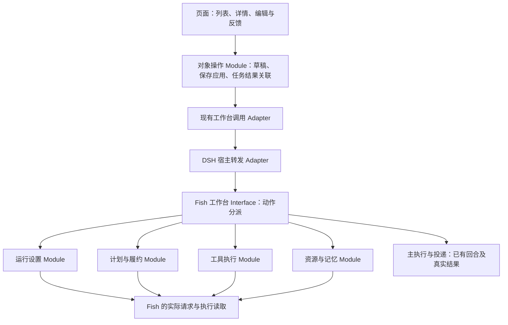

# 09：原生操作工作台与管理闭环

**What to build:** 主人在 Fish 客户端能配置能力、管理任务/记忆/资料并处理实际文件事务，而不只是查看列表。
**Status:** ready-for-agent
**执行状态：** 规格与 Module/Interface 设计已整理，尚未实施本票；既有 01—08 的历史交付不作为本票界面完成证据。
**前置：** 复用 01—08 当前真实实现；开始时核对现有工作树，不要求重跑历史整批验收。M01 仍延期。
**唯一权威：** [实施规格](https://github.com/3259980040-droid/fish-agent/blob/codex/fish-tickets-20261025/project/spec.md)，本票为其 4.7、4.10.5、5.6、7.4—7.5 及相关故事的实施投影，不另立规则；冲突先改权威规格再同步本票。
**源码定位：** [实施对照表：原生工作台映射](https://github.com/3259980040-droid/fish-agent/blob/codex/fish-tickets-20261025/project/implementation-map.md#workbench-operation-map)。
**发布：** 目标 3259980040-droid/Fish 当前返回 404；本地标签 ready-for-agent，published=false，尚无远端 Issue URL。不向无关公开仓库发布。

## Problem Statement

原六页草案重点清理小字和折叠信息，但任务、记忆、资料、模型及扩展缺少可完成事务的管理流程。主人除了聊天和人格之外，多数页面只能看，无法直接创建、修改、配置、整理或执行。部分底层动作已经存在，界面与真实保存/运行尚未闭环；原型的临时数据不能当作正式功能。

## Solution

在现有 DSH 客户端内将 Fish 组织为可操作的原生工作台，沿用宿主主题与组件，按日常使用、能力配置、数据管理、连接维护呈现完整操作。先接现有 Fish 接口，确缺才在对应职责补最小桥接，保存/应用/执行/投递分别展示。保持同一 Fish 的独立 API、人格、经历和工具循环。

## User Stories

沿用权威规格的稳定编号，避免同一故事出现两套含义。

58. 作为主人，我希望在 DSH 现有客户端切入 Fish 工作台，以便聊天、管理和本机办事在同一应用完成。
59. 作为主人，我希望按日常使用、能力配置、数据管理和连接维护找到入口，以便不用猜哪个设置页藏着功能。
60. 作为主人，我希望常用正文、字段、按钮和状态能清楚阅读，以便界面不再由大量小文字组成。
61. 作为主人，我希望选中对象附近就能编辑、启停和打开结果，以便列表不仅能看还能用。
62. 作为主人，我希望每个操作说明正在处理、完成或具体失败，以便不把点击过当成成功。
63. 作为主人，我希望刷新或重新打开仍读回已保存状态，以便页面临时变化不会冒充后端保存。
64. 作为主人，我希望人格默认易于阅读、需要时再编辑，以便既能看清她的性格又能修改。
65. 作为主人，我希望“仅保存”后仍能看见刚保存的预设正文，以便不会被当前活动人格覆盖。
66. 作为主人，我希望“保存并应用”或选用预设后看到当前生效人格，以便下次聊天使用我选择的内容。
67. 作为主人，我希望换人格后仍保留既有经历和主人关系，以便换表达不等于换成另一个她。
68. 作为主人，我希望在任务页新建一次或重复计划，以便不必每次通过聊天创建。
69. 作为主人，我希望在任务详情修改内容、时间、时区、目标和重复方式，以便计划可以实际维护。
70. 作为主人，我希望暂停、恢复或取消计划并看到真实状态，以便暂时不用与永久取消有区别。
71. 作为主人，我希望可以立即运行一项适用计划，以便使用同一任务执行能力而非另建一条任务。
72. 作为主人，我希望计划、执行记录和发送回执各自清楚，以便知道是还没到点、正在做还是结果未送达。
73. 作为主人，我希望在同一任务详情打开或取得成果，以便完成后不用去日志里找文件。
74. 作为主人，我希望在工作区浏览、预览和编辑 Fish 的实际文件，以便这里能辅助处理本机事务。
75. 作为主人，我希望将选中文件交给 Fish 并关联当前任务，以便文件树与对话能够配合使用。
76. 作为主人，我希望看到本机执行任务、终端输出和已有取消入口，以便知道电脑上的工作进度。
77. 作为主人，我希望工作区明确属于 Fish，并能打开我交办的其他工程，以便不会误操作 DSH 当前项目或失去已给出的能力。
78. 作为主人，我希望新增、修改和删除 Fish 模型服务连接，以便自己管理 API 地址、凭据与模型。
79. 作为主人，我希望能获取服务提供的模型列表，或在其不支持时填写模型标识，以便不同提供商仍可配置。
80. 作为主人，我希望区分保存连接、测试连接和实际使用中的服务，以便地址填完不会被显示为已经可用。
81. 作为主人，我希望为聊天、识图及已有检索服务选择真实可用的模型，以便界面选择与运行请求一致。
82. 作为主人，我希望在扩展页新增、修改和启停 Fish 已支持的外部 API、CLI 或插件，以便能力配置不依赖手改文件。
83. 作为主人，我希望在 MCP 项中编辑连接、发现工具、重连并查看错误，以便接入 QQ 等工具后能知道实际可用能力。
84. 作为主人，我希望 Skills 可以导入、查看、编辑、启停或移除，以便说明内容实际进入 Fish 使用流程。
85. 作为主人，我希望扩展页显示真实支持的安装、更新和重载操作，以便不会出现点了也不能执行的按钮。
86. 作为主人，我希望搜索、新建、修改和停用记忆，以便错误内容能够退出后续召回。
87. 作为主人，我希望合并重复记忆时保留来源与修订关系，以便整理之后仍能解释从哪里得到结论。
88. 作为主人，我希望分别查看长期记忆、社交信息、语料和小结，以便按实际对象整理，而不只有日期时间线。
89. 作为主人，我希望按范围整理或修订小结并看到处理结果，以便不会把模型改写冒充立即保存。
90. 作为主人，我希望在资料库导入文本、已有支持的文件和网页资料，以便资料入口覆盖 Fish 已具备的资源能力。
91. 作为主人，我希望给资料分类、改名、移动、打开或移除，以便资源不会再次堆在一个列表或目录。
92. 作为主人，我希望导入时看见原件保存、解析和索引的真实进度，以便知道哪些部分已可查。
93. 作为主人，我希望输入问题试查资料并打开命中来源，以便直接知道资料是否能被 Fish 找到。
94. 作为主人，我希望词法降级或解析失败在相应资料操作处可见，以便不用靠猜或翻所有日志。
95. 作为主人，我希望在 QQ 连接页配置连接并读取真实状态，以便这里能管理已有通道。
96. 作为主人，我希望日常设置与故障维护分开，以便常用操作简单、需要排查时又能找到完整信息。
97. 作为主人，我希望故障在对应对象附近提示且系统页可查详情，以便界面简洁时也不隐藏失败。
98. 作为主人，我希望继续查看本轮原始思考、真实工具过程和成果，以便不用让模型另外写一份解释。
99. 作为主人，我希望原型演示、已保存配置和已验证功能分别标明，以便截图不会冒充已经上线。
100. 作为主人，我希望语音和情感扩展沿清楚的服务接口后续接入，以便不会因为本轮画出入口就被宣称实现。
101. 作为主人，我希望新管理入口替换对应旧入口与页面临时存储，以便以后改一个设置不再出现两套值。
102. 作为主人，我希望完成后沿客户端和 QQ 私聊连续使用一次，以便按实际效果验收而非反复跑实验。

## Implementation Decisions

本节替换旧“六页只读展示”的组织方式；页数不再是范围或验收指标。参考 AstrBot 的对象管理流程，保留 Fish 作为本机 Agent 的对话、工作区和执行结果能力。本轮交付是可操作的正式界面，不以演示原型的内存变化判完成。

#### 4.7.1 宿主、导航与视觉

- 在现有 DSH 原生客户端的 Fish 入口内实现，沿用 React、CSS Modules、DSH 组件、主题变量和字号设置。复用宿主视图不引入 DSH 默认人格、API 配置、工具权限或历史；Fish 的配置与运行归属仍按 4.1。
- 导航分为“日常使用：对话、任务与自动化、工作区”“能力配置：人格与表达、模型服务、扩展与工具”“数据管理：记忆、资料库”“连接与系统”。扩展区内区分插件/外部 API、MCP、Skills；连接与系统内区分 QQ 等连接、日常设置、故障与维护。实现可合并临近入口，但不得把所有业务表单重新塞回通用设置页。
- 采用对象列表配详情或表单，常用动作位于对象旁边；主要动作强调程度可以不同，“一个主动作”不再解释为每页只允许一个按钮。编辑、启停、打开、移除等必要动作应可直接发现。
- 正文、表单、按钮、导航和状态使用宿主可读字号与缩放；主正文不使用固定 11px 小字承载。说明按需要展开，不能靠删除操作或缩小字号制造简洁。沿用宿主主题，不新增独立设计系统、组件库或前端运行框架。
- 业务错误、送达未确认和当前处理进度留在关联对象处；五时间点、用量细分、索引实现和故障历史可进详情或维护页。“诊断全部搬走”不得变成当页失败原因不可见，灰字也不限定只能表示空状态或错误。

#### 4.7.2 保存、应用与执行的共同含义

- 页面操作经现有工作台/宿主接口进入对应负责模块。保存响应返回后，以服务端结果更新并可重读；不能仅改页面变量、静态 JSON 或本地缓存后报成功。页面缓存不成为第二份活动配置。
- 区分选中对象、编辑草稿、已保存版本和活动版本。普通编辑不取消正在执行的回合；涉及运行配置时说明是下一次模型请求生效，还是对应连接需要明确重连。确需重载的项显示真实需要，不对所有保存都强制重启。
- 同一对象的长操作使用已有任务/执行引用返回进度或完成结果，页面离开后能重新找到；已提交、正在做、已完成和已送达分别呈现。沿用现有状态含义，不为前端再建一套业务状态机。
- 保存或执行失败时保留用户编辑内容，在当前表单/对象处显示具体中文原因。发送未知继续显示未确认，不自动重发；取消只调用对应真实取消入口，收到取消请求不能立即伪称底层工作已停止。
- 控件读取已有真实设置，不为解决显示问题新增第二个开关。删除/移除的影响在对象操作中说明；移除引用、停用召回与物理删除原件分别处理，不擅自销毁原文件或恢复主人已删记录。

#### 4.7.3 各工作区的完整操作

| 工作区 | 本轮应接通的操作 | 完成与反馈的含义 |
|---|---|---|
| 对话 | 文本/已有附件发送，本轮思考展开，工具过程及成果打开，明确取消当前工作 | 继续同一经历；正文、工具结果与实际投递状态可对应；不展示伪造的思考或解释 |
| 人格与表达 | 默认阅读、进入编辑、新建/导入/保存预设、仅保存、保存并应用、选择并应用预设；查看当前实际表达设置 | 仅保存后保留新预设正文，不被活动人格覆盖；应用后下一次请求使用当前版本；不重置记忆或主人身份；长度仍由 4.2 的唯一来源负责 |
| 任务与自动化 | 创建一次/重复计划，编辑内容/时间/时区/目标，暂停/恢复/取消，立即运行，查实例与成果，打开/取得产物 | 聊天创建和页面创建是同一份计划；立即运行进入同一执行器并产生一次实例，不暗改原周期的下一次时间；明确提醒与自主机会仍按 4.6 分开 |
| 工作区 | 浏览目录，打开/预览文件，文本编辑与保存，把文件交给 Fish，查看执行任务/终端输出及已有停止操作 | 访问 Fish 实际工作区和交办工程，不借用 DSH 当前工程充数；落盘可重读，成果与所属任务相连；本票不搬运行根 |
| 模型服务 | 连接列表与新增/修改/移除，地址/凭据/模型编辑，按提供商支持获取模型列表，明确测试连接，选择聊天/视觉及已接入检索用途 | Fish 配置为唯一来源；不支持列模型时允许填写真实模型标识；测试成功不等于已应用，已应用不伪称所有用途均可用；删除正在使用的连接前需明确替换用途或如实显示未配置 |
| 插件/外部 API | 添加当前支持的扩展类型，配置参数，启停/移除，查看工具；仅对已有实现提供安装/更新/重载 | 读写 Fish 同一工具注册表；显示支持的协议与实际能力，不宣称可直接运行任意 AstrBot 插件；没有实现的动作不能成为假成功按钮 |
| MCP | 添加/编辑真实连接，连接/重连，发现工具、查看名称/说明和实际错误，启停/移除 | 参数已保存、连接成功和工具已发现是不同结果；工具来自现有注册入口，不在页面另存一份名称清单或新增调用限制 |
| Skills | 导入、列表、查看/编辑内容、保存、启停/移除 | 使用 Fish 实际加载来源并能解释何时重新读取；复用 DSH 编辑组件不代表沿用 DSH 私有配置；启停影响真实装载，不只隐藏一行 |
| 记忆 | 搜索/筛选、新建/修改、查看来源/修订、停用或删除条目、合并重复项；浏览社交信息/语料/小结并按现有对象语义整理 | 同一记忆引擎与来源链；错误项退出后续召回，合并后保留来源关联；小结模型修订与直接保存条目明确区分，不把一类操作套给所有数据 |
| 资料库 | 导入文本/已支持文件/网页，分类与目录维护、改名/移动、打开/预览/移除，查看处理进度，输入问题试查并打开命中来源 | 与 4.4、4.8 的同一原件和索引关联；明确已保存/已解析/已索引/实际取用范围；不虚构引用次数或把未读内容算已理解 |
| 连接与系统 | 管理已有 QQ 等连接与真实设置；查状态、故障与恢复记录，使用已有维护/重载能力 | 读取当前连接和开关；错误关联具体连接/任务；不增加示例连接或以自动群发验证通道 |

当前不支持解析的文件仍可按既有原件能力保存、打开和交给相应工具；要显示具体格式限制，不能静默丢失或画一个不可执行的解析按钮。语音、情感的后续位置见 4.7.6，不计入上表已完成能力。

#### 4.7.4 现有接口优先与缺口归属

- 记忆复用 memory.search/save/history、memory.digest 与 memory.curate；资料复用 library 列表、详情、导入、整理、试查及原件入口；计划复用 schedules 列表/创建/更新/取消；执行任务复用 delegations 的查询、取消、打开和下载。它们是复用线索，不等同当前页面已接通或所有调用已验收。
- 参数保存和连接管理先核对应正式服务入口，复用已有设置解析、工具注册和模型接入。已读工作台分支未给出完整模型服务、插件与 Skills 管理能力时，先查现有其他正式入口，确缺才补最小桥接；不得把“还没有页面”直接当成“必须新造后端”。
- 立即运行计划接现有“计划与履约”的 run_now 和实例执行；当前工作台尚未暴露对应动作，不代表执行实现不存在。已有记忆删除也直接复用，确缺的合并才补到“资源与记忆”。前端不直接写数据库或只删列表行，不新增计时器、模型调用或一套删除逻辑。
- 文件树、文本编辑器、终端视图、扩展及 Skills 编辑组件优先复用宿主现成组件，经 Fish 工作区和配置适配接入；其中的 DSH 活动项目、人格、模型策略和注册表不自动继承。必要新增接口仍落到 4.10 的既有职责，不新增另一套 Agent、工具目录或网页存储。
- 网页/文件导入和长任务进度沿现有资源/任务记录补接；语义不可用按 4.4 显式降级，传输沿 4.8 分层，不在新页面再次写固定附件上限。
- 具体代码位置、已找到的接口、缺口和退出对象更新到实施对照表。实施前扫描最新工作树，旧行号不是另起实现的理由。

#### 4.7.5 原思考与故障

- 直接显示提供商返回的原始 reasoning_content 和真实工具事件，不要求另写决定报告；未返回字段时如实说明。本轮思考默认收起，展开可读完整原文，历史记录按已有能力在详情/维护中访问。
- 原字段若为接口接续工具所必需，按协议保留；译文仅供显示，不能覆盖原协议材料。翻译不是默认每回合调用，也不是本轮展示通过的前提。
- 排队、网络故障、工具失败、发送未确认来自程序事实。正常沉默与失败分别显示，不由页面推测心情或生成一段“她为什么不说”的解释。

#### 4.7.6 语音、情感与扩展边界

- 模型服务的数据组织应能容纳以后转写/合成的用途；已有、实际可配的服务才提供工作表单。尚未接通的语音只在扩展说明中标明缺少服务/资源，不在对话区放假录音、假试听、假音色等候按钮。
- 本轮不交付完整 STT/TTS 音频收发，也不交付新情感打分算法或虚构情绪仪表。AstrBot 的服务分工、插件交互和情感辅助仅作为有来源的设计参考，不能据此追加付费判断层、强制情绪门槛或第二人格。
- 安装扩展由真实格式和当前适配支持决定；不承诺 AstrBot、MaiBot 与 Fish 的插件可不经适配互用。具体新增语音或情感能力应另按真实服务和资源细化，不计为本票已落地。

#### 4.7.7 本轮要退出的旧做法

- 退出“只许六页”的导航硬限制，以及把任务/资料/记忆做成主要只读列表的设计；保留已认可的对话阅读和人格编辑节奏。
- 退出“每页只能有一个动作”“所有灰字只能是空/错”“所有错误只能去设置看”的旧界面规则，改由视觉层级与对象操作组织承担简洁。
- 退出“只改前端所以允许缺接口按钮占位”的做法；必要桥接与对应后端职责同时交付，但不借此重写执行核心。
- 同一管理动作迁入新工作区时退出旧重复入口、页面临时成功状态和第二份配置；宿主原有 DSH 管理界面并非重复对象，仍服务 DSH 自己。逐项列明实际删除/合并的组件、路由、文案与读写路径；纯新增能力如实说明没有旧实现可删。

### Module / Interface / Seam 设计（权威规格 4.10.5）

**设计状态：** 以下为 codebase-design 对已定 4.7 的实现设计，尚未改运行代码。本节给出责任和交接方式，不要求把原有七个后端 Module 重建成七个包，也不增加新的运行进程。具体源码证据、实际缺口和退出对象放实施对照表的“原生操作工作台”映射。

**术语：** Module 是对调用者提供一组完整能力的模块；Interface 包括操作、数据含义、先后条件、错误和生效时点；Seam 是该 Interface 所在的实际交接位置；Adapter 是在该处完成传输或格式适配的实现。Depth 指一个简洁 Interface 能让调用者完成多少完整行为，不能用文件数量或代码行数代替。

**A. 选择：沿现有主线深化，页面不另造业务**

图是目标调用方式，不声称所有新界面已存在。“对象操作 Module”是按真实对象聚合交互知识，可留在既有页面目录；不强制每页新建一层。简单只读页面不为凑结构再包一次转发函数。DSH 宿主承载传输、已有启动维护和界面，模型配置、人格与执行仍由 Fish 提供。

- **保留真实 Seam：** 浏览器经现有工作台调用、宿主转发、Fish 动作分派进入对应 Module。现有通路能用就沿用，不在旁边开第二条前端直连或新工作台核心。
- **让重复知识退出页面：** 页面决定选中哪个对象和显示哪些控件；保存与应用的编排、返回解析、对象刷新及长任务关联由相应对象操作 Module 承担。它不持久化第二份配置，也不重算提醒、检索或权限。
- **让业务决定留在负责 Module：** 计划决定时间/实例/履约，资源决定更正/删除/索引，运行设置决定生效版本，工具执行决定连接与真实能力。工作台入口只分派和表达结果，不把所有决定继续堆在一个分支函数。
- **不制造浅壳：** 如果新增 Module 只是把同一批参数原样传下去，没有消除调用者必须知道的顺序、字段猜测或结果拼接，就不新增；优先在现有负责 Module 内完善行为。

**B. 页面实际需要知道的 Interface**

下表是目标操作和返回含义，不是要求照字面新建同名类或新增全部动作。既有操作能满足时直接用；界面不再学习数据库位置、DSH 角色目录或任务表之间的关联。

| Module / 使用入口 | 调用者需要知道的 Interface | Module 内部承担的实现与条件 |
|---|---|---|
| 人格编辑 / 人格页 | 读取活动人格与预设；打开一个预设；修改草稿；仅保存或保存并应用；应用既有预设。返回已保存对象与当前活动对象，二者分别可辨 | 草稿归选中的预设，读取活动状态不覆盖草稿；保存后保留新版本；应用失败但保存已成功时保留保存结果，后续仅重做主人明确发起的应用，不再保存一份重复版本；生效仍为下一模型请求 |
| 计划管理 / 任务页 | 读取计划及其执行详情；保存创建/修改；暂停/恢复；取消；立即运行一次并取得执行引用 | 时间字段到既有选择器的转换、时区、计划/实例/结果关联在 Module 内；立即运行接现有实例队列；不让页面猜多组 scheduledAt/runAt 字段或直接触发模型；返回入队不等于运行完成或送达 |
| 运行设置 / 模型与日常设置页 | 读取实际配置及用途绑定；保存指定连接；明确测试连接/获取模型；将已有连接应用到用途；取得保存值、活动值和生效说明 | 凭据保存、配置解析、当前模型和上下文元数据刷新由原负责实现承担；连接为一个实际对象，用途引用它，不在各页复制地址/密钥；页面只显示凭据是否已设置，不回显密钥；不因配置用途增加另一人格或 Agent |
| 工具执行 / 扩展、MCP、Skills 页 | 读取真实已登记项；保存对应类型配置；发现工具；启停/移除；读取支持的维护动作及其结果 | 接既有工具注册与执行；插件格式、连接协议、工具定义及实际 Skills 装载由内部消化；支持安装/更新/重载的项才给对应动作；不把一次 JSON 编辑成功当作工具已可用 |
| 资源与记忆 / 记忆与资料页 | 查找和打开一个稳定对象；保存/更正、删除/合并记忆；导入/分类/改名/移动/移除资料；整理小结；试查并返回来源或处理引用 | 记忆、原件、资料块、来源修订及检索维护由同一负责 Module 内部完成；不同对象保留各自操作语义，不造万能 CRUD；直接写记忆与模型修订小结返回各自真实处理结果 |
| 工具执行 / 工作区页 | 浏览或读取实际文件；保存文本；取得当前任务工作目录；查执行任务/输出；明确停止已有任务；打开成果 | 复用 Fish 文件与进程工具及原有宿主打开能力；目录、任务与成果关联在内部；不直接用宿主当前工程目录当 Fish 根，不经新 Agent 代做普通文件保存 |
| 主执行与投递 / 对话及进度详情 | 发起现有回合；按现有引用读取进展/成果/回执；明确取消；显示已提供的原始思考 | 运行与回执为既有事实；页面不推导“成功”“沉默”或第二份业务状态。不为显示进度调用主模型解释，取消响应不冒充服务商已停止计算 |

Interface 的重要含义：**保存成功、应用成功、接收执行、执行完成、投递确认不是一个结果。** 调用者取得现有对象/版本、任务/实例、资源或回执引用，并据真实结果展示；不新增通用“成功”布尔值把阶段抹平。实现可以返回这些既有字段的组合，不为本节另建状态枚举、事件总线或作业数据库。

**C. 两条必须明确的交互接续**

1. **人格仅保存：** 选中预设 → 编辑 → 既有保存操作返回新预设 → 保留该预设正文 → 更新预设列表和活动摘要。活动人格没有切换，列表/状态读取不能把编辑框重置为活动人格。保存并应用则继续应用保存返回的实际版本；途中失败保留已完成阶段。
2. **计划立即运行：** 指定计划 → 现有 run_now 创建一次实例 → 由现有调度器和主执行接手 → 返回同一实例的过程与成果。普通周期不因此重排。暂停表示停止自动到点触发；主人明确“立即运行”应能执行这一次并保持原计划暂停，不能靠临时恢复/再暂停绕过。现行 pending/claim 对暂停计划整体排除，实施时在“计划与履约”内明确人工实例来源与其领取语义，不只加一个工作台按钮就宣称可执行；删除的计划仍按现有不存在语义处理。

所有编辑对象均保持“选中项、草稿、已保存项、活动/执行结果”的关联。后台刷新或迟到响应不能写到另一个选中项，也不能静默丢掉当前草稿。只保留操作所需的页面状态，不把草稿持久化为另一份运行配置，不建设全局万能表单引擎。

**D. 依赖按实际变化处理**

| 依赖类别 | 本项目的真实对象 | 本轮处理 |
|---|---|---|
| In-process | 草稿选择、时间表单转换、结果格式化 | 留在相应 Module 内部；页面不复制同一转换。纯计算不新增 Adapter |
| Local-substitutable | 现有 SQLite、文件、资源与任务记录 | 沿原负责 Module 读写；必要验证用既有临时根，不为每张表新建抽象仓库或模拟实现 |
| Remote but owned | DSH 宿主与 Fish 进程之间的现有工作台通路 | 沿用现有调用 Adapter 与高层替代出站/返回接缝，业务 Interface 位于 Fish 负责 Module；不因不同进程把业务重新写在宿主 |
| True external | DeepSeek、QQ/NapCat、实际 MCP 服务器与模型服务 | 沿用现有 Adapter，连接/发现/实际调用各报真实结果；必要确定性检查使用已有替代返回，一次私聊体验走真实链路，不搭每提供商测试矩阵 |

模型、QQ、MCP 是已有真实变化处。宿主打开文件与本机任务输出也有实际不同载体。除此之外，不为假设未来可能更换某个库提前新增插槽；内部 Seam 不强迫调用者传入所有数据库/目录/客户端。

**E. 替换顺序、Locality 与完成判据**

- 按完整用户过程交付：先把任务/能力配置等当前缺操作的流程接通，再将其他工作区按同一方式接入；每次迁入一个负责 Interface 就退出对应旧重复决定、旧读写和页面临时成功状态。该顺序不创建新的验收批次。
- 传输解包和 DTO/返回解析只在现有传输及各对象适配处处理一次；页面不重复解析 raw JSON，也不在多个页面猜字段别名。原始后端记录无需为显示被改写成第二份存储。
- 全局外框只负责导航、当前工作区和必要运行摘要；对象详情、草稿、执行结果和对象错误留在负责 Module。对象操作完成后定向重读对应对象，只有活动人格或全局开关等确实变化时才更新相应摘要；不把每次保存都变成全站刷新或统一业务阻塞。
- Interface 内部实现改变且结果含义不变时，改动应集中在负责 Module；新增字段/改变生效或结果含义时才同步实际调用者。设计提高 Locality，不承诺任意修改都绝不会影响其他地方。
- 用删除判断检验抽离是否有价值：删掉传输 Adapter 只会使传输接法重新出现，它应保持简单；删掉人格编辑/计划管理的 Module 会让保存应用顺序、草稿保护、时间与实例关联重新散落到各页面，这些才是值得集中的复杂性。不能把代理转发壳称为深 Module。
- 验证面仍是 5.6 的一个完整用户过程。必要确定性检查经同一 Interface 看保存/生效、实例/成果和回执结果，不依赖私有函数布局。若旧测试只是锁定被替代的页面字段猜测或旧调用顺序，则随旧实现替换；覆盖独立有效行为的测试保留。不追加一套新旧双跑的实验体系。
- 本轮只完成设计与事实核对，不创建运行 Module、不改生产库、不执行模型测试或重启；09 仍为 ready-for-agent、尚未实施。

## Testing Decisions

本节把前端操作并入 5.1 的一次“Fish 客户端＋主人 QQ 私聊”连续使用，不增加逐页付费测验、每按钮模型调用或多组对照。先完成范围内整体接线与必要静态检查，再进行一次整体使用；真实问题修复后只复核受影响路径。已有 01—08 的历史实发记录不能代替本次新界面的体验。

沿同一过程：在客户端保存并应用人格；修改或接入一个实际可用服务/扩展并重读结果；创建、修改、暂停/恢复一件计划并在适当时立即运行；导入/整理一份资料并试查，纠正关联记忆；在工作区打开或编辑同一事务文件，查看真实任务结果；QQ 私聊接续该事务并检查结果交付。它是覆盖顺序，不要求每一步新起模型回合，普通保存/列表/连接发现不调用主模型写证明。

| 验收方面 | 可观察的完成标准 |
|---|---|
| 日常阅读与导航 | 现有客户端进入 Fish，可清楚阅读正文和表单，任务、模型/工具、记忆资料有可发现的操作入口；不靠隐藏功能或挤小字达标 |
| 保存/应用 | 刷新后读回服务端保存值；仅保存不暗中切人格，刚保存正文不被旧活动人格覆盖；应用后下一请求实际使用当前版本 |
| 模型/扩展 | 页面显示同一 Fish 连接/注册对象，编辑与启停可重读；连接、发现工具及使用中状态按真实结果分别呈现；不需要逐个提供商额外实测 |
| 计划与结果 | 页面和聊天管理同一计划；修改、暂停/恢复、立即运行进入真实调度和实例；实际执行、成果和投递回执可对应，不把提交当送达 |
| 记忆资料 | 同一过程里的资料导入、分类/改名、试查与来源可打开；更正或合并后的召回不再沿旧错误项；长操作有真实处理结果 |
| 本机工作 | 文件浏览/编辑属于实际 Fish 工作区或已交办工程；保存落盘可读；任务/终端与同一成果关联，可用的停止操作呈真实状态 |
| 故障与未完成 | 若遇真实失败，在相应对象可见中文原因，保留编辑内容；无实遇故障可沿已有记录或临时根观察，不为凑齐状态造生产故障；未接通项单列 |
| 旧入口退出 | 对应旧页面/路由/文案/临时存储退出清单可核对；纯新增说明无旧代码可删；原型仍明确为原型 |

交付附主要工作区截图及上述一次过程的原始记录，继续沿 5.3 保留回复原文、工具序列、成果、回执和五时间点。截图用于证明界面与操作位置，不代替后端保存或运行证据。不要求为截图另起付费对话或逐页重复造数据。

- 测验接缝沿已裁决的“客户端 → Fish 工作台 → 对应真实模块 → 成果/主人私聊回执”，无需再次询问主人或创建另一套验收入口。
- 复用已有页面保存/重读、任务持久化、附件/成果、记忆更正与真实回执的行为先例；只为必要改动补合适的确定性检查，不为每个内部函数或按钮编写镜像测试。
- 交付回答四问：她变成什么样、出错会怎样、删了什么、怎么证明；附未完成/失败/未验证清单和主要界面截图。

## Out of Scope

- 另建 Fish/DSH 执行核心、另一份工具注册表、页面专用配置或独立前端程序。
- M01 真实搬根、历史资料搬迁、无关全面重构、恢复主人已删除记录或擅自物理删除原件。
- 完整语音视频收发、新情感算法/二次判断层、任意 AstrBot 插件直接兼容、手机/云端部署。
- 新字数规则、排队秒数承诺、工具白名单或强制私聊先回；这些不因 UI 改造重新出现。
- 真实群发验收、逐票付费实验、多组对照、为了填表制造生产故障。

## Further Notes

### 2026-10-24 源码对齐与任务补充（本轮未实施）

依据主人本轮三项要求完成只读审查、建议处置和原任务补充，详见审查报告（本地资料，未公开）与建议采纳记录（本地资料，未公开）。父项原范围与故事保留，09不是已实施；子票状态不因本轮文档更新而改成完成。

- 前端与上下文/记忆后端分开。压缩/预算修复归原01，完整工具归02，目录/索引/记忆整理归04；09-06/09-07只消费这些接口和操作结果，不内置第二套后端。
- 当前任务页面已有创建、编辑、暂停/恢复和删除；run_now基础已有。09-02补桥接、暂停计划手动实例与结果，不重做已有CRUD，不新增同义pause/resume执行链。
- 当前人格保存/应用、资料读写、真实思考右栏均有基础；保留并修具体缺口。导航按现有注册分组，不新建四层路由，也不再限制只许六页。
- 模型配置基础、PluginRegistry管理方法、MemoryStore.delete、AgentTools均存在。各票接现有负责模块，缺口确实存在才补；配置来源唯一，不直接另建models.json或只改tools_visible冒充能力管理。
- 对象当页显示实际失败，详细历史集中在维护页；保留清楚阅读，不要求所有错误只能一行，也不把失败隐藏为无记录。
- 对话保持左消息/右真实思考/顶部简明状态的当前方向；真实trace按唯一记录关联，补刷新、完整可用正文与错误反馈，不重新加入五维分数、默认解释或日志墙。
- 本轮未改代码、未调用模型、未实发、未重启。后续全部接通后沿09-10做一次整体体验；未完成项继续公开，旧实发不替代新界面验收。

- 本票由 to-spec 从已讨论方案合成，不是新的需求访谈。以权威规格为准；具体位置与接口事实在实施对照表维护。
- AstrBot 参考来自官方管理页与源码核对：模型、插件、MCP、Skills、Cron 和知识库有对象操作与实际请求；未运行其服务，不把参考源码等同本机验证。
- 旧六页稿保留历史与已认可的对话/人格思路，其页数、单按钮、全部诊断只能在设置和只改前端限制由本票对应条款替代。
- GitHub 发布沿既有队列，远端恢复可访问后同步同一票并登记 URL；本地完成规格不报告为 GitHub 已发布。

- codebase-design 设计已并入权威规格 4.10.5：优先接已有立即运行/删除；人格草稿与活动版本分离；宿主为 Adapter，不成为另一业务核心；保留一次整体体验，未改运行代码。
